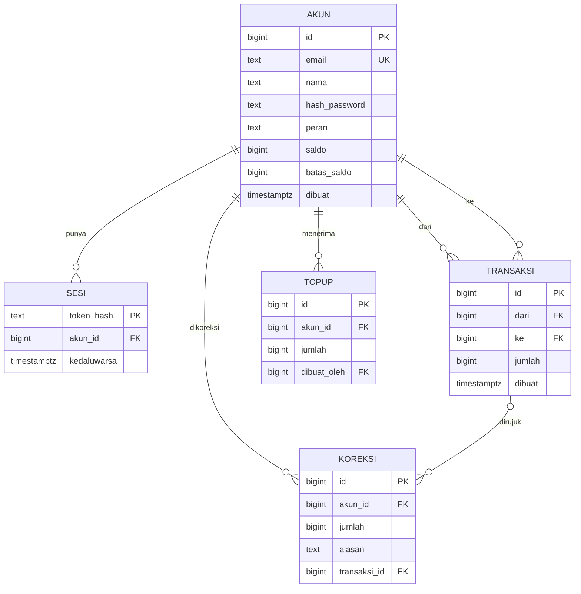
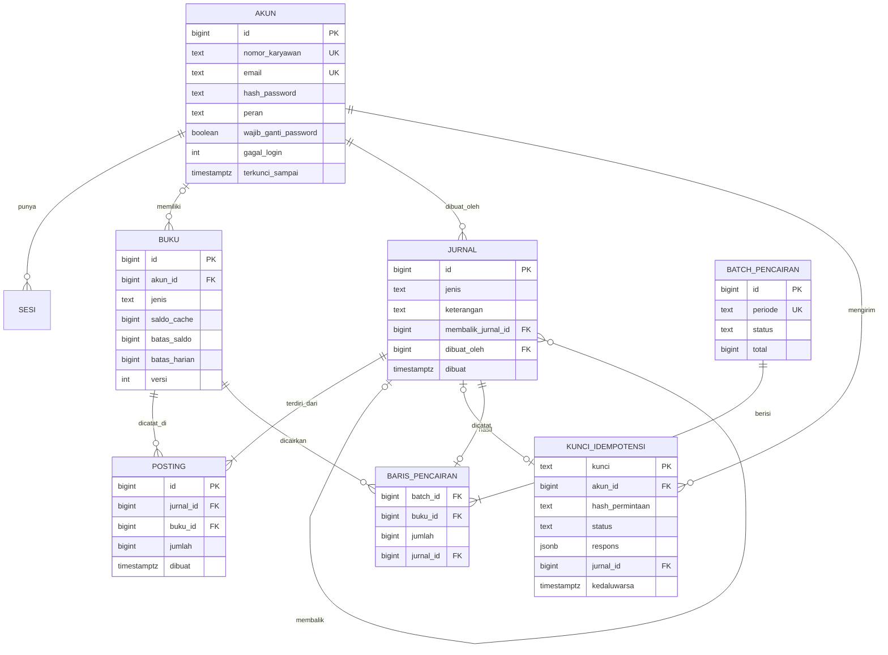

# Cerita Rekeningo · Tahap 2: Seluruh kampus

Oct 13, 2026 · @Fadhil Muhaimin

## Kenapa dokumen ini ada

Naskah ini adalah sumber kebenaran Tahap 2, disimpan di repo sebagai `plan/CERITA-TAHAP-2.md`. Strukturnya sama dengan Tahap 1: **PRD → fitur → pekerjaan teknis → inti teknis → masalah yang muncul pelan-pelan → konsep**. Halaman situs ditulis dari naskah ini. Penomoran masalah melanjutkan Tahap 1 (M1–M8), jadi Tahap 2 memakai M9 dan seterusnya.

Tahap 2 dimulai setelah Tahap 1 dinyatakan selesai dan ditinjau pemilik.

## Latar: dari Gedung A ke seluruh kampus

Uji coba Gedung A lolos: 91 dari 100 penguji aktif, rekonsiliasi 4 jam, selisih nol setelah koreksi Rp70.000 yang tercatat. Direksi memperluas Rekeningo ke seluruh kampus pusat Grup Lestari: tiga gedung, sekitar 1.000 karyawan, 12 warung tenant.

Dua hal berubah sekaligus. Pertama, **uang mulai berpindah antar karyawan**, bukan hanya dari karyawan ke warung. Kedua, **Keuangan ingin berhenti merekap**: Pak Hadi meminta tutup buku bulanan dibuktikan dari data, bukan dari rekap yang disusun tangan.

### Tokoh baru

| Tokoh | Siapa | Ingin | Kelemahan | Yang dibawanya ke cerita |
| --- | --- | --- | --- | --- |
| **Nadia** | Backend engineer dari tim ERP, dipindah ke Rekeningo. Lima tahun Java dan PostgreSQL, terbiasa dengan aturan akuntansi ERP. | Kode yang bisa diaudit dan dites | Terlalu cepat mengusulkan solusi "seperti di ERP" yang terlalu berat untuk Rekeningo | Pandangan kedua di setiap keputusan, review PR, dan bahasa akuntansi (debit, kredit, jurnal) |

Tokoh lama tetap: Raka (sekarang tidak sendirian), Sinta (PRD v2), Budi (pengguna yang sama, kini sering patungan), Ani (warung yang sama, kini satu dari 12), Pak Hadi (syarat audit makin ketat), Dimas (yang mencoba).

## 1. PRD v2 · Rekeningo untuk seluruh kampus

**Latar masalah.** Uji coba membuktikan karyawan mau memakai Rekeningo. Tapi tiga hal belum terjawab: karyawan masih membayar patungan makan siang dengan tunai, warung masih menunggu admin mentransfer pencairan secara manual, dan Keuangan masih butuh 4 jam merekap satu gedung. Untuk 10 kali lipat karyawan, rekap tangan tidak mungkin.

**Tujuan.** (1) Semua karyawan kampus pusat memakai Rekeningo untuk makan siang. (2) Patungan tanpa tunai. (3) Tutup buku bulanan selesai dalam satu hari dan bisa dibuktikan dari data. (4) Pencairan warung terjadwal tanpa kerja admin.

**Pengguna.**

| Pengguna | Kebutuhan baru | Yang membuatnya berhenti memakai |
| --- | --- | --- |
| Karyawan (Budi) | Kirim uang ke teman untuk patungan; riwayat panjang yang tetap cepat | Tertagih dua kali; riwayat lambat atau berisi data ganda |
| Warung (Ani dan 11 lainnya) | Pencairan otomatis tiap Jumat; laporan yang cocok dengan buku | Pencairan terlambat atau jumlahnya beda |
| Keuangan (Pak Hadi) | Laporan bulanan yang bisa ditelusuri sampai transaksi pertama | Ada angka yang tidak bisa dijelaskan dari data |
| Admin tunjangan | Top-up 1.000 akun tiap Senin dalam satu langkah | Top-up setengah jalan |

**Ruang lingkup (seluruh kampus, 1.000 karyawan, 12 warung, 8 minggu).**

| Prioritas | Fitur | Keterangan |
| --- | --- | --- |
| P0 | Transfer antar karyawan | Kirim ke rekan lewat nomor karyawan; batas Rp500.000 per hari |
| P0 | Tutup buku bulanan | Laporan per akun dan per warung, saldo awal + mutasi = saldo akhir, untuk seluruh sistem |
| P0 | Pencairan warung terjadwal | Setiap Jumat 15.00: saldo warung dicairkan; Keuangan menerima satu file transfer untuk diunggah ke bank (belum ada integrasi bank) |
| P0 | Top-up 1.000 akun | Satu file CSV dari HR, satu operasi |
| P1 | Riwayat panjang | Gulir tanpa batas, cepat walau sudah ribuan transaksi |
| P1 | Login yang lebih aman | Password baru wajib diganti saat login pertama; percobaan salah dibatasi |
| P2 | Notifikasi saat menerima transfer | Diminta Budi; ditunda ke v3 |

**Bukan lingkup v2.** Integrasi bank langsung, pengguna di luar Lestari, cabang di kota lain, dashboard web untuk warung, notifikasi push, promo.

**Metrik keberhasilan.** ≥ 700 karyawan aktif mingguan; tutup buku bulan pertama selesai < 1 hari dengan selisih Rp0; 0 kasus tertagih dua kali yang tidak terdeteksi otomatis.

**Batasan.** Dua engineer (Raka, Nadia) selama 8 minggu; tetap satu server produksi; anggaran tidak bertambah; aturan Pak Hadi diperketat: *"Setiap rupiah di saldo siapa pun harus bisa ditelusuri ke kejadian yang membuatnya, tanpa tabel koreksi tangan."*

**Risiko yang ditulis Sinta.** Dua engineer di satu kode untuk pertama kalinya; volume 10 kali lipat; transfer antar karyawan membuka jenis penyalahgunaan baru.

**Pertanyaan terbuka di PRD.** Apa yang terjadi kalau dua transfer dari akun yang sama terjadi bersamaan? Kalau app mengulang permintaan karena sinyal putus, apakah uang terkirim dua kali? Keduanya tidak dijawab PRD dan menjadi masalah terbesar Tahap 2.

## 2. Dari fitur ke pekerjaan teknis

| Fitur | Di app | Di backend | Di database | Konsep yang akan dibutuhkan |
| --- | --- | --- | --- | --- |
| Transfer antar karyawan | Pilih penerima, nominal, konfirmasi | Cek saldo, cek batas harian, catat perpindahan | Jurnal dan posting (lihat bagian 3) | Ledger; race condition dan lock; idempotency key |
| Tutup buku bulanan | Tidak ada (web Keuangan sederhana atau ekspor) | Hitung saldo awal, mutasi, saldo akhir per akun; cek seluruh jurnal seimbang | Query agregasi pada posting; index | Ledger; invarian; index dan query plan |
| Pencairan terjadwal | Notifikasi sederhana di app warung | Job mingguan: hitung saldo warung, buat jurnal pencairan, buat file transfer | Jurnal pencairan; status batch | Job terjadwal; idempotency job; rekonsiliasi |
| Top-up 1.000 akun | Tidak ada | Unggah CSV, validasi, satu transaction | Jurnal top-up per akun | Transaction besar; batch; validasi |
| Riwayat panjang | Gulir tanpa batas | Endpoint dengan kursor | Index `posting(akun, waktu, id)` | Pagination kursor; N+1; index |
| Login lebih aman | Ganti password pertama | Hash, hitung percobaan gagal | Kolom percobaan dan kunci sementara | Brute force; rate limit; hash password |
| Dua engineer | – | Struktur repo, review, tes | Migration bergiliran | PR review; branch protection; tes integrasi |

Dari tabel ini lahir keputusan terbesar Tahap 2, sebelum satu baris kode: **saldo bukan lagi kolom yang di-UPDATE**.

## 3. Inti teknis Tahap 2 · Ledger double-entry

Ini jantung Tahap 2, dijawab di minggu 0 sebelum masalah apa pun muncul, karena aturan Pak Hadi tidak bisa dipenuhi dengan model Tahap 1.

**Kenapa model Tahap 1 tidak cukup.** Di Tahap 1 saldo adalah kolom yang di-UPDATE, dan koreksi Rp70.000 dicatat di tabel `koreksi` dengan tangan. Pak Hadi bertanya: "Saldo Budi Rp180.000. Tunjukkan kejadian yang membuatnya jadi Rp180.000." Dengan kolom saldo, jawabannya hanya "angka terakhir yang ditulis". Tidak ada jejak.

**Model baru.** Nadia mengusulkan cara yang dipakai akuntansi sejak berabad-abad: setiap perpindahan uang adalah satu **jurnal** berisi dua atau lebih **posting**, debit dan kredit, yang jumlahnya selalu nol. Saldo adalah jumlah semua posting satu akun. Posting tidak pernah diubah atau dihapus; kesalahan dikoreksi dengan jurnal pembalik.

| Kejadian | Posting |
| --- | --- |
| Top-up Rp250.000 ke Budi | Akun tunjangan −250.000; akun Budi +250.000 |
| Budi bayar Rp25.000 ke Warung Ani | Akun Budi −25.000; akun Warung Ani +25.000 |
| Budi transfer Rp20.000 ke Citra | Akun Budi −20.000; akun Citra +20.000 |
| Pencairan Jumat Rp310.000 ke Ani | Akun Warung Ani −310.000; akun kas pencairan +310.000 |
| Koreksi salah bayar | Jurnal pembalik dengan alasan dan rujukan ke jurnal asal |

**Tiga invarian** yang dijaga database, bukan hanya kode: setiap jurnal seimbang (jumlah posting = 0); posting tidak bisa di-UPDATE atau DELETE; saldo akun karyawan tidak boleh negatif setelah jurnal.

**Yang dipelajari Raka dengan susah payah.** Ledger tidak menghapus race condition. Dua transfer bersamaan dari akun Budi sama-sama bisa melihat saldo cukup, lalu sama-sama menulis jurnal. Invarian ketiga harus dijaga dengan lock, dan itu masalah M9.

**Migrasi.** Saldo kolom diubah jadi jurnal pembuka per akun ("saldo awal per tanggal migrasi"), tabel `koreksi` dijadikan jurnal pembalik, lalu kolom saldo dipertahankan sementara sebagai cache yang dicek ulang tiap malam, dan dihapus di akhir Tahap 2 (expand → migrate → contract dari halaman 1.33).

## 3b. Skema data: ERD dari Tahap 1 ke Tahap 2

Pembaca harus bisa melihat database tumbuh, bukan hanya membacanya. Setiap tahap punya ERD: tabel, kolom penting, dan relasinya. ERD tahap sebelumnya selalu ditampilkan berdampingan dengan tahap sekarang, supaya perubahan terlihat: tabel baru, kolom yang berubah, dan tabel yang dihapus.

### ERD Tahap 1 (akhir uji coba Gedung A)

&#91;embedded content: ERD Tahap 1 · 5 tabel\]

Diagram ini disusun dari naskah Tahap 1. Kolom persisnya harus dicocokkan dengan `labs/api-t1/schema.sql`; kalau berbeda, skema lab yang benar dan diagramnya yang diperbarui.

Yang perlu diperhatikan pembaca: **saldo hanyalah satu kolom**, dan tiga tabel (`transaksi`, `topup`, `koreksi`) mencatat perpindahan uang dengan bentuk yang berbeda-beda. Untuk menjawab "kenapa saldo Budi Rp180.000", seseorang harus menggabungkan ketiganya dengan tangan.

### ERD Tahap 2 (setelah migrasi ke ledger)

&#91;embedded content: ERD Tahap 2 · ledger\]

Semua perpindahan uang kini satu bentuk: satu **jurnal** dengan dua atau lebih **posting**. Saldo bukan lagi sumber kebenaran; `buku.saldo_cache` hanya salinan cepat yang dikunci saat transfer (M9) dan dicek ulang setiap malam terhadap jumlah posting.

### Apa yang berubah dan kenapa

| Tahap 1 | Tahap 2 | Alasan | Masalah atau syarat |
| --- | --- | --- | --- |
| `akun.saldo` | `buku.saldo_cache` + jumlah `posting` | Saldo harus bisa ditelusuri ke kejadian | Aturan Pak Hadi |
| `transaksi (dari, ke, jumlah)` | `jurnal` jenis bayar + 2 `posting` | Satu bentuk untuk semua perpindahan uang | Tutup buku |
| `topup` | `jurnal` jenis topup: buku tunjangan −, buku karyawan + | Sumber uang ikut tercatat | Tutup buku |
| `koreksi` | `jurnal` jenis pembalik, `membalik_jurnal_id` | Koreksi tanpa mengubah data lama | Aturan Pak Hadi |
| `akun.batas_saldo` | `buku.batas_saldo`, `buku.batas_harian` | Batas melekat pada buku, bukan pada orang | Transfer antar karyawan |
| (tidak ada) | `kunci_idempotensi` | Mengenali permintaan yang diulang | M10 |
| (tidak ada) | `batch_pencairan`, `baris_pencairan` | Pencairan aman dijalankan dua kali | M15 |
| `akun` tanpa pengaman login | `wajib_ganti_password`, `gagal_login`, `terkunci_sampai` | Credential stuffing | M16 |
| tanpa index riwayat | `INDEX posting (buku_id, dibuat, id)` | Riwayat cepat dan kursor stabil | M11, M12 |

### Pertumbuhan skala database, Tahap 1 sampai 6

Semua angka adalah **asumsi cerita**, dengan rumus yang ditulis supaya pembaca bisa mengganti angkanya: *transaksi per hari = user × rasio aktif × 3 transaksi*; *posting per tahun = transaksi per hari × 2 × 365*; ukuran memakai ±250 byte per posting termasuk index.

| Tahap | User | Tabel inti | Baris terbesar per tahun | Ukuran per tahun | Perubahan skema penting |
| --- | --- | --- | --- | --- | --- |
| 1 | 100 | 5 | `transaksi` ±22 ribu | < 10 MB | Saldo sebagai kolom; constraint di database |
| 2 | 1.000 | 8 | `posting` ±660 ribu | ±170 MB | Ledger double-entry; idempotensi; batch pencairan |
| 3 | 10.000 | ±14 | `posting` ±5,5 juta | ±1,4 GB | Outbox notifikasi, katalog dan stok, perangkat (token push), antrean sinkron offline |
| 4 | 100.000 | ±22, dibagi per modul (schema) | `posting` ±44 juta | ±11 GB | Pembayaran gateway, webhook masuk, verifikasi identitas, kartu virtual (token), audit log berantai |
| 5 | 1 juta | ±30, sebagian di service terpisah | `posting` ±440 juta | ±110 GB | Partisi `posting` per bulan, snapshot saldo, read replica, cicilan, event untuk notifikasi massal |
| 6 (proyeksi) | 10 juta | per negara | `posting` ±4,4 miliar | ±1 TB | Multi-mata uang dan kurs, data per negara (residency), pemisahan database per wilayah |

Pola yang ingin ditanam: sampai Tahap 3, database tumbuh karena **fitur baru**; mulai Tahap 4, ia tumbuh karena **volume dan batas tim**, dan baru di Tahap 5 tabel terbesar perlu dipartisi.

### Spesifikasi untuk Claude Code

Dua blok di bawah adalah sumber yang dibaca mesin. Diagram di situs dibuat dari skema lab yang sesungguhnya, lalu dicocokkan dengan blok ini.





## 4. Masalah yang muncul, pelan-pelan

Pola sama dengan Tahap 1: gejala yang dilihat orang → yang Raka atau Nadia kira → yang sebenarnya → konsep → keputusan → yang pembaca lakukan.

| # | Minggu | Gejala yang dilihat orang | Yang dikira | Yang sebenarnya | Konsep yang lahir | Keputusan (ADR) |
| --- | --- | --- | --- | --- | --- | --- |
| M9 | 1 | Budi membuka Rekeningo di HP dan tablet, mengirim Rp70.000 dan Rp50.000 ke dua teman hampir bersamaan dari saldo Rp100.000. Keduanya berhasil. Saldo Budi −Rp20.000. | Bug di validasi saldo | Dua transaction membaca saldo yang sama sebelum salah satunya menulis. Ledger dan transaction saja tidak cukup | **Race condition**; lock; `SELECT … FOR UPDATE`; UPDATE atomik; optimistic lock; isolation level | ADR 13: lock baris saldo akun (cache) di dalam transaction jurnal; perbandingan empat cara direkam |
| M10 | 2 | Budi bayar nasi goreng Rp25.000 di lantai dasar yang sinyalnya putus. Spinner lama, ia menekan Bayar lagi. Riwayatnya menunjukkan dua pembayaran. | App terlalu cepat retry | Server tidak tahu dua permintaan itu sama. Retry itu benar; yang kurang adalah kunci yang mengenali ulangan | **Idempotency key**; retry dengan backoff; at-least-once | ADR 14: app membuat key sekali per niat bayar; server menyimpan hasil per key 24 jam |
| M11 | 3 | Riwayat Budi butuh 4 detik dibuka. Laporan harian Ani timeout di hari ramai. | Server kurang kuat | Riwayat memanggil query nama lawan satu per satu (N+1), dan tidak ada index untuk `posting(akun, waktu)` | **N+1 query**; **index dan query plan**; `EXPLAIN ANALYZE` | ADR 15: satu query dengan JOIN; index komposit; tidak menambah cache (masalahnya bukan beban) |
| M12 | 3 | Budi menggulir riwayat; transaksi yang sama muncul dua kali, dan satu transaksi baru hilang. | Bug tampilan Flutter | Pagination offset bergeser saat ada transaksi baru di halaman pertama | **Pagination kursor** (keyset); metode idempoten | ADR 16: kursor dari `(waktu, id)`; offset hanya untuk laporan Keuangan |
| M13 | 4 | Migrasi ke ledger di jam makan siang membuat semua pembayaran menunggu 40 detik, lalu app versi lama gagal membaca riwayat. | Migrasi terlalu besar, kerjakan malam hari | ALTER pada tabel besar mengambil lock lama; perubahan skema merusak kontrak app lama | **Ubah skema tanpa downtime**; `lock_timeout`; expand/migrate/contract; backfill bertahap | ADR 17: migrasi ledger dalam tiga rilis; backfill per 1.000 baris; kolom saldo jadi cache yang diverifikasi |
| M14 | 5 | Nadia dan Raka sama-sama mengubah handler transfer. Merge berhasil, tapi batas harian hilang dari kode. Ketahuan saat Citra mentransfer Rp800.000. | Salah satu lupa | Tidak ada review dan tidak ada tes yang menjaga aturan batas harian; dua orang di satu repo butuh cara kerja | **Tim 2**: PR review, branch protection, tes integrasi dengan database sungguhan (Testcontainers), CODEOWNERS | ADR 18: setiap PR direview satu orang lain; tes aturan uang wajib; main dilindungi |
| M15 | 6 | Tutup buku bulan pertama: total pencairan di file bank Rp15.000 lebih besar dari mutasi ledger. Pak Hadi menolak menandatangani. | Salah hitung di laporan | Job pencairan Jumat sempat jalan dua kali karena server restart di tengah; satu warung dicairkan dua kali di file, sekali di ledger | **Job terjadwal yang idempoten**; status batch; **rekonsiliasi** ledger vs file bank | ADR 19: pencairan per batch dengan kunci periode; rekonsiliasi otomatis sebelum file dibuat |
| M16 | 7 | Akun Ani terkunci berkali-kali pagi hari. Log menunjukkan ribuan percobaan login dari satu IP ke banyak akun, memakai password yang bocor dari situs lain. | Ani lupa password | Credential stuffing; password sementara dari Tahap 1 tidak pernah diganti | **Keamanan 4**: brute force, credential stuffing, hash password (argon2id), rate limit per IP dan per akun, kunci bertahap | ADR 20: wajib ganti password pertama; rate limit dua lapis di memori (cukup untuk satu server); Redis ditunda ke Tahap 3 |
| M17 | 8 | Uji coba tutup buku kedua lolos dalam 3 jam, selisih Rp0. Sinta datang dengan PRD v3: semua cabang di 6 kota, notifikasi, dashboard web untuk warung. | Perlu server lebih besar | Puncak beban 1,4 request per detik. Yang belum pernah diuji: pekerjaan lambat di dalam request (notifikasi), dan banyak server sekaligus | Estimasi Tahap 2 → 3; **Tim 2** retrospektif | ADR 21 "Sengaja belum dilakukan": tanpa cache, queue, Redis, server kedua |

Lab yang dipakai: `b3-ledger` baru (jurnal, posting, invarian), `b3-race` dan `b3-isolasi` ditulis ulang ke ledger, `e3-idempotency`, `b2-query` (N+1, index, kursor), `b4-skema` (migrasi tanpa downtime), `c4-ratelimit` (dipindah dari Tahap 3 lama), lab pencairan baru untuk M15, dan `api-t1` naik jadi `api-t2` dengan ledger.

## 5. Yang dibawa pembaca keluar dari Tahap 2

| Konsep | Kalimat yang diingat | Kejadian |
| --- | --- | --- |
| Ledger | Saldo adalah hasil jumlah, bukan angka yang ditulis | PRD v2, aturan Pak Hadi |
| Race condition | Membaca lalu menulis bukan satu langkah, kecuali kamu menguncinya | M9 |
| Idempotency key | Retry itu benar; yang salah adalah server yang tidak mengenali ulangan | M10 |
| N+1 dan index | Lambat di data kecil berarti query yang salah, bukan server yang lemah | M11 |
| Pagination kursor | Halaman berikutnya ditentukan oleh baris terakhir, bukan nomor halaman | M12 |
| Ubah skema tanpa downtime | Perubahan besar dipecah jadi rilis kecil yang masing-masing aman | M13 |
| Kerja berdua | Aturan uang dijaga tes, bukan ingatan | M14 |
| Job idempoten dan rekonsiliasi | Pekerjaan terjadwal harus aman dijalankan dua kali, dan hasilnya dicocokkan dengan dunia luar | M15 |
| Brute force | Batasi per akun dan per IP; password pertama wajib diganti | M16 |
| Estimasi | Masalah Tahap 2 adalah kebenaran data, bukan kapasitas | M17 |

## 6. Jembatan ke Tahap 3

PRD v3 tampil di halaman terakhir Tahap 2: enam kota, notifikasi push saat menerima uang, dashboard web untuk warung, mode offline untuk warung bersinyal buruk. Pembaca diminta menebak: dari ADR Tahap 2, mana yang pecah lebih dulu? Jawabannya (rate limit di memori saat server jadi dua; notifikasi yang dipanggil di dalam transaction jurnal) dibuka di halaman pertama Tahap 3.

## Peta halaman Tahap 2

Jenis halaman sama dengan Tahap 1. Halaman lama Tahap 2 (race, isolation, idempotency, pagination, N+1, index, payload, skema tanpa downtime) dipakai ulang isinya dan ditulis ulang pembukanya.

| # | Bagian | Halaman | Jenis | ★ | Lab |
| --- | --- | --- | --- | --- | --- |
| 2.1 | 1 | PRD v2: Rekeningo untuk seluruh kampus | PRD | ★ | – |
| 2.2 | 2 | Dari fitur ke pekerjaan teknis v2 | Fitur → teknis | ★ | – |
| 2.3 | 2 | Fitur: transfer antar karyawan | Fitur → teknis | ★ | api-t2 |
| 2.4 | 2 | Fitur: tutup buku bulanan | Fitur → teknis | ★ | b3-ledger |
| 2.5 | 2 | Fitur: pencairan warung terjadwal | Fitur → teknis |  | lab pencairan |
| 2.6 | 3 | Kenapa saldo bukan kolom | Konsep | ★ | b3-ledger |
| 2.7 | 3 | Ledger double-entry: jurnal, posting, invarian | Konsep | ★ | b3-ledger |
| 2.8 | 3 | ADR 12: dari kolom saldo ke ledger | ADR | ★ | b3-ledger |
| 2.9 | 3b | Skema data: ERD Tahap 1 → Tahap 2 dan pertumbuhannya | Konsep | ★ | api-t1, api-t2 |
| 2.10 | 4 | M9: Saldo −Rp20.000 | Masalah | ★ | b3-race |
| 2.11 | 4 | Race condition dan lock + ADR 13 | Konsep + ADR | ★ | b3-race |
| 2.12 | 4 | Isolation level secara praktis | Konsep |  | b3-isolasi |
| 2.13 | 4 | M10: Nasi goreng dibayar dua kali | Masalah | ★ | e3-idempotency |
| 2.14 | 4 | Retry dan idempotency key + ADR 14 | Konsep + ADR | ★ | e3-idempotency |
| 2.15 | 4 | M11: Riwayat 4 detik | Masalah | ★ | b2-query |
| 2.16 | 4 | N+1 query | Konsep | ★ | b2-query |
| 2.17 | 4 | Index dan query plan + ADR 15 | Konsep + ADR | ★ | b2-query |
| 2.18 | 4 | M12: Transaksi muncul dua kali | Masalah |  | b2-query |
| 2.19 | 4 | Pagination kursor + ADR 16 | Konsep + ADR | ★ | b2-query |
| 2.20 | 4 | Ukuran payload dan kuota HP | Konsep |  | e5-payload |
| 2.21 | 4 | M13: Migrasi di jam makan siang | Masalah | ★ | b4-skema |
| 2.22 | 4 | Ubah skema tanpa downtime + ADR 17 | Konsep + ADR | ★ | b4-skema |
| 2.23 | 4 | M14: Batas harian yang hilang | Masalah | ★ | api-t2 |
| 2.24 | 4 | Tim dan infra Tahap 2: review, branch protection, tes integrasi + ADR 18 | Tim dan infra | ★ | api-t2 |
| 2.25 | 4 | M15: Rp15.000 di file bank | Masalah | ★ | lab pencairan |
| 2.26 | 4 | Job terjadwal yang idempoten dan rekonsiliasi + ADR 19 | Konsep + ADR | ★ | lab pencairan |
| 2.27 | 4 | M16: Akun Ani terkunci | Masalah | ★ | c4-ratelimit |
| 2.28 | 4 | Keamanan 4: brute force, credential stuffing, hash password + ADR 20 | Keamanan + ADR | ★ | c4-ratelimit |
| 2.29 | 4 | M17: Tutup buku kedua lolos, PRD v3 datang | Masalah | ★ | – |
| 2.30 | 4 | Estimasi Tahap 2 → 3 | Konsep | ★ | – |
| 2.31 | 4 | ADR 21: Sengaja belum dilakukan | ADR | ★ | – |
| 2.32 | 5 | Yang dibawa keluar dari Tahap 2 | Konsep | ★ | – |
| 2.33 | 6 | Jembatan: pratinjau PRD v3 | PRD | ★ | – |

Jalur per peran: Mobile menonjolkan 2.13, 2.14, 2.18, 2.19, 2.20, 2.21; Backend hampir semua, terutama 2.7–2.9; DevOps 2.21, 2.22, 2.24, 2.26; Security 2.10, 2.27, 2.28.

Halaman 2.9 memakai widget **ERD bertumbuh**: satu diagram interaktif yang bisa digeser antar tahap. Tabel baru berwarna, kolom yang berubah disorot, tabel yang dihapus tampil putus-putus dengan keterangan ke mana isinya pindah, dan klik satu tabel membuka kolom lengkap serta halaman yang menjelaskannya. Widget yang sama dipasang di halaman data modeling Tahap 1 (1.12) dengan ERD Tahap 1, dan di halaman skema setiap tahap berikutnya, sehingga dari Tahap 1 sampai 6 pembaca selalu bisa membandingkan skema tahap sekarang dengan sebelumnya.

## Prompt untuk Claude Code

Kirim di sesi pengatur **setelah** Tahap 1 berstatus "Tahap 1 selesai, menunggu tinjauan pemilik" dan kamu sudah meninjaunya.

```text
Tahap 1 sudah saya tinjau dan saya nyatakan selesai. Mulai Tahap 2.

PERSIAPAN (satu PR per butir, merge sendiri bila hijau)
1. Simpan naskah Tahap 2 yang saya tempel di bawah sebagai plan/CERITA-TAHAP-2.md, kata per kata. Itu sumber kebenaran tertinggi untuk Tahap 2; jangan diubah, usulan perubahan masuk MEMORI "Usulan perubahan cerita".
2. Perbarui plan/RINGKAS.md (tetap ≤ 60 baris): tambah peta halaman Tahap 2 satu baris per halaman; ringkas bagian Tahap 1 jadi tiga baris.
3. Registry: tambahkan 33 halaman Tahap 2 (2.1–2.33) dengan jenis, bagian, peran, prasyarat. Halaman Tahap 2 lama tetap ada sampai digantikan; sidebar menandainya "versi lama", dan halaman yang belum ditulis tampil sebagai "segera", bukan tautan 404.
4. ERD dari skema sungguhan: buat tools/erd.py yang membaca skema dari database lab (information_schema: tabel, kolom, tipe, PK, FK, UNIQUE, CHECK, index) dan menulis situs/data/erd/tahap-N.json, plus selisih terhadap tahap sebelumnya (tabel baru, kolom baru/berubah, tabel dihapus beserta ke mana isinya pindah). Tahap 1 dari labs/api-t1 sekarang; Tahap 2 dari api-t2 setelah lab itu jadi. Cocokkan dengan blok mermaid di bagian 3b naskah; kalau berbeda, skema lab yang benar, catat selisihnya di MEMORI. ERD dijalankan ulang di gerbang supaya diagram tidak pernah tertinggal dari skema.
5. Isi plan/ANTREAN.md bagian Tahap 2 dengan urutan: lab sebelum halaman yang memakainya. Tugas lab: b3-ledger (baru), api-t2 (api-t1 naik ke ledger lewat migrasi expand/contract), b3-race dan b3-isolasi ditulis ulang ke ledger, lab pencairan (baru), e3-idempotency, b2-query, b4-skema, c4-ratelimit diselaraskan ke cerita. Lalu halaman 2.1–2.33. Crosscheck kecil setiap 5 halaman. X1 dan X2 di akhir.

WIDGET ERD BERTUMBUH (jalur teknis, sebelum halaman 2.9)
- Komponen React di atas @xyflow/react (sudah terpasang) dengan data dari situs/data/erd/*.json, divalidasi Zod. Satu tabel = satu node: nama, kolom (PK, FK, UNIQUE, CHECK ditandai), relasi sebagai edge FK.
- Pemilih tahap (1, 2, …) dan mode "bandingkan" dua tahap berdampingan. Warna dari token: baru, berubah, tetap; tabel dihapus putus-putus dengan keterangan tujuan migrasinya.
- Klik tabel: kolom lengkap dan tautan ke halaman yang menjelaskannya (dari registry).
- Aturan I6 berlaku: dimuat hanya di halaman yang memakainya, versi statis untuk pembaca layar, scroll halaman tidak tertangkap di 375×667, axe 0 pelanggaran.
- Dipasang di: 1.12 (ERD Tahap 1, satu PR kecil di Tahap 1), 2.9 (bandingkan Tahap 1 dan 2), dan halaman skema setiap tahap berikutnya.

CARA KERJA
- Mode paralel dua jalur seperti Tahap 1: jalur konten (halaman berurutan, satu-satunya yang menjalankan lab, port 4323) dan jalur teknis (widget ERD, lab baru yang tidak dipakai halaman berikutnya, tugas I/P/R, port 4324), masing-masing di worktree sendiri; pengatur yang merge dan menulis ANTREAN/MEMORI/STATUS. Nomor keputusan: konten mulai 400, teknis mulai 450.
- Siklus dua lapis (pelaksana + peninjau) untuk halaman, lab, widget, dan crosscheck. Batas waktu: halaman, lab, dan widget ERD 120 menit; lainnya 75 menit; lewat batas = "lanjutkan nanti".
- Lingkup dibekukan sejak awal: tugas baru dari peninjau atau crosscheck hanya masuk antrean bila kategori rusak, aksesibilitas, kontras, atau gerbang gagal. Polesan langsung ke "Setelah Tahap 2".
- Halaman dan lab keamanan (2.27, 2.28, c4-ratelimit) hanya menyerang container lokal; rekaman cukup menunjukkan beberapa percobaan, bukan skrip massal.
- Ketiga skill wajib di setiap halaman; klaim teknis dicek ke sumber primer saat ditulis.

SELESAI BILA
- 33 halaman hijau, widget ERD terpasang di 1.12 dan 2.9 dengan data dari skema lab, semua rekaman lab dari database bersih, X2 menulis plan/LAPORAN-TAHAP-2.md dengan 10 hal teratas yang perlu saya lihat sendiri dan daftar "Setelah Tahap 2". Lalu tulis "Tahap 2 selesai, menunggu tinjauan pemilik" dan berhenti. Jangan mulai Tahap 3.
- Kena batas pemakaian: catat jam pulih, tulis "Menunggu batas pulih pukul <jam>; ketik lanjutkan", lalu diam.

[tempel isi plan/CERITA-TAHAP-2.md di sini]
```
