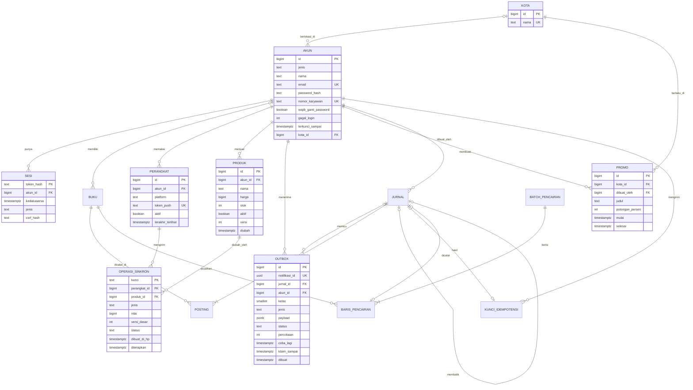

Draft otomatis, belum ditinjau pemilik

# Cerita Rekeningo · Tahap 3: Enam kota

Ditulis 2026-10-25 · draf sebelum Tahap 2 selesai (keputusan 728 butir 3)

Disesuaikan dengan Tahap 2 dan lab Tahap 3 pada 2026-10-26 (KONSISTENSI-3, keputusan 890 sampai 895). Dari Tahap 2: M21 jadi pemicu ADR 21 yang dibaca terlambat; titik mulai dari api-t2; jembatan 2.33. ADR 16 dan ADR 21 dibaca ulang di ADR 24, 27, 28; ukuran data punya dua besaran. Dari lab: satu λ dengan ambang pool dan timeout app di M18; klausa kunci dan lima percobaan di ADR 24 dan 25. Rekaman M19 sampai M27 dan katalog 207 KB masuk; load test, mitmproxy, dan k6 berlabel Tidak dijalankan.

Ditinjau konsistensi pada 2026-10-25 (PR #331, keputusan 877 sampai 879): pool 50 menunda ±58 detik, bukan ±57. M22 berlipat di penahan per IP yang ada di memori, kunci akun tetap di database. Top-up massal dan promo tidak masuk janji 95% dalam 30 detik. Akun mendapat peran `hr`, pemicu M26 menyebut staging, dan nama alat di Latar dan PRD diganti kata umum.

## Kenapa dokumen ini ada

Naskah ini adalah source of truth Tahap 3, disimpan di repo sebagai `plan/CERITA-TAHAP-3.md`. Strukturnya sama dengan Tahap 2: **PRD → fitur → pekerjaan teknis → inti teknis → masalah yang muncul pelan-pelan → konsep**. Halaman situs ditulis dari naskah ini. Penomoran melanjutkan Tahap 2: masalah M18 dan seterusnya (Tahap 2 berakhir di M17), ADR 22 dan seterusnya (Tahap 2 berakhir di ADR 21).

Satu hal berbeda dari Tahap 1 dan 2: naskah ini ditulis sebagai draf otomatis, bukan oleh pemilik, dan ditulis sebelum Tahap 2 selesai. Bahannya ringkasan dan naskah Tahap 2, PROPOSAL, dan `plan/RISET-TAHAP-3.md` (ID `R3-nn` menunjuk ke sana). Tugas `KONSISTENSI-3` mencocokkannya dengan Tahap 2 yang sebenarnya. Pemilik meninjau di akhir.

Semua pihak ketiga di Tahap 3 (layanan push, proxy tiruan, provider yang menggantung) adalah tiruan lokal di container lab. Setiap angka di naskah ini berasal dari registry dan rumus PROPOSAL, atau berlabel Asumsi atau Ilustrasi. Halaman memakai angka dari rekaman lab, bukan dari naskah.

### Pilihan draf yang perlu dilihat pemilik

Enam pilihan berikut diambil tanpa bertanya, dengan opsi paling aman dan paling mudah dibatalkan. Masing-masing dicatat sebagai usulan perubahan cerita.

1. **Transaksi per user aktif per hari: 3.** Naskah Tahap 2 bagian 3b memakai 3, registry (`trx`) memakai 2. Naskah ini mengikuti naskah Tahap 2. Hasilnya 0,868 pembayaran per detik di puncak (dibulatkan 0,87), bukan 0,58 (R3-31). Sejak T3-siap registry `tahap[2].asumsi.trx` bernilai 3, sedangkan `tahap[1]` tetap 2 sampai pemilik memutuskan (TINJAUAN-PEMILIK butir 1). Karena itu ukuran data per tahun punya dua besaran berlabel (bagian 3b).
2. **Pemicu pool habis: layanan push yang tidak menjawab dan client yang menunggu lama.** Beban biasa tidak cukup. Pada 0,868 pembayaran per detik, pool 10 baru penuh bila client menunggu lebih dari ±10,4 detik. Hitungannya (n − 1) ÷ λ = 9 ÷ 0,868, dengan jadwal kedatangan tetap; lab dengan λ = 0,87 memakai 10,34 (R3-33). Lab lama `t3-bayar` memakai 17 pembayaran per detik, 20 kali terlalu tinggi, jadi tidak dipakai sebagai dasar angka.
3. **Beban tidak memaksa cache.** Katalog dibaca 5,2 kali per detik, setara 0,03 koneksi (R3-37), dan terukur 207 KB, bukan 720 KB (R3-69). Pemicu cache di ADR 21 (L kelas itu mencapai 5 koneksi) tidak tercapai. Redis masuk karena rate limit lintas instance (R3-34). Cache katalog menumpang pada Redis itu, ADR 28 menulis alasannya apa adanya, dan "tanpa cache" tetap opsi yang sah.
4. **Mode offline hanya untuk stok dan harga.** Pembayaran tidak pernah offline. Akhir pekan warung berlangsung 62 jam, lebih lama dari umur idempotency key 24 jam di ADR 14 (R3-40). Operasi offline memakai versi baris sebagai pengaman, bukan key.
5. **Poller outbox tidak memakai kursor `(dibuat, id)`.** ADR 16 menerima risiko baris terlewat untuk riwayat. Untuk notifikasi, baris terlewat berarti pesan hilang (R3-04). ADR 16 sendiri sudah melarang kursor itu untuk pembaca aliran seperti notifikasi (aturan 5, halaman 2.19). Outbox memakai klaim per baris.
6. **Dua instance di satu VPS.** Susunan ini melindungi dari proses mati dan dari deploy, bukan dari VPS mati. VPS kedua sengaja ditunda ke Tahap 4, sesuai pemicu T3 ke T4 di PROPOSAL. Pemicu server kedua di ADR 21 (PRD meminta deploy tanpa jeda) sudah dipenuhi PRD v3 sejak dibagikan; M21 menceritakan pemicu yang dibaca terlambat.

## Latar: dari satu kampus ke enam kota

Tutup buku kedua Tahap 2 lolos dalam 3 jam dengan selisih Rp0, dan puncak beban hanya 1,4 request per detik. Direksi Grup Lestari memperluas Rekeningo ke semua cabang di enam kota dan ke warung tenant mitra di luar gedung Lestari. Hitungannya sekitar 10.000 karyawan dan ±60 warung: 12 di kampus pusat dan ±48 di lima kota lain (Asumsi).

Data lab api-t3 menamai enam kota: Jakarta (kampus pusat, 1.000 karyawan) dan lima kota lain dengan 1.800 karyawan per kota. Kelima nama itu Bandung, Surabaya, Medan, Semarang, dan Makassar; naskah tidak menyebut nama kota.

Tiga hal berubah sekaligus. Pertama, Rekeningo harus **memberi tahu**: Budi tidak tahu kapan uang masuk, dan Ani menunggu layar HP pelanggan untuk yakin sudah dibayar. Kedua, warung ingin mengatur menu, harga, dan stok sendiri dari laptop, tanpa meminta admin. Ketiga, Direksi tidak mau app berhenti saat deploy atau saat satu proses mati.

Tahap 3 berangkat dari api-t2 di akhir Tahap 2, bukan dari sistem yang sudah dibereskan (halaman 2.29 sampai 2.33). Satu proses API melayani kampus pusat, dan dua instance hanya pernah dijalankan di lab c4-ratelimit untuk batas laju. Password di-hash dengan bcrypt; argon2id dari ADR 20 hanya ada di lab c4-ratelimit, dan password sementara masih berpola `sementara-<id>`. Riwayat di app sesudah ledger turun dari 17 ke 3 baris, dan kursor riwayat (ADR 16) bisa melewatkan baris yang COMMIT belakangan.

Halaman 2.33 mencatat empat hal yang ikut ke PRD v3. Kapasitas satu server belum diukur (load test). Lupa password mandiri belum ada, penutupan periode tutup buku belum dibuat, dan Idempotency-Key belum dipasang di bayar dan transfer.

Tim jadi empat orang dalam 10 minggu (Asumsi cerita): Raka memegang app, Nadia dan Bayu memegang backend, Wulan memegang dasbor web. Yang tidak berubah: satu codebase Go, satu database PostgreSQL, ledger dari Tahap 2. Di akhir tahap ada dua instance API, satu worker, satu penyimpanan sementara untuk state bersama, dan satu lingkungan staging. Semua komponen produksi berada di satu VPS.

### Tokoh baru

| Tokoh | Siapa | Ingin | Kelemahan | Yang dibawanya ke cerita |
| --- | --- | --- | --- | --- |
| **Bayu** | Backend engineer kedua, dari tim infrastruktur Grup Lestari. Enam tahun mengurus server Linux dan proxy, belum pernah menulis kode yang menggerakkan uang. | Sistem yang bisa di-deploy kapan saja tanpa ada yang sadar | Menganggap bawaan komponen sudah aman: health check, retry, dan batas waktu | Staging, proxy, backup, alert, dan rotasi on-call |
| **Wulan** | Web engineer dari tim web Lestari. Sepuluh tahun front-end, membangun dasbor warung. | Dasbor yang cepat dan enak dipakai Ani di laptop | Menganggap data dari sistem sendiri aman ditampilkan apa adanya | Sudut pandang browser: cookie, CSP, CORS |

Tokoh lama tetap:

- **Raka** memegang app dan masih ikut menulis backend.
- **Nadia** memimpin backend dan masih cenderung mengusulkan solusi yang terlalu berat, kali ini sebuah queue pesan terpisah.
- **Sinta** menulis PRD v3.
- **Budi** kini sering patungan dengan Citra dan menerima notifikasi.
- **Ani** satu dari ±60 warung; warungnya di lantai dasar yang sinyalnya buruk.
- **Pak Hadi** menambah satu syarat: pemberitahuan tidak mendahului uang.
- **Dimas**, yang mencoba, muncul tiga kali di tahap ini dan tetap hanya penasaran.

## 1. PRD v3 · Rekeningo untuk enam kota

**Latar masalah.** Tahap 2 membuktikan ledger benar dan beban kecil. Tiga hal belum terjawab: karyawan tidak tahu kapan uang masuk, warung meminta admin untuk mengubah menu, dan satu proses mati mematikan semuanya. Di enam kota, ketiganya terasa 10 kali lipat.

**Tujuan.** (1) Semua karyawan di enam kota dan warung tenant mitra memakai Rekeningo. (2) Budi dan Ani tahu saat uang masuk, tanpa membuka app. (3) Warung mengelola menu, harga, dan stok sendiri, dari app atau dari laptop. (4) Rekeningo tetap berjalan saat deploy atau saat satu proses mati.

**User.**

| User | Kebutuhan baru | Yang membuatnya berhenti memakai |
| --- | --- | --- |
| Karyawan (Budi, Citra) | Tahu saat uang masuk; melihat menu dan harga warung di kotanya | Notifikasi terlambat, hilang, atau muncul dua kali; harga di layar berbeda dari harga di kasir |
| Warung (Ani dan ±59 lainnya) | Mengatur menu, harga, stok dari app atau laptop; tahu saat dibayar; tetap bisa bekerja saat sinyal hilang | Perubahan hilang saat offline; dasbor yang tidak aman |
| HR (peran baru) | Membuat promo per kota dengan jam mulai dan selesai | Promo yang muncul terlambat atau berbeda di HP yang berbeda |
| Keuangan (Pak Hadi) | Laporan dan tutup buku tetap bisa ditelusuri sampai kejadian pertama | Pemberitahuan yang tidak cocok dengan jurnal |

**Ruang lingkup (enam kota, 10.000 karyawan, ±60 warung, 10 minggu).**

| Prioritas | Fitur | Keterangan |
| --- | --- | --- |
| P0 | Notifikasi saat menerima uang | Bayar, transfer, dan top-up memunculkan notifikasi di HP penerima, tidak pernah mendahului uangnya, tidak hilang tanpa terdeteksi. Bayar dan transfer: 95% dalam kurang dari 30 detik. Top-up massal tiap Senin boleh menyusul beberapa menit, karena 10.000 notifikasi sekaligus (M27) |
| P0 | Katalog dan stok warung | Menu, harga, dan sisa porsi per warung; warung mengubah dari app atau dasbor; karyawan melihat per kota |
| P0 | Dasbor web warung | Laporan penjualan harian, ekspor CSV, kelola menu; masuk dengan akun yang sama |
| P0 | Tidak berhenti saat deploy | Deploy dan satu proses mati tidak terlihat oleh user; staging dan backup terjadwal |
| P1 | Promo dari HR | Potongan harga per kota dengan jam mulai dan selesai; tampil di katalog; pengumuman ke karyawan kota itu bila HR memilih |
| P1 | Catatan pada pembayaran dan transfer | Maksimal 100 karakter; tampil di notifikasi dan di dasbor |
| P1 | Mode offline di app warung | Ubah stok dan harga tanpa sinyal, tersinkron saat sinyal kembali; pembayaran tidak pernah offline |
| P1 | Masuk dasbor lebih aman | Kata sandi tetap ada; passkey boleh dipilih |
| P2 | Top-up dari rekening bank, kartu virtual, verifikasi identitas | Ditunda ke v4 |

**Bukan lingkup v3.** Pembayaran offline, integrasi bank, user di luar Lestari, kartu virtual, API untuk kasir pihak ketiga, dasbor multi-cabang, email, notifikasi untuk publik.

**Metrik keberhasilan (target, Asumsi).**

- ≥ 7.000 karyawan aktif mingguan.
- 95% notifikasi bayar dan transfer diserahkan ke layanan push dalam kurang dari 30 detik.
- 0 notifikasi uang yang hilang tanpa terdeteksi otomatis.
- Deploy tanpa error yang terlihat user.
- Tutup buku bulanan tetap selesai dalam kurang dari 1 hari, selisih Rp0.

**Batasan.** Empat engineer selama 10 minggu. Satu VPS produksi dan satu staging. Semua layanan luar berupa tiruan lokal di lab. Anggaran naik sedikit untuk satu penyimpanan sementara kecil dan satu staging.

Aturan Pak Hadi dipertahankan dan ditambah: *"Ani tidak boleh diberi tahu uang masuk sebelum uang itu benar-benar tercatat."*

**Risiko yang ditulis Sinta.** Rekeningo pertama kali bergantung pada layanan luar di jalur uang. Satu server menjadi dua. Dasbor web membuka permukaan serangan baru, dan app dipakai di Wi-Fi tenant mitra yang tidak dikelola Rekeningo.

**Pertanyaan terbuka di PRD.**

- Kalau layanan push lambat, apakah pembayaran ikut lambat?
- Kalau pemberitahuan gagal terkirim, siapa yang tahu?
- Kalau server jadi dua, apa yang tadinya disimpan di memori satu server?

Ketiganya tidak dijawab PRD dan menjadi masalah terbesar Tahap 3.

Halaman 2.33 sudah membuka dua jawaban dengan bukti dari Tahap 2. Pertama, batas laju ADR 20 di memori berlipat saat server jadi dua. Kedua, notifikasi di dalam transaction jurnal memperpanjang lock ADR 13. Halaman itu juga mencatat bahwa pemberitahuan belum punya pemeriksa, dan halaman 3.1 tidak mengulang tebakan itu.

## 2. Dari fitur ke pekerjaan teknis

| Fitur | Di app | Di backend | Di database | Konsep yang akan dibutuhkan |
| --- | --- | --- | --- | --- |
| Notifikasi saat menerima uang | Minta izin notifikasi, kirim token perangkat, tampilkan pesan, saring pesan ganda | Simpan token; kirim pemberitahuan setelah jurnal; layanan push (tiruan lokal; FCM v1 sebagai rujukan, R3-16) | `perangkat`, `outbox` | Outbox; worker; connection pool; retry; consumer idempoten |
| Katalog dan stok | Layar menu per kota; di app warung: ubah harga dan stok | Endpoint katalog; ubah produk bersyarat versi; total pembayaran dihitung ulang dari database | `produk`, `kota` | Cache dan invalidation; optimistic lock |
| Dasbor web warung | Tidak ada (halaman web) | Login web dengan cookie sesi; laporan harian; ekspor CSV; kelola menu | `sesi` jenis web | XSS; CSRF; cookie; CSP; passkey |
| Promo dari HR | Banner promo; harga promo di katalog | Promo per kota; harga efektif; pengumuman massal lewat outbox | `promo` | Cache invalidation; fan-out; kelas prioritas queue |
| Catatan pada pembayaran | Kolom isian | Validasi panjang; simpan di `jurnal.keterangan` | `jurnal.keterangan` | Validation; output encoding |
| Tidak berhenti saat deploy | Tidak ada | Dua instance; proxy dengan health check; graceful shutdown; staging; backup | Tidak ada | Reverse proxy; rate limit lintas instance; observability |
| Mode offline warung | Queue perubahan lokal; tombol sinkron | Endpoint sinkron bersyarat versi | `operasi_sinkron` | Offline-first; umur key lawan umur queue; optimistic lock |
| Empat engineer, tiga peran | Mock server dari kontrak; pipeline iOS dan Android | Staging; pipeline dengan Redis nyata; migration dry-run; k6 smoke | Tidak ada | Tim 3: staging, mock server, backup, on-call |

Dari tabel ini lahir pertanyaan pertama Tahap 3, sebelum satu baris kode: notifikasi adalah akibat dari uang yang bergerak, bukan bagian dari uang yang bergerak. Cara pertama yang ditulis tim ternyata keliru, dan itu bagian 3.

## 3. Inti teknis Tahap 3 · Uang dan pemberitahuan, dua tempat yang tidak bisa commit bersama

Ini jantung Tahap 3. Pertanyaannya dirumuskan di minggu 0, sebelum masalah apa pun muncul. "Budi transfer Rp50.000 ke Citra" kini menyentuh dua tempat: jurnal dan dua posting di PostgreSQL, ditambah satu pemberitahuan ke HP Citra. PostgreSQL bisa COMMIT atau ROLLBACK sebagai satu unit, tetapi layanan push tidak ikut unit itu.

Tiga hal harus selalu benar:

1. Pemberitahuan tidak mendahului uangnya. Kalau jurnal batal, Citra tidak diberi tahu (syarat Pak Hadi).
2. Uang yang tercatat tidak kehilangan pemberitahuannya tanpa ada yang tahu. Ani menyerahkan makanan setelah melihat notifikasi (syarat Sinta).
3. Uang tidak menunggu pihak luar. Pembayaran selesai dalam milidetik walau layanan push lambat (syarat Direksi).

**Versi pertama (minggu 1).** Nadia dan Raka menulis urutan paling pendek: `BEGIN`, kunci buku (ADR 13), `INSERT` jurnal dan posting, kirim push lewat HTTP, `COMMIT`. Kegagalan push hanya dicatat di log, dan client HTTP memakai pengaturan bawaan Go yang tanpa batas waktu (R3-08). Di staging urutan ini tampak cukup.

| Kejadian | 1. Tidak mendahului uang | 2. Tidak hilang | 3. Tidak menunggu |
| --- | --- | --- | --- |
| Push berhasil, COMMIT berhasil | Ya | Ya | Uang menunggu selama panggilan push |
| Push berhasil, COMMIT gagal | Tidak: Citra diberi tahu uang yang tidak ada | Tidak berlaku | Tidak berlaku |
| Push gagal, error dicatat saja | Ya | Tidak: hilang tanpa catatan | Uang menunggu sampai push gagal |
| Push menggantung | Tidak berlaku | Tidak berlaku | Tidak: uang dan koneksi database ikut tertahan |

Halaman inti ini menanam dua pertanyaan. Di minggu 1 Bayu bertanya apakah uang ikut menunggu bila layanan push lambat. Pak Hadi bertanya bagaimana ia tahu satu pemberitahuan sesuai satu jurnal. Jawabannya ada di M18 sampai M20.

**Yang pembaca lakukan.** Widget cari-bug: tandai baris di handler versi pertama yang melanggar satu dari tiga hal itu, lalu lihat tabel di atas terisi.

**Yang dipelajari Raka dengan susah payah.** Pola dua tempat ini muncul lagi di cache (M23), memori dua server (M22), queue offline di HP (M24), dan queue worker (M27). Aturannya sama untuk semuanya. PostgreSQL tetap satu-satunya source of truth; yang lain hanya salinan atau perantara yang boleh stale, tetapi tidak boleh menggerakkan uang.

### Angka beban Tahap 3 (Asumsi, rumus ditulis)

Masukan registry: 10.000 user, aktif 25%, 60 request per user aktif, faktor puncak 10. Transaksi uang 3 per user aktif per hari mengikuti naskah Tahap 2 dan registry Tahap 3 (`trx` 3; Tahap 1 dan 2 masih 2). Pembaca boleh mengganti angkanya.

Satu nilai dipakai untuk bayar dan transfer: 7.500 ÷ 86.400 × 10 = 0,868 per detik, dibulatkan 0,87. Lab memakai 0,87 persis (17,4 request per detik, tiap ke-20 membayar).

| Besaran | Rumus | Masukan | Hasil |
| --- | --- | --- | --- |
| Request per detik | aktif × request ÷ 86.400 × puncak | 2.500 × 60 = 150.000 per hari | 1,74 rata-rata dan 17,4 puncak (Tahap 2: 1,39; naik 12,5 kali) (R3-30) |
| Pembayaran dan transfer per detik | aktif × 3 ÷ 86.400 × puncak | 7.500 per hari, 5% dari request | 0,087 rata-rata dan 0,868 puncak (dibulatkan 0,87); jendela makan siang (80% dalam 90 menit): 1,11 (R3-31) |
| Pool tanpa panggilan luar | L = λ × W | pool 10 koneksi (Asumsi cerita: batas yang Bayu tetapkan di minggu 1, karena api-t2 memakai `database/sql` yang tanpa batas bawaan, dokumentasi Go dibuka 2026-10-25, R2-206; bawaan pgxpool: yang lebih besar dari 4 atau jumlah core, R3-07); W 20 ms (Asumsi; lab t3-pool hanya menolak W di atas 50 ms, jadi 20 ms tidak terbukti); 17,4 request per detik | 0,35 koneksi untuk seluruh request (R3-32); Rekaman lab: L semua request di bawah 0,87 (batas lab 17,4 × 50 ms) |
| Pool dengan panggilan luar | L = 0,868 × (0,02 + t) | t = 0,3 / 2 / 10 / 30 detik | 0,28 / 1,75 / 8,7 / 26,1 koneksi (R3-33); lab dengan λ = 0,87 mencocokkan rata-rata koneksi dalam 15% dengan 0,278 / 1,757 / 8,717 untuk t = 0,3 / 2 / 10 (Rekaman lab) |
| Pool 10 penuh | tanpa client yang menyerah: n ÷ λ; ambang client: W > (n − 1) ÷ λ | n = 10, λ = 0,868 (puncak) | penuh pada ±11,5 detik bila push tidak pernah menjawab dan client terus menunggu (Rekaman lab: antara detik ke-11 dan ke-12). Client yang menyerah sesudah T detik melepas koneksinya: pool hanya penuh bila T > 9 ÷ 0,868 = ±10,4 detik (hitungan; lab dengan λ = 0,87: 10,34), dan paling banyak ⌈0,868 × T⌉ koneksi terpakai (T = 5: 5, Rekaman lab). Jendela makan siang (λ = 1,11): n ÷ λ ±9 detik, ambang ±8,1 detik. Pool 50 hanya menunda ke 50 ÷ 0,868 = ±57,6 detik (lab: antara detik ke-57 dan ke-58). Kedatangan di lab berjadwal tetap; kedatangan acak bisa mengisi pool lebih awal (halaman 2.30) |
| Koneksi database | instance × pool + worker + admin + reserved | 2 × 10 + 4 + 3 + 3 | 30 dari 100 (R3-35) |
| Kapasitas worker | c ÷ t | c = 4, t = 0,3 detik (Asumsi) | 13,3 per detik, 15 kali puncak (R3-36); Rekaman lab: terukur 12 sampai 13,33 per detik |
| Promo atau top-up massal ke 10.000 HP | 10.000 ÷ 13,3 | satu queue urut waktu; top-up 10.000 akun bila semua karyawan menerima tunjangan (Asumsi) | ±750 detik, 12,5 menit; dalam 30 detik hanya 400 yang terkirim (4%), sedangkan 95% dalam 30 detik butuh ±317 per detik (hitungan dari c ÷ t; Rekaman lab: 3,4% sampai 4,2% terkirim dalam 30 detik, 12,5 menit tidak dijalankan) |
| Katalog | 60 × 40 × 86 B; 30% request; 5 ms | 2.400 item | 207 KB (Rekaman lab: 206.551 B untuk enam kota, 86 B per item; tebakan awal 300 B per item memberi 720 KB); 5,2 baca per detik; L = 0,026 (R3-37, R3-69; baca per detik dan 5 ms Asumsi) |
| Rate limit dengan N instance | batas per instance × N | per IP 10 burst dan 10 per menit, per akun 5 burst (keputusan 545), N = 2 | per IP antara 10 dan 20, per akun antara 5 dan 10; kunci akun di database tetap lima gagal berturut-turut (R3-34, keputusan 550); Rekaman lab t3-instance: per IP 10 pada satu instance, 20 dengan round_robin, antara 10 dan 20 dengan random, 10 dengan Redis; per akun 5, 10 (round_robin), dan 5 (Redis) |
| Offline akhir pekan | Jumat 17.00 sampai Senin 07.00 | key 24 jam | 62 jam, lebih dari 24 jam (R3-40); lab memerankan Jumat 16.50 sampai Senin 06.50, juga 62 jam (jam service digeser, Ilustrasi mekanisme) |

Dua kesimpulan dari tabel ini menentukan seluruh tahap. Beban 17,4 request per detik tidak membuat apa pun sesak. Yang berbahaya adalah **lama** satu panggilan, bukan **banyak**: Little's Law (R2-35).

Kapasitas satu server tetap belum diukur. ADR 21 aturan 5 menjadwalkan satu load test sebelum fitur PRD v3 pertama. Lab Tahap 3 memakai beban berjadwal 17,4 request per detik yang mengukur koneksi, bukan kapasitas (Tidak dijalankan). Kata "tidak sesak" dan "lega" di naskah ini berarti L kecil terhadap pool 10 di laptop lab.

## 3b. Skema data: ERD dari Tahap 2 ke Tahap 3

Aturan sama dengan Tahap 2: ERD tahap sebelumnya selalu tampil berdampingan dengan tahap sekarang. Dengan begitu tabel baru, kolom yang berubah, dan tabel yang hilang terlihat. Halaman skema Tahap 3 memakai widget ERD bertumbuh dengan Tahap 2 di kiri dan Tahap 3 di kanan, dibuat dari skema lab `api-t3`.

Diagram di bawah disusun dari skema Tahap 2 di lab (`labs/api-t2`), bukan dari blok mermaid naskah Tahap 2, karena skema lab yang benar. Kolom persisnya harus dicocokkan dengan skema lab `api-t3`; kalau berbeda, skema lab yang benar dan diagramnya yang diperbarui. Pemeriksaan ERD3 menemukan tiga selisih, dan blok di bawah sudah mengikuti lab: urutan kolom `sesi`, `jurnal.membalik_jurnal_id` UNIQUE, dan `baris_pencairan.jurnal_id` yang boleh kosong.

### Apa yang berubah dan kenapa

| Tahap 2 | Tahap 3 | Alasan | Masalah atau syarat |
| --- | --- | --- | --- |
| (tidak ada) | `perangkat` (akun, platform, token push, aktif, terakhir terlihat) | Tujuan notifikasi; token yang tidak berlaku dibersihkan (R3-16) | Notifikasi |
| (tidak ada) | `outbox` (notifikasi_id, jurnal_id, akun_id, kelas, jenis, payload, status: menunggu, terkirim, dilewati, mati; percobaan, coba_lagi, klaim_sampai) | Pemberitahuan ditulis dalam transaction yang sama dengan jurnal | M18, M19, M20, M27 |
| (tidak ada) | `produk`, `kota`, `promo` | Katalog, stok, dan harga per kota; promo HR | Katalog, promo |
| (tidak ada) | `operasi_sinkron` (kunci, perangkat, produk, jenis, nilai, versi_dasar, status) | Operasi dari queue offline dikenali sampai 14 hari | M24 |
| `sesi` (token_hash, akun_id, kedaluwarsa) | `sesi` + `jenis` (app, web) dan `csrf_hash` | Sesi dasbor memakai cookie dan token CSRF | M25 |
| `akun` (`jenis`: karyawan, warung, admin, sistem) | `akun` + `kota_id` (boleh kosong untuk admin dan sistem); `jenis` + `hr` | Warung dan karyawan punya kota; katalog dan promo per kota; HR membuat promo | Enam kota; promo |
| `jurnal.keterangan` teks bebas | Tetap; kini juga diisi dari catatan user dan wajib di-encode saat ditampilkan | Catatan tampil di notifikasi dan dasbor; jurnal tidak bisa dihapus, dan halaman 2.8 mencatat penghapusan data pribadi belum dijadwalkan | M25 |
| `kunci_idempotensi` berumur 24 jam | Tabel dan umur 24 jam tetap (ADR 14). api-t2 belum memakainya di bayar dan transfer; api-t3 memasangnya sebagai header Idempotency-Key opsional di bayar, transfer, dan pesanan (lab t3-offline), jadi app 1.0 dan 1.1 tanpa key tetap rentan M10 | Offline tidak memperpanjangnya; versi baris yang menjaga (ADR 29) | M24 |

### Pertumbuhan skala database, Tahap 2 sampai 4

Rumus dan angka mengikuti naskah Tahap 2 bagian 3b. *Posting per tahun = transaksi per hari × 2 × 365*, ±250 byte per posting termasuk index. Tahap 1, 5, dan 6 ada di naskah Tahap 2.

| Tahap | User | Tabel inti | Baris terbesar per tahun | Ukuran per tahun | Perubahan skema penting |
| --- | --- | --- | --- | --- | --- |
| 2 | 1.000 | 8 | `posting` ±660 ribu | ±170 MB | Ledger double-entry; idempotensi; batch pencairan |
| 3 | 10.000 | ±14 | `posting` ±5,5 juta (2.500 × 3 × 2 × 365 = 5,475 juta) | ±1,4 GB (1,37 GB, R3-38; rumus registry ±820 MB) | Outbox, perangkat, katalog dan stok, promo, operasi sinkron |
| 4 | 100.000 | ±22, dibagi per modul | `posting` ±44 juta | ±11 GB | Pembayaran gateway, webhook masuk, verifikasi identitas, kartu virtual |

Ukuran data tahun Tahap 3 punya dua besaran, keduanya Asumsi. Rumus registry 1.38 (2.500 × 3 × 365 × 300 B, satu baris per transaksi) memberi ±820 MB, dan rumus ledger memberi ±1,4 GB. Halaman 2.30 menambah ±750 MB dari 137 B per posting hasil rekaman api-t2, jadi ketiganya satu orde besaran. Registry Tahap 2 masih `trx` 2 (±65,7 MB di halaman 2.9; keputusan pemilik di TINJAUAN-PEMILIK butir 1).

Tabel baru Tahap 3 kecil. `outbox` setahun tanpa pembersihan 7.500 × 365 × 300 B ≈ 0,82 GB; dengan retensi 7 hari tinggal ±15,8 MB. `perangkat` 10.000 × 1,3 × 300 B ≈ 3,9 MB (1,3 perangkat per user adalah Asumsi). `produk` hanya 60 × 40 = 2.400 baris (R3-39).

Pola yang ditanam tetap sama: sampai Tahap 3, database tumbuh karena **fitur baru**, bukan karena volume. Tabel terbesar masih `posting`, dan belum perlu dipartisi.

### Spesifikasi untuk Claude Code

Blok di bawah dibaca mesin. Diagram di situs dibuat dari skema lab yang sesungguhnya, lalu dicocokkan dengan blok ini. Entitas tanpa kolom tidak berubah dari Tahap 2.

Versi dasar lab (R3-01, dicek 2026-10-25): PostgreSQL 17.11, Go 1.27.3, pgx v5.11.0, Redis 8.10.2, go-redis v9.23.0, Caddy v2.11.7, mitmproxy v12.3.0, k6 v2.3.0, Prism v5.16.0. Versi dicek ulang saat lab ditulis. Tidak dijalankan di lab: mitmproxy (lab t3-mitm memakai proxy tiruan Go), k6, dan Prism. Lab t3-mitm menambah dio 5.11.0 dan crypto 3.0.7 (Dart).

## 4. Masalah yang muncul, pelan-pelan

Pola sama dengan Tahap 1 dan 2. Gejala yang dilihat orang, lalu yang Raka, Nadia, atau Bayu kira, lalu yang sebenarnya, konsep, keputusan, dan yang pembaca lakukan. Angka di kolom gejala berlabel Ilustrasi sampai ada rekaman lab; mekanismenya yang direkam, bukan angkanya.

| # | Minggu | Gejala yang dilihat orang | Yang dikira | Yang sebenarnya | Konsep yang lahir | Keputusan (ADR) |
| --- | --- | --- | --- | --- | --- | --- |
| M18 | 3 | Jumat 12.20, Rekeningo berhenti menjawab selama ±9 menit (Ilustrasi). Budi tidak bisa membuka saldo, Ani tidak bisa membuka laporan, tombol Bayar berputar lalu "timeout". Bukan hanya pembayaran: semua layar. | Database lambat; Raka mengusulkan pool dinaikkan dari 10 ke 50 | Layanan push (di lab: tiruan lokal) menerima koneksi tetapi tidak menjawab. Pembayaran memanggilnya di dalam transaction dengan client tanpa batas waktu (nol berarti tanpa batas, R3-08). Tiap pembayaran menahan satu koneksi. Bila push tidak pernah menjawab dan client terus menunggu, pool 10 penuh dalam ±11,5 detik (10 ÷ 0,868; Rekaman lab t3-pool: antara detik ke-11 dan ke-12) dan semua request lain ikut mengantre, juga pembacaan saldo (190 dari 190 tidak dijawab); 95% adalah 16,5 ÷ 17,4 (hitungan). Client yang menyerah sesudah T detik melepas koneksinya, jadi pool hanya penuh bila T > (n − 1) ÷ λ = ±10,4 detik (hitungan; Rekaman lab T = 5: paling banyak 5 koneksi, jurnal 0). Naskah tidak menyebut timeout app: M18 memakai 30 detik atau tanpa batas (Asumsi), jadi layar membeku sejak ±12 detik dan HP baru menampilkan "timeout" sekitar detik ke-30. `Future.timeout` di Dart tidak membatalkan permintaan sumbernya (R3-94), jadi app yang hanya memakai itu tidak melepas koneksi [perlu verifikasi untuk package `http` dan `dio`] | **Connection pool**; **Little's Law** (L = λ × W); timeout; observability: log, metric, trace (R3-07, R3-08, R3-14) | ADR 22: panggilan keluar tidak pernah di dalam transaction; setiap client punya timeout 3 detik; pool tidak dinaikkan (pool 50 hanya menunda ke ±58 detik) |
| M19 | 4 | Budi dan seorang rekan mengirim patungan ke Citra hampir bersamaan. Saldo Citra naik Rp50.000, tetapi HP-nya berbunyi sekali, bukan dua kali. Dua hari kemudian Ani menemukan tiga pembayaran hari Jumat yang tidak pernah diberitahukan (Ilustrasi). | Token perangkat Citra salah; Nadia: poller perlu nomor urut tanpa celah | Poller outbox membaca dengan kursor `(dibuat, id)`, meniru ADR 16, padahal aturan 5 ADR 16 melarang kursor itu untuk pembaca aliran seperti notifikasi. `dibuat` adalah awal transaction, bukan COMMIT. Transaction yang menunggu lock buku selesai belakangan dengan `dibuat` lebih awal, lalu tertinggal di belakang kursor. Nomor urut `id` pun bukan urutan commit (R3-04). Rekaman lab t3-outbox: dua transfer ke penerima yang sama antre di baris buku penerima; tanpa penghambat buatan, urutan `dibuat` dan nomor outbox terbalik pada sebagian pasang serentak, dan baris tertinggal bila putaran poller jatuh di antara dua COMMIT (celah dipanjangkan supaya terekam). Peluang per kejadian tidak direkam (pengukuran peninjau: 7 dari 15 pasang terbalik, bergantung mesin) | Urutan commit tidak sama dengan urutan id; **klaim per baris** (klausa kunci `FOR UPDATE` dan `klaim_sampai`); lease (R3-03, R3-04) | ADR 24: worker mengklaim baris, tanpa kursor; klaim punya batas waktu |
| M20 | 4 | Ani menerima "Rp25.000 dari Budi" dua kali dalam enam detik dan mengira Budi membayar dua kali, seperti M10. Ia hampir menyerahkan dua porsi. | Jurnal ganda atau retry app (M10 terulang) | Hanya ada satu jurnal. Bayu menghentikan worker saat deploy di antara "kirim" dan "tandai terkirim"; klaim 5 detik habis, worker baru mengklaim ulang baris itu; selang dua pengiriman di lab sedikit di atas lima detik (batas 4,9 sampai 7,0 bergantung mesin, Rekaman lab ganda.txt A). Mengirim ulang itu benar; yang kurang adalah penerima yang mengenali ulangan | **At-least-once**; retry dengan backoff dan jitter; dead-letter; consumer idempoten (`notifikasi_id`) (R3-02, R3-06) | ADR 25: pengiriman at-least-once, maksimal 5 percobaan lalu dead-letter; app menyaring `notifikasi_id` yang sudah tampil |
| M21 | 5 | Rabu 12.05 Rekeningo tidak bisa dibuka ±9 menit sampai Bayu memulai ulang prosesnya. Kamis malam, deploy mematikan app ±40 detik (Ilustrasi). Sinta: "Satu proses mati, semua mati." | Server kurang kuat; Raka mengusulkan VPS yang lebih besar | Proses API satu-satunya keluar karena panic di goroutine latar milik ekspor laporan (ringkasan audit yang mengira laporan tidak pernah kosong; Rekaman lab t3-instance: kode keluar 2, sedangkan panic di goroutine handler dipulihkan `net/http` dan proses hidup, R3-70), dan tidak ada yang memulainya lagi. Deploy mengganti satu-satunya proses. Ukuran VPS tidak berperan. Pemicu server kedua di ADR 21 (PRD meminta deploy tanpa jeda) sudah dipenuhi PRD v3 sejak dibagikan, dan tidak ada yang membaca ulang ADR 21 terhadap PRD v3 sampai Rabu itu: pemicu yang dibaca terlambat | **Ketersediaan**; dua instance di belakang reverse proxy; health check aktif dan retry (bawaan proxy tidak memilikinya); graceful shutdown; deploy bergulir (R3-13) | ADR 26 menjalankan pemicu ADR 21 yang terlambat dibaca: dua instance di satu VPS; proxy dengan health check aktif dan retry; `Shutdown` saat SIGTERM; satu VPS tetap titik gagal tunggal |
| M22 | 6 | Dimas menguji staging atas permintaan Bayu. Sesudah instance kedua dipasang, ia mengirim 24 percobaan login dari satu IP ke akun uji yang berbeda dengan password bocor. Dua puluh lolos ke pemeriksaan password sebelum ada yang ditolak 429, padahal batas per IP 10 (Ilustrasi; rekaman c4-ratelimit bagian F memberi 20 dari 24). | Penghitung gagal login salah di kode | Token bucket ADR 20 ada di memori tiap instance. Proxy memilih instance acak, jadi batas efektif per IP antara 10 dan 20, per akun antara 5 dan 10, dan per IP sampai 600 per 30 menit (hitungan: 2 × 10 per menit × 30 menit, keputusan 545 dan 648; tidak direkam, R3-34). Rekaman lab t3-instance (`batas.txt`) mengulang angka itu: per IP 10 pada satu instance dan 20 dengan round_robin, per akun 5 dan 10. Kunci akun tidak ikut berlipat: `gagal_login` dan `terkunci_sampai` ada di database (keputusan 550), jadi lima salah berturut-turut ke satu akun tetap mengunci. Yang longgar adalah penahan banjir per IP: satu tebakan per akun tidak pernah menyentuh kunci akun (rekaman c4-ratelimit bagian C). Dengan N instance, batas bisa N kali lipat | **State bersama lawan state per proses**; rate limit lintas instance; `INCR` dan `EXPIRE` yang atomik (R3-10, R3-12) | ADR 27: Redis untuk state bersama; skrip atomik; timeout 50 ms; Redis mati berarti batas lokal; Redis bukan queue dan bukan source of truth |
| M23 | 6 | HR menyalakan promo pukul 11.30. HP Budi menunjukkan nasi goreng Rp22.500, HP Citra di meja yang sama Rp25.000. Orang yang mengantre di warung Ani berdebat soal harga (Ilustrasi). | Bug Flutter menyimpan harga lama | Di minggu 2 Nadia menambah cache katalog di memori proses (TTL 5 menit) karena "katalog dibaca terus". Dengan dua instance, hanya instance yang menerima perubahan yang membuang entri; instance lain tetap stale (data yang sudah tidak terbaru) sampai TTL habis. Beban katalog sebenarnya 5,2 baca per detik, 0,03 koneksi: cache tidak diperlukan oleh beban (R3-37), dan ADR 21 menunda cache sampai L kelas itu mencapai 5 koneksi (katalog: 0,026). Stok di katalog ikut stale: layar menunjukkan 50 padahal database 49, karena pesanan tidak menghapus kunci. Harga yang ditagih dan stok yang diperiksa saat pesan selalu dari database (Rekaman lab t3-cache `memori.txt` C) | **Cache**; cache-aside; TTL dan invalidation (tulis database dulu, baru hapus kunci); stampede hanya disebut (R3-09, R3-11, R3-25) | ADR 28: cache katalog di Redis, TTL 60 detik, hapus kunci sesudah tulis; harga yang ditagih selalu dari database; "tanpa cache" tetap opsi sah |
| M24 | 7 | Senin 07.05 app Budi menunjukkan ayam geprek "habis", padahal Ani mengisi 30 porsi lewat dasbor hari Sabtu. Ani: "Jumat sore saya catat habis, itu sudah lewat dua hari." | Dasbor atau jam HP yang salah | Jumat 16.50 operasi "stok = 0" sampai ke server, tetapi jawabannya hilang; HP Ani lalu offline sampai Senin 07.00 (62 jam, Asumsi; lab memerankan 16.50 sampai 06.50, juga 62 jam). App mengirim ulang dengan key yang sama; key sudah lewat 24 jam (ADR 14; endpoint stok memakai tabel kunci yang sama), jadi server tidak mengenalinya dan menerapkannya sebagai timpa tanpa pemeriksaan versi (R3-40). Rekaman lab t3-offline: ulangan 17 jam dikenali dan 62 jam tidak; angka 24 jam persis dijaga tes Go, bukan rekaman. api-t3 tidak punya endpoint stok sebelum ADR 29: lab memerankannya dengan mode rentan `stok-timpa`. Idempotency-Key opsional, jadi app 1.0 dan 1.1 tanpa key tetap rentan M10; server mati di antara COMMIT dan penyimpanan respons membuat ulangan dijawab 409 dan uang paling banyak berpindah sekali (celah yang diterima; Tidak dijalankan) | **Offline-first**; queue sinkron; operasi bersyarat versi (optimistic lock); umur key lawan umur queue; konflik ditampilkan, bukan ditimpa (R3-17) | ADR 29: offline hanya stok dan harga; `UPDATE … WHERE versi = …`, 409 memunculkan pilihan; key sinkron 14 hari di `operasi_sinkron`; pembayaran tidak pernah offline |
| M25 | 8 | Setiap Ani membuka "Riwayat penerimaan" di dasbor, muncul kotak peringatan berisi angka 1. Wulan: "Mungkin ekstensi browser Ani." | Ekstensi browser atau bug library tabel | Dimas menaruh `` di catatan pembayaran ke warung Ani, untuk mencoba. Dasbor menampilkan catatan lewat `innerHTML`, jadi skripnya berjalan dengan sesi Ani. Jurnal tidak bisa dihapus (append-only), jadi catatan itu tinggal selamanya; perbaikannya di output. Rekaman lab t3-dasbor: skrip yang sama memanggil endpoint CSRF-benar dengan token halaman sendiri dan berhasil walau cookie `HttpOnly`, jadi XSS mengalahkan CSRF yang benar dan `HttpOnly` tidak mencegah aksi atas nama Ani (R3-19, R3-93) | **XSS** (stored); output encoding; CSP; CSRF dan cookie sesi; XSS mengalahkan semua mitigasi CSRF (R3-19) | ADR 30: tanpa `innerHTML`; CSP dengan nonce; token CSRF; cookie `__Host-` dengan `HttpOnly`, `Secure`, `SameSite=Lax`; passkey sebagai pilihan (ceremony pendaftaran direkam dengan authenticator virtual, R3-82; login passkey penuh Tidak dijalankan) |
| M26 | 9 | Budi sedang makan di kantin tenant mitra di kota kelima. Ia membuka app dan melihat saldonya turun Rp150.000, dengan satu "Transfer ke Dimas" di riwayat yang tidak ia buat. (Uji lapangan atas permintaan Pak Hadi, dengan akun uji.) | Password Budi bocor | Dimas memasang hotspot tiruan bernama sama dengan Wi-Fi kantin. App 3.1 memuat flag "terima sertifikat apa pun" dari staging: Bayu meminta, Raka memasang, tidak dicabut dari build rilis. Proxy tiruan membaca header Authorization dan memakainya. Rekaman lab t3-mitm: proxy mengubah transfer Rp10.000 ke Citra menjadi Rp150.000 ke Dimas, server mencatat satu jurnal seimbang, dan saldo Budi turun dari Rp250.000 ke Rp100.000; validasi sertifikat yang aktif menahan CA tak dikenal tetapi tidak menahan CA yang sudah ada di daftar akar (R3-74 sampai R3-77) | **TLS dan validasi sertifikat**; HSTS; **certificate pinning** (SPKI dan cadangan); token pendek dan refresh; redaksi log (R3-18) | ADR 31: validasi selalu aktif; pin SPKI dengan satu cadangan; token sesi 15 menit (Asumsi) yang butuh cara app memperbarui, usulnya refresh token (api-t3 hanya punya sesi berumur tetap, Tidak dijalankan) |
| M27 | 9 | Jumat 11.30 HR mengirim promo ke semua 10.000 HP. Sampai 11.42 notifikasi pembayaran Ani belum datang; orang menumpuk di warung; Ani mengabari Sinta pukul 11.44 (Ilustrasi). | Layanan push lambat | Satu queue urut waktu: 10.000 baris promo berada di depan notifikasi uang. Kapasitas worker 4 ÷ 0,3 detik = 13,3 per detik, jadi 10.000 ÷ 13,3 = ±750 detik (12,5 menit; hitungan dari c ÷ t, Asumsi; Rekaman lab t3-outbox: kapasitas 12 sampai 13,33 per detik, notifikasi uang di belakang 10.000 promo menunggu lebih dari 30 detik tanpa kelas dan terkirim pertama dengan kelas). Top-up massal tiap Senin memakai queue yang sama dan punya akibat yang sama. Tidak ada alert untuk umur notifikasi tertua | **Kapasitas worker** (c ÷ t); fan-out; **kelas prioritas**; laju promo; alert umur tertua; empat golden signals (R3-14, R3-36) | ADR 32 (merevisi ADR 23): kolom `kelas`, bayar dan transfer lebih dulu, top-up massal dan promo sesudahnya; promo paling banyak 5 per detik; alert umur tertua; staging; on-call |
| M28 | 10 | Uji coba enam kota lolos: tutup buku bulan ketiga selesai kurang dari sehari, selisih Rp0. Sinta datang dengan PRD v4: PT Rekeningo terpisah, top-up dari bank lewat gateway, verifikasi identitas, QR di merchant luar, kartu virtual, back office. | Perlu server lebih besar | Puncak 17,4 request per detik; di lab t3-pool L semua request terbukti di bawah 0,87 koneksi (batas lab) pada pool 10, jadi satu PostgreSQL tidak terdesak di laptop lab, sedangkan kapasitas satu server belum diukur (load test ADR 21 Tidak dijalankan). Yang belum pernah diuji: pihak ketiga yang menggerakkan uang, tiga tim di satu codebase, dan satu VPS sebagai titik gagal tunggal | Estimasi Tahap 3 → 4; **Tim 3** retrospektif | ADR 33 "Sengaja belum dilakukan": tanpa microservices, Kubernetes, read replica, PgBouncer, CDC, VPS kedua, cache saldo |

Fitur PRD v3 yang memicu tiap masalah:

- M18, M19, M20: notifikasi saat menerima uang (P0).
- M21, M22: tidak berhenti saat deploy (P0); M21 juga memakai ekspor CSV dari dasbor (P0).
- M23: katalog dan stok (P0) dan promo dari HR (P1).
- M24: mode offline di app warung (P1).
- M25: dasbor web warung (P0) dan catatan pada pembayaran (P1).
- M26: tidak berhenti saat deploy (P0), karena staging memakai sertifikat tiruan yang memicu flag terima-semua, dan warung tenant mitra dengan Wi-Fi sendiri (ruang lingkup PRD).
- M27: promo dari HR (P1) dan notifikasi (P0).
- M28: PRD v4, bukan fitur v3.

### ADR yang lahir di Tahap 3

Setiap ADR ditulis dengan tiga opsi atau lebih, pre-mortem, dan "kapan keputusan ini salah", sesuai skill analisis-kritis. Tabel ini hanya acuan untuk penulis halaman.

| ADR | Keputusan | Opsi yang ditimbang selain pilihan | Kapan salah | Sumber |
| --- | --- | --- | --- | --- |
| 22 | Panggilan keluar tidak di dalam transaction; timeout 3 detik di setiap client; `idle_in_transaction_session_timeout` 5 detik; pool tetap 10. Tiap pengaman punya tugas sendiri: di luar transaction memutus rantai, timeout 3 detik membatasi panggilan, `idle_in_transaction_session_timeout` melindungi PostgreSQL dan bukan pool Go (Rekaman lab adr22.txt E) | Pool 50 (menunda ke ±57,6 detik, m18.txt B); timeout tetapi tetap di dalam transaction (pool selamat, paling banyak ⌈0,868 × 3⌉ = 3 koneksi, tetapi lock buku warung tertahan 3 detik per pembayaran: pembayaran kedua ke warung yang sama selesai sesudah lebih dari 5 detik, adr22.txt D); circuit breaker (Tidak dijalankan) | Bila panggilan luar harus atomik dengan uang, mis. otorisasi kartu di Tahap 4 | R3-07, R3-08, R3-62, R3-63, R3-64 |
| 23 | Outbox di PostgreSQL, worker terpisah; notifikasi uang dan data uang dalam satu transaction | Queue di Redis; log-based CDC dengan Kafka; kirim sesudah COMMIT tanpa outbox (ketiganya dari dokumentasi dan penalaran, Tidak dijalankan di lab t3-outbox) | Bila banyak consumer butuh urutan commit penuh, atau pesan terus mengalir ratusan per detik. Pembanding: ±20 juta job per hari di queue berbasis database (R3-24) | R3-02, R3-04, R3-22, R3-24 |
| 24 | Worker mengklaim baris dengan `FOR UPDATE SKIP LOCKED` dan batas klaim, tanpa kursor. Baris tidak dikirim dua kali karena klausa kunci `FOR UPDATE` dan `klaim_sampai`; `SKIP LOCKED` tidak menambah kebenaran, hanya mengganti menunggu dengan melewati baris yang terkunci (Rekaman lab klaim.txt A dan D) | Kursor `(dibuat, id)` seperti ADR 16 (aturan 5 ADR 16 sudah melarangnya untuk pembaca aliran); nomor urut tanpa celah; `LISTEN`/`NOTIFY` sebagai sumber (hanya boleh membangunkan worker, polling tetap sumber, listen.txt) | Bila urutan antar pesan penting: klaim per baris tidak menjaga urutan, dengan atau tanpa `SKIP LOCKED`. Ongkos `SKIP LOCKED` menurut dokumentasi: tampilan data tidak konsisten, mis. sesi ketiga mendapat 0 baris walau queue belum kosong | R3-03, R3-04, R3-05, R3-60, R3-61 |
| 25 | At-least-once; maksimal 5 percobaan dengan backoff dan jitter; dead-letter; `notifikasi_id` stabil; app menyaring ganda. Batas 5 dihitung saat klaim: baris yang mematikan worker dikirim lima kali dan masuk dead-letter di klaim ke-6 tanpa kirim (Rekaman lab retry.txt C) | At-most-once; retry tanpa batas; exactly-once lewat kerja sama penerima | Bila penerima menggerakkan uang (webhook Tahap 4): penerima wajib idempoten dengan key. Bila penerima punya dua perangkat yang menggantung: klaim 5 detik kurang dari 2 × 3 detik (ganda.txt D) | R3-02, R3-06, R3-16 |
| 26 | Dua instance di satu VPS (menjalankan pemicu server kedua ADR 21: PRD meminta deploy tanpa jeda); proxy dengan health check aktif dan retry; graceful shutdown; deploy bergulir. Rekaman lab proxy.txt: dengan satu instance mati, round_robin tanpa pengaman gagal 10 dari 20 request, health check saja menyisakan selang 30 detik (5 dari 10 gagal), dan health check bersama retry 0 gagal | Dua instance dengan proxy bawaan (instance mati tetap dipilih acak: tanpa health check aktif dan tanpa retry, R3-13); satu instance dengan restart otomatis; dua VPS dengan load balancer; Kubernetes | Bila VPS mati: kedua instance ikut mati, dijawab Tahap 4. Dua instance menahan satu kematian, bukan satu bug yang bisa dipicu berulang (Rekaman lab panic.txt D: Ekspor ditekan lagi mematikan instance kedua dan proxy menjawab 503) | R3-13, R3-70, R3-71, R3-72 |
| 27 | Redis untuk state bersama; rate limit lewat skrip atomik; timeout 50 ms; Redis mati berarti batas lokal (Rekaman lab batas.txt: per IP 10 dengan Redis lawan 20 dengan bucket di memori dan round_robin; per akun 5 lawan 10; `gagal_login` tetap 5) | Counter di PostgreSQL (tidak direkam; pemicu Redis di ADR 21 meminta operasinya diukur dulu, jadi alasan Redis di sini pilihan desain berlabel, bukan hasil ukur); sticky session (hash IP) di proxy; batas per instance dibagi N | Bila Redis jadi komponen kritis tanpa cadangan, atau key penting terbuang saat memori penuh. Di belakang proxy tanpa `X-Forwarded-For` dari proxy tepercaya semua client berbagi satu key per IP (batas.txt, kepala rekaman), jadi satu penyerang bisa menolak login semua orang (dari mekanismenya, tidak direkam) | R3-10, R3-12, R3-34, R3-71, R3-73 |
| 28 | Cache katalog di Redis, TTL 60 detik, hapus kunci sesudah tulis; harga yang ditagih dari database; error backend tidak membuang entri; client Redis dengan batas waktu per perintah dan tanpa retry bawaan (Rekaman lab gagal.txt A) | Tanpa cache (opsi sah); cache di memori proses (ditolak, M23); ETag dan cache lokal di app saja | Bila hit rate rendah atau data harus selalu segar; bila "tanpa cache" cukup, cache dicabut. Hapus kunci sesudah tulis masih punya dua celah terekam: pembaca lambat yang menyimpan harga lama sesudah kunci dihapus (stale set, redis.txt F) dan promo yang mulai di jam tertentu tanpa tulis saat mulai (redis.txt G); keduanya hanya dibatasi TTL. Pemicu cache di ADR 21 (L mencapai 5 koneksi) tidak tercapai oleh katalog (0,026), dan ADR 28 menulis itu apa adanya | R3-09, R3-10, R3-11, R3-25, R3-37, R3-65, R3-69 |
| 29 | Offline hanya stok dan harga; operasi bersyarat versi; key sinkron 14 hari; queue paling lama 7 hari; pembayaran tidak offline (Rekaman lab t3-offline: key 17 jam dikenali, 62 jam tidak; Idempotency-Key tetap opsional, jadi app 1.0 dan 1.1 tanpa key rentan M10) | Key semua endpoint 7 hari; last-write-wins dengan cap waktu HP; CRDT; queue pembayaran offline | Bila warung perlu menerima pembayaran tanpa sinyal, atau banyak perangkat sering mengubah baris yang sama; server mati di antara COMMIT dan penyimpanan respons membuat ulangan dijawab 409 dan uang paling banyak berpindah sekali per key (Tidak dijalankan) | R3-17, R3-40, R3-90, R3-91, R3-92 |
| 30 | Tanpa `innerHTML`; CSP dengan nonce; token CSRF dengan pemeriksaan `Sec-Fetch-Site` dan `Origin`; cookie `__Host-`; passkey sebagai pilihan. Escaping dan CSP dua lapis independen (Rekaman lab xss.txt C). `SameSite=Lax` yang ditulis eksplisit sudah menahan form POST lintas situs sebelum token diperiksa, jadi gerbang token diuji dengan `SameSite=None` (csrf.txt D, R3-81) | Escape manual saja; CSP saja; token di `localStorage` tanpa cookie | Bila dasbor tumbuh jadi banyak subdomain, atau CSP merusak komponen pihak ketiga | R3-19, R3-20 |
| 31 | Validasi sertifikat selalu aktif; HSTS di dasbor; pin SPKI dengan satu cadangan dan masa berlaku pin; token 15 menit. Mekanisme di Dart: pin di `HttpClient.connectionFactory`, bukan `badCertificateCallback` (tidak dipanggil bila CA dipercaya, pin.txt B) dan bukan `validateCertificate` dio. Klaim dio#2418 terbukti untuk dio 5.11.0: `request.close()` (baris 161) mendahului `validateCertificate` (baris 195), jadi transfer sudah diproses sebelum callback menolak (Rekaman lab dio.txt A). Token 15 menit butuh cara app memperbarui: usulnya refresh token dengan rotasi (Tidak dijalankan) | Tanpa pinning; pin sertifikat daun (yang berubah tiap penerbitan ulang adalah hash sertifikat, bukan SPKI: dengan masa berlaku maksimum 200 hari sejak 2026-03-15 pin daun mati paling sedikit 1,83 kali per tahun, R3-18; pin SPKI bertahan bila kunci dipakai ulang, pin.txt D); pin CA (tidak menahan CA yang salah di daftar akar) | Bila rotasi kunci lebih cepat dari jadwal rilis app: pin mematikan app. Pin cadangan menahan satu rotasi, bukan dua (pin.txt C). Pin di Android, iOS, HSTS preload, dan Flutter Web Tidak dijalankan | R3-18, R3-74, R3-75, R3-77 |
| 32 | Kelas queue (bayar dan transfer lebih dulu, top-up massal dan promo sesudahnya) dan laju promo; alert umur tertua dihitung per kelas uang (umur semua kelas berbunyi walau uang tepat waktu, Rekaman lab queue.txt E); laju promo 5 per detik dijadwalkan di lab lewat `coba_lagi` (terukur 4 sampai 5,6 per detik, queue.txt F) dan belum ada di kode api-t3; staging otomatis dan produksi lewat approval; backup diuji pulih mingguan; on-call bergiliran | Dua tabel outbox terpisah; alert hanya dari CPU; tanpa staging | Bila tim lebih dari ±8 orang (rotasi), atau staging menyimpang dari produksi sehingga lolos palsu | R3-15, R3-21, R3-36 |
| 33 | Sengaja belum: microservices, Kubernetes dan canary, read replica, PgBouncer, CDC, VPS kedua, cache saldo dan riwayat, pembayaran offline | Masing-masing diukur dengan angka tahap ini | Pemicu masing-masing ditulis di halamannya | R3-04, R3-35, R3-37 |

Isi halaman 3.27 (Tim dan infra) mengikuti PROPOSAL "Pipeline backend per tahap" dan "Pipeline app Flutter per tahap":

- Backend: merge ke main menjalankan integration test dengan Testcontainers (PostgreSQL dan Redis nyata), migration dry-run, dan k6 smoke 30 detik. Staging otomatis, produksi lewat tombol approve (R3-15). Tahap 2 (ADR 18, halaman 2.24) memakai service container PostgreSQL di CI. Testcontainers ditulis di sana untuk tes yang butuh Redis atau container lain. Lab api-t3 memakai PostgreSQL dan Redis dari docker compose, jadi Testcontainers dan k6 Tidak dijalankan.
- Catatan R3-15: required reviewers dan wait timer di paket GitHub Free, Pro, dan Team hanya untuk repositori publik. Plan pemilik [perlu verifikasi]; cadangannya tombol manual.
- App: build iOS di runner macOS, dengan tarif per menit ±10 kali Linux (R3-15, halaman tanpa tanggal). Signing lewat fastlane match dengan `readonly` di CI, ditambah golden test. Mock server dari kontrak OpenAPI membuat app tidak menunggu backend (R3-23).
- Backup: `pg_dump` terjadwal harian, diuji pulih tiap minggu di staging (R3-21); backup yang belum pernah dipulihkan belum dihitung.
- On-call: rotasi mingguan bergiliran; alert hanya untuk gejala yang dirasakan user: umur notifikasi uang tertua, error rate, p95, dan request yang menunggu koneksi. Ambangnya Asumsi, ditetapkan di lab `t3-outbox` dan `api-t3`.

Lab yang dipakai. Semuanya baru atau naik dari lab lama; `t3-bayar`, `b9-cache`, `e2-sync`, dan `c4-ratelimit` hanya bahan, bukan dasar angka.

- `api-t3`: api-t2 naik dengan outbox, perangkat, katalog, dasbor API, dan sinkron; lab utama dan sumber ERD.
- `t3-pool`: layanan push tiruan yang menggantung; beban 17,4 request per detik dengan 5% pembayaran.
- `t3-outbox`: outbox, kursor lawan klaim, retry, pesan ganda, queue promo.
- `t3-instance`: proxy dengan dua instance, health check, graceful shutdown, rate limit memori lawan Redis.
- `t3-cache`: katalog di memori proses lawan Redis, TTL, invalidasi, error backend.
- `t3-offline`: sinkron stok dan harga, key 24 jam lawan 62 jam, versi.
- `t3-dasbor`: dasbor kecil dengan mode rentan (XSS, CSRF, CSP, SameSite); passkey: ceremony pendaftaran dengan authenticator virtual terbukti (R3-82), login penuh Tidak dijalankan.
- `t3-mitm`: proxy tiruan Go (bukan mitmproxy), client Dart dengan dan tanpa pinning, rotasi pin.

## 5. Yang dibawa pembaca keluar dari Tahap 3

| Konsep | Kalimat yang diingat | Kejadian |
| --- | --- | --- |
| Connection pool dan Little's Law | Pool habis karena lama, bukan karena banyak | M18 |
| Observability | Tanpa trace, "lambat" tidak punya alamat | M18 |
| Outbox | Uang dan pemberitahuan ditulis di satu tempat dulu, dikirim dari tempat lain kemudian | PRD v3, M18 |
| Klaim per baris | Urutan id bukan urutan commit | M19 |
| At-least-once | Mengirim ulang itu benar; yang salah adalah penerima yang tidak mengenali ulangan | M20 |
| Dua instance | Dua proses butuh proxy yang tahu mana yang hidup | M21 |
| State bersama | Yang disimpan di memori satu proses berlipat saat prosesnya dua | M22 |
| Cache | Cache boleh stale untuk tampilan, tidak untuk uang | M23 |
| Offline | Operasi yang menunggu lama harus bisa ditolak dengan benar | M24 |
| XSS dan CSRF | Data dari sistem sendiri tetap input | M25 |
| TLS dan pinning | Sertifikat selalu divalidasi; pin selalu dengan cadangan | M26 |
| Queue dan alert | Queue punya umur, dan yang tertua yang paling penting | M27 |
| Estimasi | Masalah Tahap 3 adalah ketergantungan, bukan kapasitas | M28; kapasitas satu server belum diukur |

## 6. Jembatan ke Tahap 4

PRD v4 tampil di halaman terakhir Tahap 3. Isinya:

- PT Rekeningo berdiri sendiri.
- Top-up dari rekening bank lewat gateway.
- Verifikasi identitas.
- QR untuk merchant di luar Lestari.
- Kartu virtual.
- Back office untuk tim risk.

Tim naik dari 4 menjadi 10 sampai 15 orang dalam tiga tim. Frasa "uang elektronik publik" di naskah Tahap 1 tidak membawa klaim izin atau regulasi apa pun. Pembaca diminta menebak: dari ADR Tahap 3, mana yang pecah lebih dulu?

Jawabannya dibuka di halaman pertama Tahap 4. Satu VPS yang menyimpan semuanya adalah titik gagal tunggal yang sengaja diterima di ADR 26. Tiga tim yang mengerjakan gateway, kartu, dan dasbor akan bentrok di satu codebase dan satu skema. Dan gateway memanggil outbox dari arah sebaliknya: webhook masuk yang menggerakkan uang tidak boleh diproses dua kali.

Pola ini sama dengan Tahap 2 ke 3. Naskah Tahap 2 menahan jawaban untuk halaman pertama Tahap 3. Halaman 2.33 membukanya lebih dulu dengan bukti yang sudah tercatat. Buktinya batas laju ADR 20, notifikasi di dalam transaction ADR 13, dan ADR 21 yang dibaca ulang terhadap PRD v3.

Halaman 3.1 tidak mengulangnya. Halaman 3.32 mengikuti pola itu: bukti dari rekaman Tahap 3 boleh tampil di tebakan, tanpa isi Tahap 4.

## Peta halaman Tahap 3

Jenis halaman sama dengan Tahap 1 dan 2. Halaman lama Tahap 3 dipakai ulang isinya dan ditulis ulang pembukanya:

- C2 Observability menjadi 3.7.
- B2.5 Connection pool menjadi 3.8.
- B10.1 Background job menjadi 3.9, 3.11, dan 3.13.
- B8 Concurrency dan async dilebur ke 3.11 (worker di berbagai stack).
- E4 Push dan real-time dilebur ke 3.3 dan 3.13.
- B9 Caching menjadi 3.19.
- C4 Security dasar dan rate limit menjadi 3.17; bagian brute force sudah di 2.28.
- E2 Offline-first menjadi 3.21.

| # | Bagian | Halaman | Jenis | ★ | Lab | Widget |
| --- | --- | --- | --- | --- | --- | --- |
| 3.1 | 1 | PRD v3: Rekeningo untuk enam kota | PRD | ★ | – | – |
| 3.2 | 2 | Dari fitur ke pekerjaan teknis v3 | Fitur → teknis | ★ | – | – |
| 3.3 | 2 | Fitur: notifikasi push dan promo HR | Fitur → teknis | ★ | api-t3 | alur |
| 3.4 | 3 | Dua tempat yang tidak bisa commit bersama | Konsep | ★ | t3-outbox | cari-bug |
| 3.5 | 3b | Skema data: ERD Tahap 2 → Tahap 3 dan pertumbuhannya | Konsep | ★ | api-t2, api-t3 | ERD bertumbuh |
| 3.6 | 4 | M18: Seluruh app membeku jam 12.20 | Masalah | ★ | t3-pool | alur |
| 3.7 | 4 | Observability: log, metric, trace | Konsep | ★ | api-t3, t3-pool | pilah |
| 3.8 | 4 | Connection pool, Little's Law, dan timeout + ADR 22 | Konsep + ADR | ★ | t3-pool | W3-pool |
| 3.9 | 4 | Outbox transaksional dan worker + ADR 23 | Konsep + ADR | ★ | t3-outbox | W3-outbox |
| 3.10 | 4 | M19: Ani tidak diberi tahu | Masalah | ★ | t3-outbox | race |
| 3.11 | 4 | Klaim per baris, bukan kursor: SKIP LOCKED + ADR 24 | Konsep + ADR | ★ | t3-outbox | race |
| 3.12 | 4 | M20: Notifikasi masuk dua kali | Masalah |  | t3-outbox | alur |
| 3.13 | 4 | At-least-once: retry, dead-letter, penyaring di app + ADR 25 | Konsep + ADR | ★ | t3-outbox | W3-outbox |
| 3.14 | 4 | M21: Satu proses mati, semua mati | Masalah | ★ | t3-instance | alur |
| 3.15 | 4 | Dua instance di belakang proxy + ADR 26 | Konsep + ADR | ★ | t3-instance | banding |
| 3.16 | 4 | M22: Batas login jadi dua kali lipat | Masalah | ★ | t3-instance | ember |
| 3.17 | 4 | Rate limit lintas instance dan Redis + ADR 27 | Konsep + ADR | ★ | t3-instance | ember |
| 3.18 | 4 | M23: Dua harga di satu meja | Masalah |  | t3-cache | alur |
| 3.19 | 4 | Cache dan invalidation + ADR 28 | Konsep + ADR | ★ | t3-cache | W3-cache |
| 3.20 | 4 | M24: Stok yang kembali ke angka lama | Masalah |  | t3-offline | alur |
| 3.21 | 4 | Offline-first dan sinkron + ADR 29 | Konsep + ADR |  | t3-offline | tebak |
| 3.22 | 4 | M25: Kotak peringatan di riwayat Ani | Masalah | ★ | t3-dasbor | cari-bug |
| 3.23 | 4 | Keamanan 5: XSS, CSRF, cookie sesi, passkey + ADR 30 | Keamanan + ADR | ★ | t3-dasbor | banding |
| 3.24 | 4 | M26: Transfer yang tidak dibuat Budi | Masalah | ★ | t3-mitm | alur |
| 3.25 | 4 | Keamanan 6: TLS, HSTS, pinning + ADR 31 | Keamanan + ADR | ★ | t3-mitm | tebak |
| 3.26 | 4 | M27: Hari promo, notifikasi uang terlambat | Masalah | ★ | t3-outbox | W3-outbox |
| 3.27 | 4 | Tim dan infra Tahap 3: staging, pipeline, alert, on-call + ADR 32 | Tim dan infra | ★ | api-t3, t3-outbox | pilah |
| 3.28 | 4 | M28: Uji coba enam kota lolos, PRD v4 datang | Masalah | ★ | – | kalkulator |
| 3.29 | 4 | Estimasi Tahap 3 → 4 | Konsep | ★ | – | kalkulator |
| 3.30 | 4 | ADR 33: Sengaja belum dilakukan | ADR | ★ | – | – |
| 3.31 | 5 | Yang dibawa keluar dari Tahap 3 | Konsep | ★ | – | kartu |
| 3.32 | 6 | Jembatan: pratinjau PRD v4 | PRD | ★ | – | tebak |

Widget bertanda W3 adalah widget baru (tugas `W3-pool`, `W3-outbox`, `W3-cache`); widget lain sudah ada atau diturunkan dari yang ada.

- `W3-pool` memakai 0,87 pembayaran per detik dan pool 10 dari tabel angka beban.
- `W3-outbox` juga butuh mode queue dengan dan tanpa kelas untuk 3.26.
- Halaman 3.5 memakai widget **ERD bertumbuh** yang sama dengan 1.12 dan 2.9, dengan Tahap 2 dan 3 berdampingan.

Jalur per peran:

- **Mobile** menonjolkan 3.3, 3.12, 3.13, 3.20, 3.21, 3.24, 3.25.
- **Backend** hampir semua, terutama 3.4, 3.5, dan 3.8 sampai 3.13.
- **DevOps** 3.14, 3.15, 3.17, 3.26, 3.27.
- **Security** 3.16, 3.17, 3.22 sampai 3.25.
