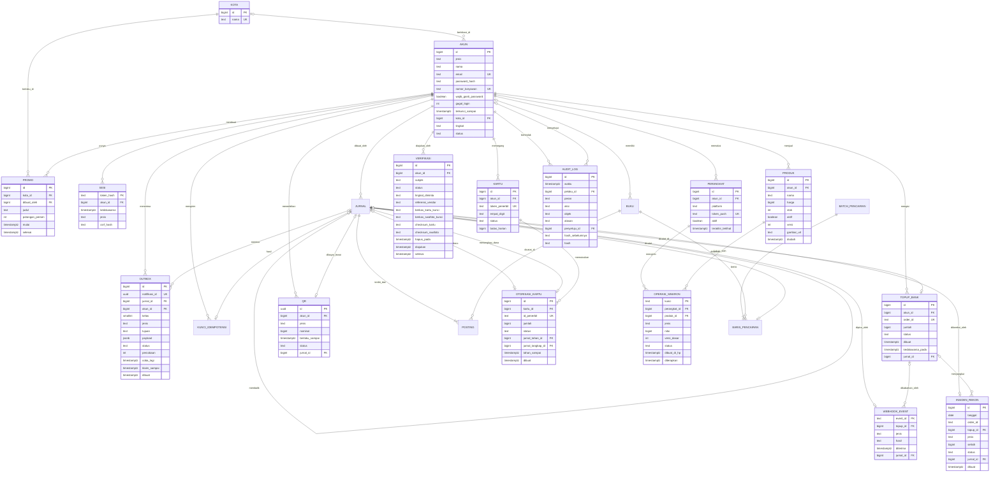

Draft otomatis, belum ditinjau pemilik

# Cerita Rekeningo · Tahap 4: Dibuka ke publik

Ditulis 2026-10-26 · draf sebelum lab Tahap 4 ada dan sebelum Tahap 3 selesai ditulis halamannya (tugas NASKAH-4, keputusan 1200 sampai 1204)

Ditinjau konsistensi pada 2026-10-26 (PR #379, keputusan 1205 dan 1206). ADR 34 dan ADR 42 disamakan dengan ADR 37: ledger dipanggil lewat API dengan Idempotency-Key, bukan satu transaction. Kunci ledger top-up satu bentuk (`order_id`), dan M34 pindah ke minggu 8. ADR 12 (tes contract di CI), ADR 22, ADR 25, dan ADR 26 dibaca ulang.

Dari hitungan: M31 memakai lima percobaan (ADR 25), bukan enam, jadi 1,74 dari 4 worker. Ambang pool memakai dua bentuk M18 Tahap 3 (±17,3 dan ±15,5 detik). M33 memakai 28 hari, dan ambang 5 detik di ADR 34 diberi pembandingnya. Dari sumber: jadwal retry gateway dibatasi ke kode status yang diulang lima kali, dan kalimat otorisasi kartu mengikuti dokumentasinya.

Dipangkas pada 2026-10-26 oleh tugas T4-siap (keputusan 1207 sampai 1209, usulan peninjau PR #379). Lab `t4-beban` dilipat ke `api-t4` sebagai target `make beban`, jadi M39 dan estimasi tidak punya lab sendiri, seperti M28 dan estimasi Tahap 3. Widget `W4-modul` diganti `banding` yang sudah ada. Lab `t4-infra` memakai OpenTofu dengan provider `random` dan `local`, bukan provider Docker. Hasilnya 11 lab dan dua widget baru (`W4-webhook`, `W4-breaker`). BFF terpisah tidak diubah di sini: pilihan draf 6 menunggu keputusan pemilik.

Disesuaikan dengan lab dan halaman Tahap 3 pada 2026-10-29 (KONSISTENSI-4, keputusan 1390 sampai 1392): 95 tambalan. Sumbernya 11 lab Tahap 4 (README, rekaman, dan temuan peninjau di PR #392 sampai #420), dan widget W4-webhook dan W4-breaker (PR #425 dan #426), `ERD4` (#419), halaman 3.1 sampai 3.32, dan keputusan Tahap 3. Tiap tambalan ada di tempatnya. Struktur bagian, nomor M29 sampai M39, nomor ADR 34 sampai 45, angka tabel beban, dan peta halaman tidak berubah. Bila angka naskah berbeda dari rekaman, tambalannya menulis nilai rekaman di sampingnya.

- Tahap 3, Latar, bagian 1 dan 6 (12): tim 13, halaman Tahap 3, nama tiga tim, dan ADR 22, 23, 25, 27, 28, 30, 31, 33.
- Angka beban, bagian 3 (5): satu λ, ambang dua pool 5, kapasitas 13,33, notifikasi 8,7 kali, koneksi 40.
- Skema 3b (6): `tujuan_bayar`, 22 tabel dari `ERD4`, bentuk akhir modul dan role, empat selisih blok mermaid.
- M29, M30, ADR 34, ADR 35, dan tabel Terjaga dan Rusak (11): sumber sel, balasan hilang, diparkir, `settlement` sesudah `expire`, key 24 jam, aturan koreksi, rotasi.
- M31 dan ADR 36 (7): lajur tanpa breaker, batas 60 detik, half-open, `tidak_pasti` per percobaan, 4xx, ambang ke-6, kelas queue.
- M32 dan ADR 37 (5): `TeksTopupLangsung`, `internal/modul/`, role monolith pewaris, anggaran 50 ms, kondisi yang terekam.
- M33 dan ADR 38 (5): angka Ilustrasi, "ikut transaction", ukuran saat unggah, nomor identitas, file ditimpa, bandwidth.
- M34 dan ADR 39 (7): 403 tanpa breaker, state IaC, pin ADR 31, OpenBao v2.7.2, mode dev, pemicu ADR 33.
- M35 dan ADR 40 (6): payload, kota merchant, laporan QR palsu, layar konfirmasi, dua pembayaran, CRC.
- M36 dan ADR 41 (9): kolom `galat`, resolver, 2 MiB, daftar alamat, nama dikenal, golang/go#80417 dan #79925, lab dipersempit.
- M37 dan ADR 42 (7): dua otorisasi berurutan, `lock_timeout`, hold yatim, flag di memori, batas harian, fail terbuka, penagihan.
- M38 dan ADR 43 (5): dua mode lab dan Dina, hak `api_t4`, "dua orang", rantai dan jangkar, MCP.
- ADR 44 (6): `--flatten-params`, cosign dan tag, pemindai gagal terbuka, Go 1.27.1, grype.
- Versi alat (4): Go, Redis, OpenBao, pipeline, OpenFeature.

## Kenapa dokumen ini ada

Naskah ini adalah source of truth Tahap 4, disimpan di repo sebagai `plan/CERITA-TAHAP-4.md`. Strukturnya sama dengan Tahap 2 dan 3: **PRD → fitur → pekerjaan teknis → inti teknis → masalah yang muncul pelan-pelan → konsep**. Halaman situs ditulis dari naskah ini. Penomoran melanjutkan Tahap 3: masalah M29 dan seterusnya (Tahap 3 berakhir di M28), ADR 34 dan seterusnya (Tahap 3 berakhir di ADR 33).

Seperti Tahap 3, naskah ini draf otomatis, bukan tulisan pemilik, dan ditulis sebelum tahap sebelumnya selesai. Bahannya naskah Tahap 1 sampai 3, PROPOSAL, `plan/RISET-TAHAP-4.md` (ID `R4-nn` menunjuk ke sana, termasuk R4-100 sampai R4-102 yang ditambahkan untuk naskah ini), dan catatan `plan/SETELAH-TAHAP-3.md`. Tugas `KONSISTENSI-4` mencocokkannya dengan Tahap 3 yang sebenarnya dan dengan lab Tahap 4. Pemilik meninjau di akhir.

Semua pihak ketiga di Tahap 4 adalah tiruan lokal di container lab: gateway pembayaran, layanan verifikasi identitas, penerbit kartu, dan tujuan di jaringan dalam. Merek nyata tidak dipakai. Standar publik (EMVCo untuk QR, RFC, OWASP, NIST) disebut sebagai sumber, tanpa klaim izin atau kepatuhan regulasi apa pun.

Pelajaran KONSISTENSI-3 mengubah cara naskah ini ditulis. Naskah Tahap 3 memerlukan 63 tambalan: 21 dari keputusan Tahap 2 dan 42 dari temuan lab dan widget (PR #360). Enam aturan berikut dipakai supaya kelas kesalahan yang sama tidak terulang.

1. **Satu angka, satu bentuk.** Angka beban dihitung sekali (tabel bagian 3), ditulis dengan nilai tepat dan satu pembulatan, lalu semua bagian memakai bentuk itu. Turunan dihitung dari angka yang tertulis. Besaran yang punya dua versi di registry atau naskah lama ditulis berdampingan dengan labelnya, tidak dipilih diam-diam.
2. **Kalimat rekaman menunggu rekaman.** Lab Tahap 4 belum ada. Naskah ini hanya memakai label Asumsi, Hitungan, Ilustrasi, atau sumber yang sudah dibuka. Apa yang harus dibuktikan lab ditulis sebagai pernyataan yang bisa gagal (bagian 4, tabel "Yang harus bisa dibuktikan lab"); bila lab membantahnya, naskah yang berubah.
3. **Klaim negatif menyebut lingkupnya.** "Tidak ada X" hanya untuk lab, tahap, atau file yang disebut.
4. **"Kapan salah" tidak bertentangan dengan pembandingnya sendiri.** Di Tahap 3, ambang "ratusan per detik" di ADR 23 sudah terlampaui oleh pembandingnya sendiri, ±231 per detik (20 juta job per hari). Setiap ambang di tabel ADR bagian 4 ditulis dengan satuan dan angka pembanding yang sama.
5. **Urutan commit, nomor urut, dan jam tidak diklaim di luar rekaman.** Naskah menyebut mekanismenya dan menandai angka kejadian sebagai Ilustrasi.
6. **ADR lama dibaca ulang terhadap PRD baru.** Syarat ADR sebelumnya yang menyebut Tahap 4 (ADR 12, 22, 25, 26, dan 32) diperiksa terhadap PRD v4 di bagian 1. Syarat yang sudah terpenuhi sejak PRD dibagikan ikut ditulis.

### Pilihan draf yang perlu dilihat pemilik

Tujuh pilihan berikut diambil tanpa bertanya, dengan opsi paling aman dan paling mudah dibatalkan. Masing-masing dicatat sebagai usulan perubahan cerita.

1. **Tim: 13 orang dalam tiga tim.** Jembatan 3.32 menulis 10 sampai 15 orang dalam tiga tim, dan PROPOSAL menulis 10 sampai 15. Registry `tahap[3].asumsi.tim` masih menulis "6–10 developer, 2 tim" dan halaman lama 8 orang (R4-38). Naskah ini memakai 13 (Pembayaran 5, Merchant 4, Platform 4, Asumsi cerita). `T4-siap` menyamakan registry. Registry kini menulis "13 developer, 3 tim" (keputusan 1207). Halaman 3.27, 3.29, dan 3.32 menulis "10 sampai 15 engineer dalam tiga tim", dan 13 berada di rentang itu (keputusan 1126). Halaman 3.5 masih menulis "6–10 developer dalam 2 tim" untuk Tahap 4; KONSISTENSI-4 menggantinya dengan 13 developer dalam tiga tim.
2. **Transaksi per user aktif per hari: 3.** Naskah Tahap 2 dan 3 memakai 3, registry `tahap[3].asumsi.trx` masih 2. Naskah ini mengikuti naskah sebelumnya, jadi ukuran data per tahun punya tiga besaran berlabel (bagian 3b). Koneksi database dihitung dengan semua suku Tahap 3 (instance × pool, worker, admin, reserved) ditambah pool pembayaran. Hasilnya 40, bukan 37 seperti di riset yang melewatkan satu suku. Registry `tahap[3].asumsi.trx` sudah 3 sejak T4-siap (keputusan 1207).
3. **Webhook ganda datang dari balasan yang hilang, bukan dari "dua kali dalam satu detik".** Gateway mengulang kiriman yang tidak dijawab 2xx dengan jeda menit (R4-08). Kasus M29 dan M30 memakai jadwal itu.
4. **Tidak ada pool habis kedua.** ADR 22 sudah menutup pemicunya: panggilan keluar di luar transaction dengan timeout 3 detik. Pool pembayaran 10 koneksi penuh dalam 10 ÷ 0,579 = ±17,3 detik bila gateway tidak pernah menjawab dan client terus menunggu. Bila client menyerah sesudah T detik, pool penuh hanya bila T > 9 ÷ 0,579 = ±15,5 detik (bentuk ambang M18 Tahap 3). Itu untuk satu pool 10; dua pool 5 memberi ±13,8 detik (bagian 3). Keduanya hanya bila client gateway tanpa timeout memegang koneksi database (Hitungan, Asumsi). Pemicu M31 adalah queue dan jumlah percobaan, bukan pool.
5. **Hosting terkelola tidak bisa direkam.** PostgreSQL terkelola, NAT cloud, dan secret manager penyedia hanya bisa dijelaskan. Lab memakai tiruan di Compose (PostgreSQL, SeaweedFS, OpenBao, OpenTofu dengan provider `random` dan `local`, proxy keluar) dan menandai sisanya Tidak dijalankan atau Ilustrasi. VPS kedua tetap tidak dibuat: ADR 33 menunda, dan ADR 39 menjawab sebagian titik gagal tunggal dengan layanan terkelola (data dan secret, bukan ketersediaan app).
6. **Login sosial, BFF terpisah, dan gRPC tidak jadi halaman.** Riset memasukkannya sebagai teknik, tetapi tidak ada fitur PRD v4 yang memaksanya. ADR 45 mencatat pemicunya. PROPOSAL "Enam tahap dalam satu tabel" menulis bentuk Tahap 4 sebagai "modular monolith + 1 service pembayaran + BFF". Naskah ini menunda BFF (R4-06: pola ini tidak cocok bila antarmuka memanggil hal yang sama). Pemilik memutuskan mana yang berlaku.
7. **QR memakai standar publik tanpa nama skema nasional.** Cerita memakai "QR Rekeningo" dengan format yang mengikuti EMVCo (R4-27, R4-101). Parameter CRC belum dibaca dari PDF EMVCo (R4-101, [perlu verifikasi]).

## Latar: dari enam kota ke publik

Uji coba enam kota lolos pada minggu ke-10 Tahap 3. Tutup buku bulan ketiga selesai kurang dari sehari dengan selisih Rp0, dan puncak beban 17,4 request per detik. Direksi Grup Lestari mendirikan **PT Rekeningo** (fiktif) supaya orang di luar Lestari bisa memakai Rekeningo. Lestari menjadi satu merchant dan satu pelanggan korporat untuk tunjangan makan.

Sasarannya 100.000 user terdaftar, 20% aktif tiap hari (Asumsi, registry), dan merchant di luar kampus. Frasa "uang elektronik publik" di naskah Tahap 1 tidak membawa klaim izin atau regulasi apa pun. Naskah ini juga tidak.

Tiga hal berubah sekaligus. Pertama, **uang datang dari luar**: user mengisi saldo dari rekening bank lewat gateway pembayaran, dan Rekeningo bukan lagi satu-satunya yang tahu kapan uang masuk. Kedua, **user tidak dikenal**: tidak ada HR Lestari yang menjamin siapa mereka, jadi identitas diverifikasi lewat layanan luar dan foto kartu identitas disimpan. Ketiga, **tim dan perusahaan berpisah dari Lestari**: tiga tim, infrastruktur sendiri, dan akses ke data yang harus bisa dipertanggungjawabkan.

Tahap 4 berangkat dari `api-t3` di akhir Tahap 3, bukan dari sistem yang sudah dibereskan. Halaman Tahap 3 sesudah 3.10 belum selesai saat naskah ini dibuat, jadi tidak diandalkan. Sejak 2026-10-28 ke-32 halaman Tahap 3 ada di main. Sembilan dari sebelas halaman ADR 22 sampai 32 menyebut Tahap 4 sebagai syarat, pemicu, atau revisi (pemindaian `situs/src/content/docs/tahap-3/`, keputusan 1125). Yang tercatat dari naskah Tahap 3 dan README lab `api-t3`:

- Satu VPS menjalankan dua instance API, satu worker, satu Redis, dan staging. Titik gagal tunggal itu diterima di ADR 26 dan ADR 33.
- Ledger dari Tahap 2 tetap satu-satunya tempat uang bergerak. Notifikasi lewat outbox dalam transaction yang sama dengan jurnal (ADR 23). Panggilan keluar tidak di dalam transaction dan memakai timeout 3 detik (ADR 22).
- Pengiriman at-least-once, maksimal 5 percobaan lalu dead-letter, penerima menyaring `notifikasi_id` (ADR 25). Kelas queue memisahkan bayar dan transfer dari promo (ADR 32).
- Idempotency-Key opsional di bayar, transfer, dan pesanan. App 1.0 dan 1.1 tanpa key tetap rentan terhadap M10.
- Satu-satunya pihak ketiga di `api-t3` dan lab Tahap 3 adalah layanan push tiruan. Belum ada pihak ketiga yang menggerakkan uang atau menerima data pribadi.
- Rate limit belum ada di `/perangkat`, `/pesanan`, `/promo`, dan `/sinkron` (README `api-t3`, bagian "Yang belum ada di lab ini"). Pendaftaran terbuka membuat celah itu relevan; PRD v4 mencatatnya sebagai risiko dan halaman 4.3 sebagai syarat. Lab `api-t4` menutup empat endpoint itu dan tiga endpoint publik baru (daftar, top-up bank, verifikasi) dengan token bucket di memori satu proses (Asumsi lab; `batas.txt`). Penghitung bersama lintas instance (ADR 27) belum dipasang pada endpoint baru.
- Load test kapasitas (ADR 21 aturan 5) Tidak dijalankan di Tahap 3, dan M28 menulis kapasitas belum diukur. Tahap 4 menambah beban berjadwal di lab `api-t4` (target `make beban`).

Tim tumbuh dari 4 menjadi 13 orang dalam tiga tim selama 12 minggu (Asumsi cerita): enam minggu pertama menerima engineer baru bertahap. **Tim Pembayaran** (5 orang, dipimpin Nadia) memegang gateway, top-up, rekonsiliasi, dan kartu. **Tim Merchant** (4 orang, dipimpin Wulan) memegang merchant luar, QR, katalog, dan dasbor web. **Tim Platform** (4 orang, dipimpin Bayu) memegang akun, identitas, outbox, infrastruktur, dan keamanan; Raka memegang paket inti app di dalamnya.

Yang tidak berubah: satu codebase Go untuk monolith, satu PostgreSQL, ledger dari Tahap 2. Yang baru: satu service pembayaran terpisah dan infrastruktur milik PT Rekeningo.

### Tokoh baru

| Tokoh | Siapa | Ingin | Kelemahan | Yang dibawanya ke cerita |
| --- | --- | --- | --- | --- |
| **Laras** | Security engineer yang bergabung di minggu 2. Sepuluh tahun audit konfigurasi dan uji penetrasi, belum pernah memegang sistem uang dari dalam. | Keamanan yang bisa dibuktikan, bukan dijanjikan | Menandai hampir semua temuan sebagai kritis, sehingga rilis yang aman ikut tertunda | Security review sebelum dibuka ke publik; sudut pandang pihak yang mencoba |
| **Ratih** | Analis risiko, memimpin tim risk (3 orang) dan memakai back office setiap hari. | Membekukan akun yang mencurigakan secepat mungkin | Percaya angka skor tanpa memeriksa buktinya, dan ingin akses ke semua data | Sudut pandang back office: limit, pembekuan, data identitas, audit |
| **Bu Marni** | Pemilik toko kelontong di seberang kampus, merchant luar pertama. | Dibayar tepat tanpa alat tambahan | Memasang satu stiker QR sejak hari pertama dan tidak memeriksanya lagi | Sisi merchant di luar Lestari |
| **Pihak yang mencoba** | Tidak dikenal. Memegang peran yang di Tahap 1 sampai 3 dipegang Dimas, sesuai naskah Tahap 1. | Mengambil uang atau data | Tidak diketahui; selalu mencoba bagian yang paling jarang diperiksa | Setiap adegan keamanan Tahap 4 |

Tokoh lama tetap:

- **Raka** memegang paket inti app dan masih menulis backend bila perlu.
- **Nadia** memimpin tim Pembayaran dan cenderung mengusulkan solusi yang terlalu berat, kali ini service per pihak ketiga.
- **Bayu** memimpin tim Platform dan masih menganggap bawaan komponen aman, kali ini bawaan layanan terkelola.
- **Wulan** memimpin tim Merchant dan masih menganggap data dari sistem sendiri aman ditampilkan.
- **Sinta** menulis PRD v4.
- **Budi** kini juga memakai Rekeningo di luar kampus, dengan uang dari rekening pribadinya.
- **Citra** mengisi saldo dari bank dan membayar patungan lewat QR.
- **Ani** satu dari ±60 warung Lestari, kini juga menerima QR.
- **Pak Hadi** menambah satu syarat: setiap rupiah dari luar cocok dengan catatan pihak yang mengirimnya.
- **Dimas** tidak muncul di Tahap 4. Peran "yang mencoba" diambil pihak tak dikenal, seperti ditulis naskah Tahap 1.

## 1. PRD v4 · Rekeningo dibuka ke publik

**Latar masalah.** Tahap 3 membuktikan notifikasi, katalog, dasbor, dan deploy tanpa jeda untuk 10.000 karyawan. Tiga kebutuhan belum terpenuhi: mengisi saldo dari bank, mengenali siapa pemakainya, dan menerima pembayaran di toko luar kampus. Ketiganya berlaku untuk orang di luar Lestari.

**Tujuan.** (1) PT Rekeningo berdiri sendiri: infrastruktur, kredensial, dan akses data terpisah dari Lestari. (2) Siapa pun dengan rekening bank mengisi saldo dan membayar di merchant luar. (3) Identitas user terverifikasi sebelum batas besar. (4) Tim risk bisa membekukan dan menelusuri akun, dan setiap akses staf tercatat.

**User.**

| User | Kebutuhan baru | Yang membuatnya berhenti memakai |
| --- | --- | --- |
| User umum (Budi dan Citra di luar kampus) | Mengisi saldo dari bank; membayar QR; kartu virtual | Saldo naik dua kali atau tidak naik; verifikasi yang gagal tanpa alasan; data yang bocor |
| Merchant luar (Bu Marni dan ±400 lainnya, Asumsi) | Menerima QR; kelola katalog; dicairkan ke rekening bank | Pembayaran yang tidak masuk laporan; QR yang bisa diganti orang |
| Warung Lestari (Ani dan ±59 lainnya) | Tetap seperti Tahap 3, ditambah QR | Notifikasi atau laporan yang terganggu urusan publik |
| Tim risk (Ratih) | Melihat akun dan verifikasi; menyetujui merchant; membekukan akun; mengubah batas | Data yang tidak cukup, atau akses yang tidak tercatat |
| Keuangan (Pak Hadi) | Rekonsiliasi harian dengan gateway; selisih bernomor | Selisih yang dikoreksi dengan tangan |
| Security reviewer (Laras) | Bukti, bukan janji, sebelum dibuka ke publik | Temuan yang ditutup dengan "sudah dibahas" |

**Ruang lingkup (publik, 100.000 user terdaftar, 20.000 aktif per hari, 13 orang, 12 minggu).**

| Prioritas | Fitur | Keterangan |
| --- | --- | --- |
| P0 | PT Rekeningo berdiri sendiri | Infrastruktur, kredensial, dan akses data milik PT, terpisah dari Lestari. Lestari menjadi satu merchant dan satu pelanggan korporat. Setiap akses staf ke data identitas tercatat |
| P0 | Top-up dari rekening bank lewat gateway | User memilih nominal, mendapat tujuan bayar dari gateway, membayar di app bank, dan saldo bertambah saat gateway memberi tahu. Gateway lambat atau mati tidak menahan bayar dan transfer antar akun. Selisih dengan laporan gateway tercatat sebagai insiden |
| P0 | Verifikasi identitas | Pendaftaran sendiri dan pemulihan akun memakai verifikasi yang sama: foto kartu identitas dan swafoto dikirim ke layanan verifikasi. Dua tingkat (Asumsi produk): belum terverifikasi, boleh top-up dan membayar QR dengan saldo paling banyak Rp1.000.000; terverifikasi, saldo paling banyak Rp10.000.000, boleh transfer dan memegang kartu. 10.000 akun Lestari ditandai terverifikasi lewat HR |
| P0 | QR untuk merchant di luar Lestari | Pembeli memindai QR merchant dan membayar dari saldo. Merchant diajukan, diverifikasi tim risk, dan dicairkan ke rekening bank lewat file seperti Tahap 2 |
| P1 | Kartu virtual | User terverifikasi menerbitkan kartu virtual dari saldonya untuk belanja online; penerbit kartu tiruan; batas per kartu; pembekuan dari app; rilis bertahap |
| P1 | Back office untuk tim risk | Lihat akun dan verifikasi, setujui merchant, bekukan akun, ubah batas dengan persetujuan dua orang; semua aksi tercatat |
| P2 | Ditunda ke v5 | Laporan merchant real-time, notifikasi massal skala besar, cicilan dan tabungan, API publik untuk POS |

**Bukan lingkup v4.** Pembayaran offline, pencairan merchant otomatis lewat bank (tetap file), tarik tunai, kartu fisik, multi-mata uang, dan klaim izin atau kepatuhan regulasi apa pun.

**Metrik keberhasilan (target, Asumsi).**

- 20.000 user aktif per hari (20% dari 100.000, registry).
- 99% top-up tercatat dalam kurang dari 5 menit sejak gateway mengirim kabar.
- 0 top-up tercatat dua kali; setiap selisih rekonsiliasi harian menjadi insiden bernomor yang ditutup dalam satu hari kerja.
- 90% verifikasi selesai dalam kurang dari 10 menit.
- 100% akses staf ke file dan data identitas tercatat di audit log.
- Deploy tanpa error yang terlihat user.

**Batasan.** 13 engineer dalam tiga tim selama 12 minggu. Infrastruktur baru milik PT, dengan anggaran naik untuk layanan terkelola (Asumsi). Semua pihak ketiga berupa tiruan lokal di lab. Security review oleh Laras lolos sebelum dibuka ke publik.

Aturan Pak Hadi dipertahankan dan diperluas: *"Setiap rupiah dari luar harus cocok dengan catatan pihak yang mengirimnya. Kalau tidak cocok, namanya insiden, bukan angka yang saya koreksi."*

**Risiko yang ditulis Sinta.** Rekeningo pertama kali menerima kabar dari luar yang menggerakkan uang, menyimpan data pribadi orang yang tidak dikenal, dan dikerjakan tiga tim sekaligus. Pendaftaran terbuka juga membuka endpoint yang belum punya rate limit (daftar, verifikasi, top-up).

**Pertanyaan terbuka di PRD.**

- Kalau gateway mengirim kabar dua kali, terlambat, atau tidak mengirim sama sekali, siapa yang tahu?
- Kalau tiga tim mengubah tabel yang sama, siapa yang tahu sebelum rilis?
- Kalau satu orang di dalam membaca data identitas, bagaimana ketahuan?

Ketiganya tidak dijawab PRD dan menjadi masalah terbesar Tahap 4.

Halaman 4.1 membuka jawaban tebakan di halaman 3.32 (dari ADR Tahap 3, mana yang pecah lebih dulu?). Satu VPS yang menyimpan semuanya adalah titik gagal tunggal yang sengaja diterima di ADR 26 dan ADR 33. Begitu uang publik masuk, titik itu menjadi masalah bisnis. ADR 39 menjawab sebagian dengan hosting terkelola: data, file, dan secret tidak lagi mati bersama satu VPS, sedangkan app tetap berhenti selama mesin diganti.

Tiga tim (Pembayaran: gateway dan kartu; Merchant: QR dan dasbor; Platform: sisanya) bentrok di satu codebase dan satu skema, dijawab batas modul di ADR 37. Jembatan 3.32 menulis "10 sampai 15 engineer dalam tiga tim" tanpa menamai ketiganya (keputusan 1126). Nama "gateway, kartu, dasbor" hanya ada di naskah Tahap 3 bagian 6. Gateway memanggil dari arah sebaliknya: webhook masuk yang menggerakkan uang tidak boleh diproses dua kali, dan ADR 34 menjawabnya. M28 sudah menulis bahwa ketiga hal itu belum pernah diuji.

Lima ADR sebelumnya menulis Tahap 4 sebagai batasnya, jadi syaratnya dibaca ulang terhadap PRD ini:

- ADR 12 (Tahap 1) menunda service kedua sampai beberapa tim bentrok di satu repo dan menulis "Tahap 4: modular monolith dan satu service pembayaran". Ia juga memperingatkan bahwa pembayaran yang menyentuh dua service tidak lagi bisa dibungkus satu transaction. Tabel "Yang juga sengaja belum" di halaman itu juga menjadwalkan tes contract OpenAPI di CI untuk Tahap 4, dan ADR 44 mengerjakannya.
- ADR 22 menyebut otorisasi kartu sebagai kasus "bila panggilan luar harus atomik dengan uang".
- ADR 25 menulis "bila penerima menggerakkan uang (webhook Tahap 4)": penerima wajib idempoten dengan key.
- ADR 26 menulis "bila VPS mati ... dijawab Tahap 4".
- ADR 32 menulis "bila tim lebih dari ±8 orang".

PRD v4 memenuhi kelimanya sejak dibagikan. Tiga tim memenuhi ADR 12 dan 32. Kartu virtual memenuhi ADR 22, webhook yang menggerakkan uang memenuhi ADR 25, dan uang publik di satu VPS memenuhi ADR 26. Halaman 4.1 menulisnya sebagai syarat yang sudah terpenuhi, bukan sebagai kejutan.

Pembacaan ulang KONSISTENSI-4 menambah tiga hal:

- **ADR 23, 27, 28, 30, dan 31.** ADR 23 menulis syarat yang sama dengan ADR 25: penerima sistem lain yang menggerakkan uang. Halaman 3.32 menghitungnya sekali lewat ADR 25 (keputusan 1127). ADR 27, 28, 30, dan 31 menyebut Tahap 4 dengan syarat sendiri (keputusan 1125). Syaratnya berurutan: endpoint publik tanpa rate limit, puncak request yang naik, back office yang menampilkan data user luar, dan pindah hosting yang mengganti server tepi. Lab `api-t4` menutup yang pertama untuk satu proses, dan tiga lainnya Tidak dijalankan di lab Tahap 4.
- **ADR 33.** Pemicu VPS kedua ditulis sebagai waktu pulih atau jendela kehilangan data yang lebih besar dari yang bisa diterima Pak Hadi atau PRD. PRD v3 dan PRD v4 tidak menulis batas itu. Backup `pg_dump` harian berjendela sampai 24 jam: ±7.500 transaksi uang di Tahap 3 dan ±65.000 per hari di Tahap 4 (60.000 + 5.000; Hitungan atas Asumsi). PostgreSQL terkelola (ADR 39) bisa menggantikan jadwal itu, tetapi jendelanya menurut penyedia belum diketahui, jadi pemicu ADR 33 tetap pertanyaan terbuka.
- **ADR 22.** Janjinya, "halaman Tahap 4 yang membahas panggilan luar yang harus selesai sebelum uang bergerak", dijawab dua ADR. ADR 36 menjawab panggilan keluar ke gateway dan vendor, dan ADR 42 menjawab otorisasi kartu. Aturan 1 ADR 22 (panggilan luar di luar transaction) tetap berlaku di kedua jalur. Pengaman lain yang diminta ADR 22 untuk kartu adalah hold di ledger, `lock_timeout`, dan batas waktu untuk seluruh panggilan.

Kartu virtual membalik arah ADR 22: penerbit yang memanggil Rekeningo, jadi tidak ada panggilan keluar di dalam transaction, dan ADR 42 menulis akibatnya. Peringatan ADR 12 tentang dua service menjadi bagian ADR 37. Sesudah service pembayaran terpisah, jurnal dibuat lewat API ledger dengan Idempotency-Key. Itu mengubah cara ADR 34 dan ADR 42 dibaca, karena jurnal tidak lagi di transaction yang sama.

## 2. Dari fitur ke pekerjaan teknis

| Fitur | Di app | Di backend | Di database | Konsep yang akan dibutuhkan |
| --- | --- | --- | --- | --- |
| PT berdiri sendiri | Tidak ada | Infrastruktur milik PT: PostgreSQL terkelola, penyimpanan objek, secret manager; IaC; alamat keluar tetap; modul dengan schema dan role sendiri; akses staf tercatat | Schema dan role per modul | Modular monolith; IaC; secret manager; CODEOWNERS; audit log |
| Top-up dari bank | Pilih nominal; tampilkan tujuan bayar dan status; notifikasi saat masuk | Service pembayaran: buat top-up di gateway dengan kunci; terima webhook; cek status; rekonsiliasi harian | `topup_bank`, `webhook_event`, `insiden_rekon` | Webhook masuk; idempotensi; retry dan circuit breaker; rekonsiliasi |
| Verifikasi identitas | Ambil foto kartu dan swafoto; kirim; tunggu status | Unggah ke penyimpanan objek; queue per vendor; panggil layanan verifikasi; tetapkan tingkat | `verifikasi`, kolom `akun.tingkat` | Object storage; presigned URL; queue per vendor; minimisasi data |
| QR merchant luar | Pindai QR; layar konfirmasi nama merchant; di app merchant: tampilkan QR | QR statis dan dinamis; pengajuan dan verifikasi merchant; bayar QR = jurnal internal; katalog impor dengan URL gambar | `qr`, `akun` jenis merchant | QR; konfirmasi; SSRF |
| Kartu virtual | Terbitkan; lihat empat digit terakhir; bekukan | Otorisasi real-time dari penerbit; dana tertahan; clearing; kill switch | `kartu`, `otorisasi_kartu` | Otorisasi lawan clearing; hold di ledger; feature flag |
| Back office tim risk | Tidak ada (web internal) | Peran dan persetujuan dua orang; audit log; agen baca saja | `audit_log` | Audit log berantai hash; insider; MCP |
| 13 engineer, tiga tim | Paket app per tim; client API dibuat dari contract | Modul dan service pembayaran; CODEOWNERS; ADR wajib; pipeline per modul: contract, SAST, SBOM, tanda tangan | Migration per modul | Modular monolith; supply chain; rilis bertahap |

Dari tabel ini lahir pertanyaan pertama Tahap 4, sebelum satu baris kode: **kabar dari luar adalah klaim, bukan fakta**. Cara pertama yang ditulis tim memperlakukannya sebagai fakta, dan itu bagian 3.

## 3. Inti teknis Tahap 4 · Kabar dari luar adalah klaim, bukan fakta

Ini jantung Tahap 4. Pertanyaannya dirumuskan di minggu 0, sebelum masalah apa pun muncul. Di Tahap 3, uang ada di PostgreSQL dan kabar keluar dari sana. Di Tahap 4 arahnya bertambah.

"Budi mengisi Rp200.000 dari rekening banknya" berarti uang masuk karena **kabar dari gateway**. Kabar itu bisa datang dua kali, terlambat, tidak berurutan, palsu, atau tidak datang sama sekali.

Rekeningo tidak bisa membuat gateway ikut COMMIT atau ROLLBACK.

Tiga hal harus selalu benar:

1. Uang dari luar dicatat satu kali, walau kabarnya datang dua kali, terlambat, atau tidak berurutan (syarat Pak Hadi).
2. Kabar dari luar dipercaya hanya sesudah dicek: tanda tangan atas byte mentah, dan status ke sumbernya bila ada keraguan (syarat Laras).
3. Pihak luar yang lambat atau mati tidak menahan pembayaran antar akun (syarat Direksi, lanjutan Tahap 3).

**Versi pertama (minggu 2).** Nadia dan satu engineer baru menulis handler paling pendek. `POST /webhooks/pembayaran` mengurai JSON. Bila `status` bernilai `settlement`, handler memanggil ledger untuk jurnal top-up sebesar jumlah di isi kabar, menandai `topup_bank` sebagai `dibayar`, lalu membalas 200.

Tidak ada tabel event, tidak ada pemeriksaan tanda tangan (gateway tiruan di staging belum menandatangani), dan client ke gateway dibuat dari contoh di dokumentasi.

Di staging urutan ini tampak cukup.

| Kejadian | 1. Dicatat satu kali | 2. Dipercaya setelah dicek | 3. Tidak menahan yang lain |
| --- | --- | --- | --- |
| Kiriman normal, sekali | Terjaga | Rusak: POST dari siapa pun diterima | Terjaga: selesai dalam milidetik |
| Kiriman yang sama datang lagi sesudah balasan hilang | Rusak: jurnal kedua dengan jumlah yang sama | Tidak berlaku | Terjaga |
| Kabar `menunggu` datang sesudah `dibayar` | Rusak: status mundur ke `menunggu`, lalu kiriman `dibayar` berikutnya dikredit lagi | Tidak berlaku | Terjaga |
| Gateway tidak pernah mengirim | Rusak: uang ada di bank, tidak ada jurnal, tidak ada yang tahu | Tidak berlaku | Terjaga |
| Isi diubah atau kiriman lama diputar ulang | Rusak: jumlah di isi dipercaya | Rusak: tanpa tanda tangan dan tanpa batas waktu | Terjaga |
| Gateway tidak menjawab saat Rekeningo membuat top-up | Tidak berlaku | Tidak berlaku | Bergantung pada timeout: ADR 22 menahannya di 3 detik, dan pengulangannya perlu pengaman sendiri (ADR 36) |

Handler versi pertama (mode rentan `webhook-v1`) terekam di `api-t4/output/rentan.txt` bagian A: POST dari siapa pun diterima, jumlah di isi dipercaya, dan status mundur ke `menunggu`. Dua jurnal untuk satu pembayaran juga ada di `t4-webhook/output/ganda.txt` A, dan gateway yang tidak mengirim di `rekon.txt` A.

Dua hal tidak terekam. Kalimat "kiriman `dibayar` berikutnya dikredit lagi" hanya benar menurut kode `webhookV1`, yang menjurnal tiap settlement. Dan "selesai dalam milidetik" belum diukur; hanya batas p95 di `make beban`. Versi ADR 34 terekam di `urutan.txt` F1: `menunggu` sesudah `dibayar` diparkir dan status tidak mundur.

Halaman inti ini menanam tiga pertanyaan. Di minggu 2 Laras bertanya siapa yang boleh mengirim ke alamat itu. Pak Hadi bertanya bagaimana ia tahu satu pembayaran di bank sama dengan satu jurnal di ledger. Bayu bertanya apa yang terjadi bila gateway mati sehari.

Jawabannya ada di M29 sampai M31.

**Yang pembaca lakukan.** Widget cari-bug: tandai baris di handler versi pertama yang melanggar satu dari tiga hal itu, lalu lihat tabel di atas terisi.

**Yang dipelajari Raka dengan susah payah.** Pola ini muncul lagi di layanan verifikasi (M31), file identitas (M33), dan penerbit kartu yang memanggil Rekeningo dengan tenggat 2 detik (M37). Aturannya sama untuk semuanya: PostgreSQL tetap satu-satunya source of truth, dan pihak ketiga hanya memberi klaim. Klaim itu dicek, lalu dicatat sekali: dalam transaction yang sama dengan efeknya selama satu proses, atau lewat Idempotency-Key sesudah service pembayaran terpisah (ADR 37).

### Angka beban Tahap 4 (Asumsi, rumus ditulis)

Masukan registry: 100.000 user, aktif 20%, 60 request per user aktif, faktor puncak 10, unggahan 2.000 per hari, 500 KB per file. Transaksi uang 3 per user aktif per hari mengikuti naskah Tahap 2 dan 3; registry `tahap[3].asumsi.trx` dulu 2 dan `T4-siap` sudah mengubahnya menjadi 3 (keputusan 1207). Pembaca boleh mengganti angkanya. Satu nilai dipakai di seluruh naskah: transaksi uang puncak 6,94 per detik.

| Besaran | Rumus | Masukan | Hasil |
| --- | --- | --- | --- |
| Request per detik | aktif × request ÷ 86.400 × puncak | 20.000 × 60 = 1,2 juta per hari | 13,9 rata-rata dan 138,9 puncak (Tahap 3: 17,4; naik 7,98 kali, dibulatkan 8 kali) (R4-30) |
| Transaksi uang internal (bayar, transfer, QR) | aktif × 3 ÷ 86.400 × puncak | 60.000 per hari (Tahap 3: 7.500) | 0,694 rata-rata dan 6,94 puncak (Tahap 3: 0,868; naik 8,0 kali); jendela makan siang (80% dalam 90 menit): 8,89 (R4-31) |
| Top-up dari bank | aktif × 0,25 ÷ 86.400 × puncak | 0,25 top-up per user aktif per hari (Asumsi), 5.000 per hari | 0,058 rata-rata dan 0,579 puncak (dibulatkan 0,58). Kiriman webhook paling banyak 6 per kejadian (jadwal tiruan), jadi batas atas 3,47 per detik bila semua kiriman gagal (R4-33, R4-08) |
| Gateway di dalam request | L = λ × W | λ = 0,579; W = 0,3 / 2 / 3 / 15 / 30 detik | L = 0,17 / 1,16 / 1,74 / 8,68 / 17,4. Pool pembayaran 10 (2 instance × 5, Asumsi) penuh dalam ±17,3 detik (10 ÷ 0,579) bila gateway tidak pernah menjawab dan client terus menunggu. Client yang menyerah sesudah T detik membuatnya penuh hanya bila T > 9 ÷ 0,579 = ±15,5 detik (jadwal kedatangan tetap, rumus M18 Tahap 3). Keduanya hanya bila tiap panggilan ke gateway memegang koneksi database dan tidak punya timeout. Dengan timeout 3 detik (ADR 22): L = 1,74 (R4-32, R4-36) |
| Notifikasi uang dan pemakaian worker | (60.000 + 5.000) ÷ 86.400 × 10 lawan c ÷ t | c = 4, t = 0,3 detik (Asumsi Tahap 3), kapasitas 13,3 per detik | 7,52 per detik puncak = 56% kapasitas (Tahap 3: 0,868 ÷ 13,3 = 6,5%); makan siang: 65.000 × 0,8 ÷ 5.400 = 9,63 per detik = 72% |
| Pengumuman ke 100.000 HP | 100.000 ÷ 13,3 | satu queue urut waktu | ±7.500 detik, 125 menit (Tahap 3: 750 detik untuk 10.000). Hitungan dari c ÷ t, Tidak dijalankan |
| Verifikasi identitas | pendaftar ÷ 86.400 × puncak | 1.000 pendaftar per hari (Asumsi) | 0,116 per detik puncak. Bila vendor mati dan tiap pekerjaan memakai 5 percobaan × 3 detik (ADR 25): 0,116 × 15 = 1,74 dari 4 worker, dan 1,74 + 2,26 (notifikasi uang, baris di atas) = 4,0 dari 4 worker (Hitungan, Asumsi) |
| Unggahan file | unggahan × KB | 2.000 per hari (1.000 pendaftar × 2 file) × 500 KB | 0,231 per detik puncak = 116 KB per detik; 1 GB per hari (R4-35) |
| Otorisasi kartu | otorisasi ÷ 86.400 × puncak | 1.000 per hari (5% dari 20.000 aktif × 1; Asumsi) | 0,116 per detik puncak; L untuk tenggat 2 detik = 0,23 |
| Koneksi database | instance × pool + pembayaran + worker + admin + reserved | 2 × 10 + 2 × 5 + 4 + 3 + 3 | 40 dari 100 (Tahap 3: 30; riset menulis 37 karena satu suku kurang) (R4-36) |
| Ukuran tim | tiga tim | 5 + 4 + 4 | 13 orang (Asumsi cerita; jembatan 3.32: 10 sampai 15) (R4-38) |

Dua kesimpulan dari tabel ini menentukan seluruh tahap. Pertama, beban 138,9 request per detik naik 8 kali, sedikit di bawah pertumbuhan user 10 kali karena user aktif turun dari 25% ke 20%. Tidak ada komponen di tabel ini yang melewati kapasitasnya karena banyaknya; worker paling tinggi, 72% pada jendela makan siang.

Yang berbahaya dari pihak ketiga adalah **lama dan tidak pasti**, bukan banyak: Little's Law (R2-35) dan hasil yang tidak diketahui sesudah timeout. Kedua, yang tumbuh paling cepat bukan request tetapi file (365 GB per tahun lawan 10,95 GB posting) dan pekerjaan worker (6,5% menjadi 56%).

Kapasitas satu server tetap belum terukur. Target `make beban` di lab `api-t4` memberi beban berjadwal 138,9 request per detik dan mengukur koneksi dan p95 di laptop lab. Itu bukan kapasitas produksi, dan kata "tidak sesak" di naskah ini berarti L kecil terhadap pool di laptop lab.

Penyesuaian angka (KONSISTENSI-4; hitungan diulang dari angka yang tertulis di tabel):

- λ top-up tepatnya 20.000 × 0,25 ÷ 86.400 × 10 = 0,5787 per detik; naskah memakai 0,579 dan RISET 0,58. L = 1,74 berlaku untuk W = 3 detik (timeout ADR 22). R4-32 memakai W = 5 detik (L = 2,9), yaitu besaran ambang 5 detik ADR 34.
- Ambang client menyerah ±15,5 detik (9 ÷ 0,579) berlaku untuk satu pool 10. Dua pool 5 menerima masing-masing setengah laju (0,289 per detik), jadi ambangnya (5 − 1) ÷ 0,289 = ±13,8 detik. Penuh tanpa client menyerah tetap 5 ÷ 0,289 = ±17,3 detik (Hitungan, Asumsi).
- Kapasitas worker 4 ÷ 0,3 = 13,333 per detik; "13,33" dan "13,3" adalah pembulatannya. Turunannya memakai nilai tepat: 7,52 ÷ 13,333 = 56,4% (dibulatkan 56%), dan makan siang 9,63 ÷ 13,333 = 72,2%. Lalu 100.000 ÷ 13,333 = 7.500 detik; dengan 13,3 hasilnya 7.519.
- Pemakaian worker untuk notifikasi uang naik 8,7 kali (7,52 ÷ 0,868), sedikit di atas naik request dan transaksi uang (8,0 kali).
- Koneksi database 40 dari 100 adalah Hitungan dari pool Asumsi (2 × 10 + 2 × 5 + 4 + 3 + 3). Lab `api-t4` (satu proses, pool 10) tidak mengukurnya: rekaman `beban.txt` A menulis koneksi paling banyak ≤ 10, batas yang dipasang pool sendiri. Yang membuktikan pool tidak sesak adalah p95 di bawah 500 ms (batas lab, Asumsi) dan jadwal yang tidak tertinggal lebih dari 100 ms.

## 3b. Skema data: ERD dari Tahap 3 ke Tahap 4

Aturan sama dengan Tahap 2 dan 3: ERD tahap sebelumnya selalu tampil berdampingan dengan tahap sekarang, dari skema lab. Halaman skema Tahap 4 memakai widget ERD bertumbuh dengan Tahap 3 di kiri dan Tahap 4 di kanan, dibuat dari skema lab `api-t4`. Diagram di bawah disusun dari skema Tahap 3 di lab (`labs/api-t3`) dan rancangan Tahap 4. Kolom persisnya harus dicocokkan dengan skema lab `api-t4`; kalau berbeda, skema lab yang benar dan diagramnya yang diperbarui.

### Apa yang berubah dan kenapa

| Tahap 3 | Tahap 4 | Alasan | Masalah atau syarat |
| --- | --- | --- | --- |
| (tidak ada) | `topup_bank` (akun, `order_id` di gateway UNIK, jumlah, status: menunggu, dibayar, kedaluwarsa, gagal, tidak_pasti; kedaluwarsa_pada, `tujuan_bayar` dari gateway; jurnal_id boleh kosong) | Satu top-up satu baris; status hanya maju | M29, M30 |
| (tidak ada) | `webhook_event` (`event_id` kunci utama, topup_id boleh kosong, jenis, hasil: diproses, ganda, diparkir, ditolak; jurnal_id boleh kosong) | Event yang sama tidak diproses dua kali: kunci utama dan jurnal dalam satu transaction | M29 |
| (tidak ada) | `insiden_rekon` (tanggal, order_id, topup_id boleh kosong, jenis: tidak_di_ledger, tidak_di_gateway, jumlah_beda; selisih; status: terbuka, selesai; jurnal_id boleh kosong) | Selisih dengan laporan gateway bernomor, tanpa koreksi tangan | M30 |
| (tidak ada) | `verifikasi` (akun, subjek: `pemakai` atau `merchant`, status, tingkat_diminta, referensi_vendor, kunci objek dan checksum untuk kartu identitas dan swafoto, hapus_pada) | File di penyimpanan objek; database hanya menyimpan kunci dan checksum | M31, M33 |
| (tidak ada) | `qr` (akun merchant, jenis: statis atau dinamis, nominal boleh kosong, berlaku_sampai boleh kosong, status, jurnal_id boleh kosong) | QR dinamis sekali pakai dengan nominal terikat | M35 |
| (tidak ada) | `kartu` (akun, `token_penerbit` UNIK, empat_digit, status, batas_harian) | Nomor kartu penuh tidak disimpan; hanya token dan empat digit (Asumsi desain) | M37 |
| (tidak ada) | `otorisasi_kartu` (kartu, `id_penerbit` UNIK, jumlah, status: ditahan, ditangkap, dibalik, kedaluwarsa, ditolak; jurnal_tahan_id dan jurnal_tangkap_id boleh kosong; tahan_sampai) | Otorisasi dikenali ulang, dan dana tertahan adalah jurnal di ledger | M37 |
| (tidak ada) | `audit_log` (waktu, pelaku, peran, aksi, objek, alasan, penyetuju boleh kosong, hash_sebelumnya, hash) | Append-only berantai hash; role aplikasi tanpa UPDATE dan DELETE | M38 |
| `akun` (`jenis`: karyawan, warung, admin, sistem, hr) | `akun` + `tingkat` (belum, terverifikasi) dan `status` (aktif, dibekukan); `jenis` + `pemakai`, `merchant`, `risk` | Tingkat menentukan batas; pembekuan oleh tim risk. Nilai enum baru ditandai oasdiff sebagai perubahan yang bisa merusak client berenum tertutup, seperti `hr` di Tahap 3 | M35, M38 |
| `outbox` (`kelas`, `jenis`) | `outbox` + `tujuan` (push, verifikasi) | Lajur per tujuan; pekerjaan verifikasi memakai mekanisme klaim yang sama dengan notifikasi | M31 |
| `produk` | `produk` + `gambar_url` | Merchant luar mengimpor katalog dengan URL gambar | M36 |
| `kunci_idempotensi` berumur 24 jam | Tetap (ADR 14). Service pembayaran mengirim `order_id` (top-up) atau `id_penerbit` (otorisasi) sebagai Idempotency-Key ke ledger | Idempotensi melewati batas service | M29, M37 |
| Semua tabel di satu schema | 22 tabel dibagi per modul dalam schema dan role sendiri (tabel di bawah) | Batas modul dijaga database, bukan ingatan | M32 |

Pembagian modul dan schema berikut adalah rancangan (Asumsi desain); lab `t4-modul` menentukan bentuk akhirnya. Jumlahnya 22 tabel: 14 dari Tahap 3 dan 8 baru, sesuai baris Tahap 4 di tabel pertumbuhan Tahap 2 ("±22, dibagi per modul").

Hitungan `ERD4` dari katalog lab (PostgreSQL 17.11) memberi 22 tabel dan 35 foreign key, jadi "±22" di naskah Tahap 2 dan 3 dan di halaman 3.5 tepat. Bentuk akhir dari `t4-modul` sama dengan tabel ini. Isinya enam schema berawalan `t4m_` (nama schema global di database lab), 22 tabel (6, 4, 1, 4, 5, 2), dan 21 foreign key lintas modul, semuanya ke `akun` (14) atau `jurnal` (7). Satu role per modul ada dan dites. Proses monolith memakai satu role `t4m_monolit` yang mewarisi lima role modul, dan satu pool per modul belum dibangun.

| Modul (schema) | Tabel | Jumlah |
| --- | --- | --- |
| `ledger` | `buku`, `jurnal`, `posting`, `kunci_idempotensi`, `batch_pencairan`, `baris_pencairan` | 6 |
| `akun` | `akun`, `sesi`, `perangkat`, `kota` | 4 |
| `identitas` | `verifikasi` | 1 |
| `merchant` | `produk`, `promo`, `operasi_sinkron`, `qr` | 4 |
| `pembayaran` (service sendiri) | `topup_bank`, `webhook_event`, `insiden_rekon`, `kartu`, `otorisasi_kartu` | 5 |
| `platform` | `outbox`, `audit_log` | 2 |

### Pertumbuhan skala database, Tahap 3 sampai 5

Rumus dan angka mengikuti naskah Tahap 2 bagian 3b dan naskah Tahap 3. *Posting per tahun = transaksi per hari × 2 × 365*, ±250 byte per posting termasuk index. Tahap 1, 2, dan 6 ada di naskah Tahap 2.

| Tahap | User | Tabel inti | Baris terbesar per tahun | Ukuran per tahun | Perubahan skema penting |
| --- | --- | --- | --- | --- | --- |
| 3 | 10.000 | 14 | `posting` ±5,5 juta | ±1,4 GB | Outbox, perangkat, katalog dan stok, promo, operasi sinkron |
| 4 | 100.000 | 22, dibagi per modul | `posting` ±44 juta (20.000 × 3 × 2 × 365 = 43,8 juta) | ±11 GB (10,95 GB) | Pembayaran gateway, webhook masuk, verifikasi identitas, kartu virtual (token), audit log berantai |
| 5 | 1 juta | ±30, sebagian di service terpisah | `posting` ±440 juta | ±110 GB | Partisi `posting` per bulan, snapshot saldo, read replica, cicilan, event untuk notifikasi massal |

Ukuran data tahun Tahap 4 punya tiga besaran, semuanya Asumsi. Halaman lama Tahap 4 menulis ±4,4 GB (rumus registry dengan 2 transaksi per user: 20.000 × 2 × 365 × 300 B = 4,38 GB). Rumus registry dengan 3 transaksi memberi 6,57 GB (20.000 × 3 × 365 × 300 B), dan rumus ledger memberi 10,95 GB. Ketiganya satu orde besaran. `T4-siap` sudah menyamakan registry ke 3 transaksi (keputusan 1207).

Tabel baru Tahap 4 kecil, kecuali file dan `outbox` tanpa retensi. `webhook_event` 5.000 × 365 × 400 B ≈ 730 MB per tahun, dan 60 MB dengan retensi 30 hari (400 B per baris adalah Asumsi).

`audit_log` 2.000 aksi per hari (±10 staf × 200 aksi, Asumsi) × 365 × 400 B ≈ 292 MB. `verifikasi` 1.000 × 365 × 500 B ≈ 183 MB (500 B Asumsi). `outbox` 65.000 × 365 × 300 B ≈ 7,12 GB tanpa pembersihan, dan 65.000 × 7 × 300 B ≈ 136,5 MB dengan retensi 7 hari.

**File 2.000 × 500 KB × 365 = 365 GB per tahun.** Itu sekitar 33 kali posting ledger (365 ÷ 10,95) dan 56 kali rumus registry dengan 3 transaksi (365 ÷ 6,57). Karena itu file tidak masuk tabel (M33).

Pola yang ditanam: mulai Tahap 4, database tumbuh karena **volume dan batas tim**, dan baru di Tahap 5 tabel terbesar perlu dipartisi.

### Spesifikasi untuk Claude Code

Blok di bawah dibaca mesin. Diagram di situs dibuat dari skema lab yang sesungguhnya, lalu dicocokkan dengan blok ini. Entitas tanpa kolom tidak berubah dari Tahap 3.

Selisih blok mermaid di atas dengan skema lab (`ERD4`, `python3 tools/erd.py --naskah 4`; skema lab yang benar, dan blok tidak diubah karena salinan tangannya di `labs/api-t4/run.py` ikut menjaganya):

- `outbox.tujuan` dan `produk.gambar_url` ada di kolom terakhir tabelnya di lab; blok menaruhnya di tengah.
- `topup_bank.tujuan_bayar` ada di lab dan tidak di blok, padahal teks menulis user mendapat tujuan bayar dari gateway. `audit_log.hash` UNIQUE di lab, tanpa tanda di blok.
- `webhook_event.jurnal_id` dan `insiden_rekon.jurnal_id` tanpa UNIQUE di lab: satu jurnal boleh dirujuk banyak baris, sedangkan blok menggambar satu-ke-satu.
- Nilai `jenis` yang bertambah di CHECK lab: `buku` (`pemakai`, `merchant`, `bank`, `dana_tertahan`, `settlement_kartu`) dan `jurnal` (`topup_bank`, `kartu_tahan`, `kartu_tangkap`); pembayaran QR memakai jenis jurnal `bayar`. Blok hanya menyebut akun sistem dana tertahan.

Versi dasar lab (R4-01, dicek 2026-10-25; dicek ulang 2026-10-27 sampai 2026-10-29 oleh lab dan KONSISTENSI-4, selisihnya tertulis di tiap butir):

- Database dan bahasa: PostgreSQL 17.11 (terbaru 18.6); Go: toolchain lab go1.27.1 (kepala semua rekaman) dengan dokumentasi dibaca di go1.27.3 (go.dev/dl, 2026-10-27). Lab Tahap 3 tetap memakai pgx v5.11.0 dan Redis 8.10.2. README `api-t4` menyebut kontainer `redis:8-alpine` yang berjalan; 8.10.3 sudah ada di Docker Hub (2026-10-27), dan rekaman tidak menulis versi Redis. Caddy v2.11.7 tidak dipakai lab Tahap 4: proxy keluar `t4-infra` adalah biner Go (`cmd/proxykeluar`).
- Penyimpanan dan rahasia: SeaweedFS 4.51 (Apache-2.0, endpoint S3 lokal; rilis 2026-10-25, dicek 2026-10-26), OpenBao v2.7.2 (MPL-2.0; R4-01 menulis v2.7.1, patch keamanan v2.7.2 terbit 2026-10-26 dan dipakai lab), OpenTofu v1.13.2 (MPL-2.0).
- Pipeline: oasdiff v1.34.1, oapi-codegen v2.8.1, openapi-generator v7.26.0, gosec v2.30.0, govulncheck v1.9.0, syft v1.55.0, grype v0.121.0, cosign v3.1.4, dan `registry:3` (distribution v3.1.2). oasdiff v1.35.0 terbit 2026-10-28; `labs/api-t4/kontrak.sh` memakai image berdigest tanpa versi tertulis.
- Pengaman: sony/gobreaker v2.4.0; OpenFeature go-sdk v1.20.0 dan flagd core v0.19.1 (spesifikasi belum 1.0); MCP spesifikasi 2026-07-28 dan go-sdk v1.8.0. OpenFeature hanya dibaca dan tidak dipakai lab: kill switch lab adalah flag di memori proses. Spesifikasi MCP itu benar untuk server HTTP tanpa sesi, yang dipakai lab; opsi bawaan SDK dengan sesi menegosiasikan 2025-11-25 (`mcp.txt` A). File LICENSE go-sdk v1.8.0 mencatat peralihan dari MIT ke Apache-2.0, dan menjadikannya dasar server produk adalah keputusan pemilik.
- Hanya dibandingkan, tidak dijalankan: Terraform v1.17.0 dan Vault v2.2.1 (lisensi BSL), cosign keyless (butuh layanan publik), provenance SLSA, atestasi app, dan semua layanan terkelola.

## 4. Masalah yang muncul, pelan-pelan

Pola sama dengan Tahap 1 sampai 3. Gejala yang dilihat orang, lalu yang Raka, Nadia, atau Bayu kira, lalu yang sebenarnya, konsep, keputusan, dan yang pembaca lakukan. Angka di kolom gejala berlabel Ilustrasi kecuali ada hitungan yang ditulis; mekanismenya yang direkam lab, bukan angkanya. Pernyataan yang harus dibuktikan lab ada di tabel "Yang harus bisa dibuktikan lab" sesudah tabel ADR.

| # | Minggu | Gejala yang dilihat orang | Yang dikira | Yang sebenarnya | Konsep yang lahir | Keputusan (ADR) |
| --- | --- | --- | --- | --- | --- | --- |
| M29 | 3 | Budi mengisi Rp200.000 dari rekening banknya. Saldo di app naik dari Rp50.000 ke Rp450.000. Paginya rekonsiliasi Pak Hadi menunjukkan satu pembayaran di laporan gateway dan dua jurnal top-up di ledger (Ilustrasi; rekaman lab memakai saldo awal Rp250.000 dari data awal Tahap 3, jadi Rp250.000 ke Rp650.000). | Gateway mengirim dua kali karena bug; Raka mengusulkan menghapus jurnal kedua dengan tangan | Gateway menjamin at-least-once dan mengulang kiriman yang tidak dijawab 2xx dengan jeda menit, bukan "dua kali dalam satu detik" (R4-08). Balasan 200 yang pertama tidak sampai ke gateway (di lab, tiruan gateway memutus koneksi begitu byte pertama balasan tiba, sesudah COMMIT; memutusnya lebih awal membatalkan konteks permintaan dan bisa mem-rollback transaction, alasan desain yang tidak diukur), jadi kiriman dengan `event_id` yang sama datang lagi. Handler versi pertama menambah saldo dari isi tiap kiriman, tanpa tabel event dan tanpa status bersyarat. Dua kiriman yang tiba hampir bersamaan juga lolos dari cek-lalu-tulis, dan kabar `menunggu` yang datang sesudah `dibayar` memundurkan status (R4-10). Handler tidak memeriksa tanda tangan, jadi isi yang diubah dan kiriman lama yang diputar ulang ikut diterima (R4-08) | **Webhook masuk**; at-least-once dari sisi gateway; `event_id` unik dalam transaction yang sama dengan jurnal; tanda tangan atas byte mentah dengan batas waktu; status hanya maju; balas 2xx sesudah COMMIT (R4-08, R4-09, R4-10) | ADR 34: tabel `webhook_event` dengan `event_id` kunci utama dalam satu transaction dengan jurnal; tanda tangan atas byte mentah, toleransi 5 menit (Asumsi); status hanya maju; kabar yang tidak berurutan diparkir, dan dicek ke gateway hanya bila top-up masih `menunggu` atau `tidak_pasti` |
| M30 | 4 | Sabtu malam sampai Minggu pagi. Minggu 09.40 Citra menulis ke CS: Rp500.000 sudah keluar dari rekeningnya, tetapi saldo di app belum naik dan status top-up "menunggu" sejak Sabtu malam. Senin pagi laporan settlement gateway berisi tujuh top-up yang tidak punya jurnal (Ilustrasi). | Gateway lambat; Raka: tunggu sehari | Sabtu 18.00 gateway tiruan merotasi secret webhook dan langsung menandatangani dengan secret baru. Service pembayaran masih memeriksa dengan secret lama, jadi setiap kiriman ditolak dengan 401 sampai Bayu menyamakannya Minggu 09.10. Dokumentasi gateway nyata lain memberi masa tumpang tindih sampai 24 jam saat rotasi; tiruan lab tidak (R4-08). Gateway mengulang 5 kali dengan jeda antar percobaan 2, 10, 30, 90, dan 210 menit, total 342 menit atau ±5,7 jam, lalu berhenti. Jadwal tiruan mengikuti dokumentasi satu gateway nyata, yang mengulang lima kali untuk kode status di luar daftar khusus (2xx tanpa ulangan, 400 dan 404 dua kali, 500 sekali, 503 empat kali), sehingga penolakan 401 memakai jadwal lima kali. Gateway itu juga menggeser tiap percobaan sedikit secara acak; tiruan lab tidak (R4-08). Kiriman yang pertama kali datang sebelum ±03.30 (09.10 − 5,7 jam; Hitungan) sudah kehabisan jadwal sebelum secret disamakan, jadi tidak datang lagi. Webhook adalah satu-satunya jalan kabar, dan tidak ada jalan kedua. Kasus terkait yang direkam lab: `settlement` yang datang sesudah `expire` diparkir, status tetap `kedaluwarsa`, dan uang di bank tidak tercatat; hanya rekonsiliasi yang menemukannya (`tidak_di_ledger`) dan job koreksi tidak menutupnya, karena PRD v4 belum memutuskan apakah pembayaran sesudah kedaluwarsa dikredit, dikembalikan, atau ditahan (`urutan.txt` F3) | Webhook bukan satu-satunya sumber: cek status ke gateway; **rekonsiliasi** laporan settlement dengan jurnal; status top-up punya umur; selisih menjadi insiden bernomor; rotasi secret dengan masa tumpang tindih (R4-08, R4-10, R4-11) | ADR 35: dua lapis. Job cek status untuk top-up `menunggu` yang melewati batas, dan rekonsiliasi harian dengan laporan gateway. Selisih menjadi `insiden_rekon`; koreksi lewat jurnal normal oleh job idempoten (ADR 19), bukan UPDATE pada posting atau `buku.saldo_cache` |
| M31 | 5 | Sabtu 09.10 sampai 12.40. Pendaftar baru melihat "Sedang diverifikasi" yang tidak berubah, lalu 146 pendaftar berstatus "Verifikasi gagal" padahal foto mereka jelas. Ratih membuka daftar tinjauan dan melihat daftar panjang yang sama (Ilustrasi). | Foto buram atau pendaftar salah mengambil foto | Layanan verifikasi tiruan tidak menjawab selama 3 jam 30 menit (Ilustrasi). Pekerjaan verifikasi memakai mekanisme klaim outbox yang sama dengan notifikasi, dan aturan ADR 25 berlaku: 5 percobaan dengan backoff, lalu dead-letter. Tiap pekerjaan menghabiskan lima percobaan dan mati karena vendor, bukan karena pendaftar. Jumlahnya 0,0116 per detik × 12.600 detik = 146 pada laju rata-rata (Hitungan). Tiap percobaan menahan satu worker 3 detik (timeout ADR 22), jadi pada laju puncak 0,116 × 5 × 3 = 1,74 dari 4 worker terpakai untuk pekerjaan yang pasti gagal, dan bersama notifikasi uang (2,26 dari 4 worker pada puncak, bagian 3) 4,0 dari 4 (Hitungan, Asumsi). Tidak ada yang menghentikan percobaan saat vendor jelas mati, dan tidak ada yang mengantrekan ulang sesudah vendor pulih (`lajur.txt` A: semua pekerjaan habis sebelum vendor pulih). Angka c = 4 dan t = 3 detik terukur di lab (`worker.txt`, t sebagai batas waktu client); 0,116 per detik, 7,52 per detik, dan 0,3 detik tetap Asumsi | **Timeout**, retry dengan kunci idempotensi; **circuit breaker** (closed, open, half-open); lajur queue per vendor yang dijeda, bukan dead-letter; status "belum pasti"; isolasi kegagalan tanpa satu service per vendor (R4-07, R4-09, R4-29) | ADR 36: semua client keluar lewat satu fungsi pembuat dengan timeout 3 detik; kunci idempotensi dari id internal; jalur sinkron memakai breaker per vendor, jalur queue menjeda lajur per `tujuan` tanpa menghitung percobaan; hasil timeout bernilai `tidak_pasti`, bukan gagal |
| M32 | 6 | Kamis 15.20 tim Merchant merilis. 15.22 tombol "Terima top-up" memunculkan kesalahan dan notifikasi "Rp200.000 masuk" tidak muncul di HP penerima. Rollback selesai 15.58 (Ilustrasi). Tim Pembayaran: "Kami tidak mengubah apa pun." | Rilis tim Pembayaran yang rusak; Nadia memeriksa commit timnya sendiri | Tim Merchant mengganti nama kolom `akun.nama` menjadi `akun.nama_tampil` lewat migration. Modul pembayaran membaca `akun.nama` dengan SQL langsung untuk teks notifikasi (di lab, kode top-up api-t4 tidak membaca kolom itu: `TeksTopupLangsung` adalah kode lab yang ditulis seperti uraian ini, jadi bagian tanpa batas adalah Ilustrasi mekanisme dengan kode dan database nyata, `batas.txt`). Tes tiap tim lolos karena tes pembayaran memakai data tiruan, bukan skema tim lain. Folder migration dipakai bersama tanpa pemilik, dan yang meninjau perubahan itu anggota tim Merchant sendiri. ADR 17 (expand lalu contract) sudah ada, tetapi tidak ada mesin yang memaksanya lintas tim | **Modular monolith**; batas modul dipaksa compiler (`internal/`) dan database (schema dan role per modul); **CODEOWNERS** dan review wajib; ADR wajib untuk perubahan lintas modul; satu service pembayaran karena kredensial gateway dan audit (R4-02, R4-03, R4-04, R4-05, R4-28) | ADR 37: modular monolith dengan batas modul; service pembayaran terpisah; schema dan role per modul; CODEOWNERS; ADR wajib untuk perubahan lintas modul |
| M33 | 7 | Uji pulih mingguan di staging (ADR 32) selesai dalam 3 jam 40 menit; tiga minggu lalu 12 menit. Sabtu disk staging penuh dan pemulihan berhenti di tengah (Ilustrasi). Bayu: "Backup yang belum pernah dipulihkan belum dihitung." | Disk staging terlalu kecil; tambah disk | Foto kartu identitas dan swafoto disimpan di kolom `bytea` karena "ikut transaction dan ikut backup" (pilihan minggu 3). 2.000 unggahan × 500 KB = 1 GB per hari, jadi sesudah 28 hari (minggu 3 sampai minggu 7, pada laju penuh) ±28 GB file lawan ±0,84 GB posting (43,8 juta ÷ 365 × 28 × 250 B; Hitungan, Asumsi). Backup dan uji pulih mengangkut data yang 97% isinya file, bukan data transaksi (28 ÷ 28,84 = 97,1%; Hitungan dari Asumsi). Angka 3 jam 40 menit, 12 menit, dan disk penuh tetap Ilustrasi: lab merekam rasio ukuran (dump terkompresi ±1,1 kali ukuran file, dump teks 2,0 kali, lawan di bawah 0,01 untuk penyimpanan objek), bukan waktu (`ukuran.txt`). Alasan "ikut transaction" tidak dibuktikan atau dibantah lab: penyimpanan di lab, termasuk `bytea`, menulis dengan satu pernyataan di luar transaction pengajuan | **Object storage**; kunci objek dan checksum di database, file di luar; presigned URL (bearer token yang punya umur); minimisasi dan retensi data identitas (R4-12, R4-16, R4-35) | ADR 38: file di penyimpanan objek; unggah lewat presigned PUT berumur pendek; unduh hanya lewat server yang menulis audit; file identitas dihapus 30 hari sesudah verifikasi selesai (Asumsi produk); ukuran dan checksum diperiksa sesudah unggah |
| M34 | 8 | Senin 07.50, hari pertama sesudah cutover akhir pekan ke infrastruktur PT. Semua pendaftar baru melihat "Verifikasi gagal"; ±42 pendaftar per jam mencoba lagi (Hitungan: 1.000 ÷ 24). Log vendor menolak dengan 403. Laras: "Ini bukan pemadaman." (Ilustrasi) | Vendor mati lagi; M31 terulang | Rekeningo pindah ke akun cloud PT, dan alamat keluarnya berubah. Layanan verifikasi tiruan hanya menerima permintaan dari alamat IP yang didaftarkan, dan alamat baru belum didaftarkan; pendaftaran alamat butuh dua hari kerja (Asumsi). Breaker ADR 36 tidak terbuka: 403 adalah jawaban 4xx dan ADR 36 menghitungnya sukses, jadi delapan pekerjaan menghabiskan 40 percobaan dan delapan pengajuan `gagal` (`alamat.txt` C). Breaker bawaan pustaka terbuka sesudah enam penolakan dan pekerjaan menunggu, tetapi tidak memperbaiki penyebabnya: sesudah alamat didaftarkan tujuh dari delapan pekerjaan lulus, dan satu mati karena ambang 6 lebih tinggi daripada batas percobaan 5. Pemeriksaan sesudahnya menemukan dua hal lain dari pindahan yang sama: nilai secret ikut tertulis di state IaC (R4-20; terekam untuk `random_password`, variabel, dan data source `local`, `state.txt` A dan C; provider Vault atau OpenBao Tidak dijalankan [perlu verifikasi]), dan staging memakai kunci API gateway produksi (Ilustrasi; lab merekam pemindai atas dua file contoh, bukan kejadiannya). Pindahan juga mengganti server tepi dan mungkin kunci TLS-nya, jadi pin ADR 31 harus ditinjau ulang sebelum pindah (halaman 3.25; lab Tahap 4 tidak menjalankannya) | **Alamat keluar tetap** (proxy keluar atau NAT dengan IP tetap); **secret manager** dan rotasi tanpa deploy; **IaC** dan state yang berisi secret; secret staging dan produksi terpisah (R4-13, R4-20) | ADR 39: layanan terkelola milik PT (PostgreSQL, penyimpanan objek, secret manager); IaC dengan OpenTofu; alamat keluar tetap yang didaftarkan sekali; rotasi lewat secret manager. Ini menjawab sebagian titik gagal tunggal ADR 26: data dan secret, bukan ketersediaan app |
| M35 | 8 | Rabu. Bu Marni mengeluh: tiga pelanggan bilang sudah membayar Rp35.000, Rp48.000, dan Rp22.000, dan tidak ada yang masuk laporannya. Di app Budi tercatat "Berhasil: Toko Sumber Rejeki, Rp35.000". Stiker QR di kasir Bu Marni bukan lagi stikernya (Ilustrasi). | App Rekeningo salah mencatat | Pihak yang mencoba menempelkan stiker QR statis miliknya di atas stiker Bu Marni. Miliknya merchant sah yang terverifikasi dengan identitasnya sendiri, jadi pembayaran valid: jurnal seimbang, merchant aktif, saldo cukup. Payload QR memuat CRC di tag 63, tetapi CRC mendeteksi salah baca, bukan penggantian: CRC tidak memakai kunci rahasia, jadi pelaku menghitung CRC untuk payload miliknya (R4-101; Hitungan). Layar konfirmasi versi pertama hanya bertanya "Bayar?" dengan nama merchant berhuruf kecil, dan Budi tidak membandingkannya dengan papan toko. Layar itu tidak ada di lab: yang terbukti hanya bahwa nama di payload bisa berbeda dari nama yang dijawab server bila payload dipalsukan (`statis.txt` C) | **QR statis lawan dinamis** (tag 01 bernilai 11 atau 12); CRC bukan autentikasi; layar konfirmasi dengan nama terverifikasi; batas nominal QR statis; pelaporan dan pembekuan merchant (R4-27, R4-101) | ADR 40: QR dinamis per transaksi untuk merchant dengan layar kasir, berlaku 5 menit (Asumsi); QR statis tetap untuk toko kecil dengan batas Rp200.000 per transaksi (Asumsi produk) dan layar konfirmasi nama terverifikasi; laporan QR palsu membekukan merchant lebih dulu, memeriksa kemudian |
| M36 | 9 | Senin. Ratih meninjau merchant baru dan melihat kolom "pratinjau gambar" toko "Toko Andalan" berisi teks JSON dengan kata `penyimpanan-internal`, bukan gambar. Laras menemukan hal yang sama dalam security review (Ilustrasi). | Gambar rusak atau file CSV salah | Merchant luar mengimpor katalog dari CSV dengan kolom `gambar_url`, dan server mengunduh URL itu untuk membuat thumbnail. Pihak yang mencoba mengisi alamat di jaringan dalam (nama layanan penyimpanan objek di container). Server memintanya dengan hak jaringan dalam, dan pesan kesalahan menampilkan sebagian isi respons. Di api-t4 isi respons versi rentan muncul di kolom `galat` baris impor, bukan di kolom `pratinjau`. Pemeriksaan teks atas URL ("tidak boleh mengandung localhost") dilewati dengan nama atau bentuk alamat lain, dan redirect dari alamat luar ke alamat dalam tidak diperiksa (R4-14). Bentuk yang lolos bergantung resolver platform (resolver sistem macOS lawan resolver Go murni di biner Linux statik), jadi halaman tidak menulis bentuk tertentu sebagai pasti tanpa label platform | **SSRF**; allowlist bila tujuan dikenal, validasi alamat saat dial (`Dialer.ControlContext`), redirect dimatikan, batas ukuran dan waktu; deny-list string hanya pilihan terakhir (R4-14) | ADR 41: satu fungsi unduh: hanya https; resolusi DNS lalu pemeriksaan alamat di `ControlContext`; redirect dimatikan; 2 MiB dan 3 detik; pesan kesalahan tanpa isi respons |
| M37 | 10 | Budi menerbitkan kartu virtual; saldonya Rp100.000. Ia membeli barang Rp80.000 di dua toko online dalam beberapa detik, dan keduanya disetujui. Esok harinya clearing kedua ditolak ledger karena saldo tidak boleh negatif, dan Pak Hadi menemukan Rp80.000 yang sudah disetujui kepada toko tanpa saldo yang menutupinya (Ilustrasi). | Bug di penerbit kartu | Handler otorisasi versi pertama memeriksa saldo lalu menjawab setuju tanpa menahan dana: cek-lalu-tulis seperti M9. Keserentakan bukan syaratnya: dua otorisasi berurutan juga disetujui keduanya, karena tidak ada yang mengubah saldo yang dibaca berikutnya (`otorisasi.txt` A; di lab Rp240.000 disetujui lawan saldo Rp100.000, dan angka Rp80.000 naskah tetap Ilustrasi). Ledger menjaga saldo tidak negatif saat clearing, yang datang berjam-jam kemudian, padahal persetujuan sudah diberikan dan tidak bisa ditarik. Penerbit memberi tenggat 2 detik (tiruan lab mengikuti dokumentasi satu penerbit); bila jawaban terlambat, penerbit memutuskan menurut aturan timeout yang dipasang, bukan menurut Rekeningo (R4-100) | **Otorisasi lawan clearing**; dana tertahan sebagai jurnal di ledger; `lock_timeout` lebih pendek dari tenggat penerbit; reversal dan kedaluwarsa hold; kill switch dan rilis bertahap lewat feature flag (R4-100, R4-21, R4-22) | ADR 42: otorisasi menahan dana dalam satu transaction (jurnal ke akun dana tertahan), id penerbit unik, `lock_timeout` 1 detik; hold kedaluwarsa 7 hari (Asumsi); kill switch dan rilis bertahap 1%, 5%, 25%, 100% (Asumsi) |
| M38 | 11 | Budi menerima pesan dari orang tak dikenal yang menyebut nama lengkap dan nomor identitasnya. Pak Hadi bertanya: siapa yang membuka data Budi dalam 30 hari terakhir? Tidak ada yang bisa menjawab (Ilustrasi). | Layanan verifikasi yang bocor; Ratih: "Kami hanya melihat data bila perlu" | Back office versi pertama memakai satu akun bersama untuk tim risk, dan log aplikasi biasa mencatat sebagian aksi tetapi tidak pembacaan file. Lab memerankannya dengan dua mode: tanpa audit tidak mencatat apa pun, dan log biasa mencatat semua aksi (termasuk membuka file) tanpa hash; "sebagian" tidak direkam (`rantai.txt` A dan B). Pemilik data di rekaman adalah Dina (akun 40001), bukan Budi. Engineer membaca tabel `verifikasi` lewat role pemilik schema, yang melewati semua pembatasan dan tidak meninggalkan catatan. Bahkan bila log ada, baris log biasa bisa diubah atau dihapus oleh siapa pun yang punya akses tulis. Sumber pesan ke Budi tidak pernah dibuktikan. Yang terbukti: Rekeningo tidak bisa menjawab pertanyaan Pak Hadi, dan jawaban "tidak ada" sama nilainya dengan "tidak tahu" | **Insider**; peran dan persetujuan dua orang; **audit log append-only berantai hash**; jangkar hash di luar database; agen AI baca-saja (MCP) tanpa meneruskan token; data user sebagai input tak tepercaya bagi agen (R4-24, R4-26, R4-102) | ADR 43: peran `cs`, `risk`, `keuangan`, dan `admin-sistem`; ubah batas dan buka blokir butuh dua orang; audit log berantai dengan jangkar harian di luar database; akses langsung ke database hanya lewat role baca per modul dengan sesi tercatat; agen hanya baca |
| M39 | 12 | Uji coba publik lolos: 100.000 user terdaftar, dan rekonsiliasi harian selisih Rp0 atau insiden tertutup dalam satu hari kerja selama 14 hari berturut-turut (target, Asumsi). Sinta datang dengan PRD v5: skala nasional, merchant massal, cicilan dan tabungan, laporan merchant real-time, notifikasi massal, API publik untuk POS (Ilustrasi). | Perlu server lebih besar, Kubernetes, atau satu service per modul | Puncak 138,9 request per detik (naik 8 kali), 6,94 transaksi uang per detik, worker notifikasi 56% terpakai (naik dari 6,5%), pengumuman ke 100.000 HP butuh 125 menit (semua Hitungan, Asumsi). Di lab `api-t4` (`make beban`), koneksi dan p95 diukur di laptop; kapasitas produksi belum diukur. Yang belum pernah diuji: laporan merchant dan transaksi di satu database, satu worker untuk notifikasi massal, dan 13 orang menjadi 20 sampai 40 di satu repo (PROPOSAL, tahap 5) | Estimasi Tahap 4 → 5; **Tim 4** retrospektif | ADR 45 "Sengaja belum dilakukan": tanpa service per modul, Kubernetes, gRPC, read replica, BFF terpisah, login sosial |

Fitur PRD v4 yang memicu tiap masalah:

- M29, M30: top-up dari rekening bank lewat gateway (P0).
- M31: verifikasi identitas (P0).
- M32: batasan tiga tim dan 13 orang, serta PT berdiri sendiri (P0): kredensial gateway dan data kartu butuh batas yang bisa diaudit.
- M33: verifikasi identitas (P0), karena file yang diunggah.
- M34: PT berdiri sendiri (P0) dan verifikasi identitas (P0).
- M35: QR untuk merchant di luar Lestari (P0).
- M36: QR untuk merchant di luar Lestari (P0), karena merchant luar membawa katalog sendiri.
- M37: kartu virtual (P1).
- M38: back office (P1) dan "setiap akses staf ke data identitas tercatat" (P0).
- M39: PRD v5, bukan fitur v4.
- ADR 44 (halaman 4.26, bukan halaman masalah): lahir dari M32 dan M34. M32: rilis tim Merchant lolos karena tes contract lintas modul belum ada di CI. M34: kunci gateway produksi ada di staging. Batasan PRD yang ikut: security review Laras sebelum dibuka ke publik.

### ADR yang lahir di Tahap 4

Setiap ADR ditulis dengan tiga opsi atau lebih, pre-mortem, dan "kapan keputusan ini salah", sesuai skill analisis-kritis. Ambang di kolom "Kapan salah" memakai satuan dan pembanding yang sama dengan tabel angka beban di bagian 3. Tabel ini hanya acuan untuk penulis halaman.

| ADR | Keputusan | Opsi yang ditimbang selain pilihan | Kapan salah | Sumber |
| --- | --- | --- | --- | --- |
| 34 | Tanda tangan HMAC-SHA256 diperiksa atas byte mentah sebelum JSON diurai, dengan toleransi waktu 5 menit (bawaan satu gateway nyata, R4-08; Asumsi untuk tiruan). `webhook_event.event_id` kunci utama diisi dalam transaction yang sama dengan jurnal top-up selama ledger satu proses (sampai ADR 37), lewat `INSERT ... ON CONFLICT DO NOTHING`: nol baris berarti ganda, balas 200 tanpa jurnal. Balas 2xx hanya sesudah COMMIT. Status top-up hanya maju, kabar yang datang mundur diparkir, dan dicek ke gateway di luar transaction hanya bila top-up masih `menunggu` atau `tidak_pasti` (top-up `dibayar` atau `kedaluwarsa` tidak ditanyakan: jawaban gateway tidak bisa mengubah statusnya; `urutan.txt` F1 sampai F3). Idempotency-Key ke ledger = `order_id`: satu jurnal per top-up, lewat webhook atau job cek status (ADR 35); `event_id` hanya kunci `webhook_event`, karena gateway nyata kadang mengirim dua Event berbeda untuk satu kejadian (R4-08). Sesudah ADR 37, ledger dipanggil lewat API di luar transaction pembayaran (ADR 22) dengan key itu, lalu `webhook_event` dan `topup_bank` ditulis dalam satu transaction dan 2xx dibalas sesudah COMMIT; bila proses mati di antaranya, kiriman ulang menghasilkan jurnal yang sama | Cek-lalu-tulis berdasarkan status top-up tanpa tabel event (ditolak: M29, dua kiriman bersamaan lolos; `ganda-serentak.txt`); balas 2xx dulu lalu antre ke worker (dianjurkan untuk pemrosesan berat, R4-08; pada 0,579 top-up per detik queue tambahan tidak membeli apa pun); token statis tanpa timestamp (tidak menahan kiriman lama yang diputar ulang) | Bila pemrosesan satu kabar melebihi 5 detik (sepertiga dari timeout 15 detik satu gateway nyata, R4-08): balas-dulu-lalu-antre menjadi benar. Bila gateway tidak mengirim `event_id` yang stabil: kunci diganti hash isi. Bila gateway mengulang lebih lama dari 24 jam (umur Idempotency-Key, ADR 14; satu gateway nyata sampai 3 hari, R4-08): key ledger sudah habis dan hanya status `topup_bank` yang menahan jurnal kedua, tetapi itu benar hanya bila transaction pembayaran pernah selesai. Bila proses mati di antara ledger dan transaction itu, status masih `menunggu`, dan kiriman ulang sesudah key habis menjurnal lagi: saldo naik dua kali (`t4-modul`, `proses-mati.txt` C, jam ledger diperankan; +23 jam satu jurnal, +25 jam dua). `RekonHarian` api-t4 hanya membaca jurnal yang dipegang `topup_bank`, jadi jurnal kedua itu tidak menjadi insiden. Penutup yang mungkin: key top-up tidak kedaluwarsa selagi `topup_bank` menunggu, atau rekonsiliasi menjumlahkan semua jurnal per order (keputusan pemilik). Pembanding: pada puncak 0,579 top-up per detik, W = 5 detik memakai L = 2,9 koneksi bila tiap kabar memegang satu koneksi. Pada batas atas 3,47 kiriman per detik (semua kiriman gagal dan diulang) L = 17,4 melewati pool 10, dan pool penuh sejak W > 9 ÷ 3,47 = ±2,6 detik, jadi ambang 5 detik berlaku untuk laju puncak, bukan untuk badai ulang (Hitungan, Asumsi) | R4-08, R4-09, R4-10 |
| 35 | Dua lapis. Job cek status: top-up `menunggu` lebih dari 30 menit (Asumsi) ditanyakan ke gateway lewat job idempoten (ADR 19), dan hasil `dibayar` dikredit lewat jurnal normal dengan Idempotency-Key = `order_id`. Rekonsiliasi harian: laporan settlement gateway dibandingkan per `order_id` dengan jurnal, dan tiga jenis selisih (tidak_di_ledger, tidak_di_gateway, jumlah_beda) menjadi `insiden_rekon` bernomor yang dibaca Keuangan. Tidak ada koreksi dengan UPDATE pada posting atau `buku.saldo_cache`. Rotasi secret memakai masa tumpang tindih: dua secret diterima sampai rotasi selesai, dan itu hanya menolong bila secret manager ditulis lebih dulu dan service sudah membacanya sebelum penanda tangan beralih; urutan terbalik memberi 401 selama satu jeda baca (`t4-infra`, `rotasi.txt` C dan D). Aturan koreksi per jenis insiden adalah pilihan lab (Asumsi; README `t4-webhook`): `tidak_di_ledger` dikredit bila top-up `menunggu` atau `tidak_pasti` dan jumlahnya sama; `jumlah_beda` dikredit bila selisih positif; `tidak_di_gateway` dibalik lewat jurnal pembalik hanya bila gateway menjawab bukan settlement dan saldo cukup. Selisih negatif atau pembalikan yang membuat saldo negatif tetap terbuka bagi tim risk dan Keuangan | Percaya webhook saja (M30); polling semua top-up tiap menit (tidak menjawab selisih jumlah atau biaya); koreksi tangan oleh Keuangan (aturan Pak Hadi melarangnya) | Bila gateway tidak menyediakan laporan atau cek status per order: tidak ada pembanding, lapis ini tidak bisa dibangun. Bila selisih harian lebih dari 20 baris (Asumsi; pembanding 5.000 top-up per hari, jadi 0,4%): angka itu menandakan penyebab sistematis, bukan insiden tunggal. Sesudah jurnal pembalik, `topup_bank.status` tetap `dibayar` dan rekonsiliasi membandingkan jumlah jurnal asal tanpa pembaliknya, jadi settlement yang datang lagi sesudah kredit dibalik dijawab `ganda` dan tidak terlihat sebagai selisih (Tidak dijalankan; butuh status baru atau rekonsiliasi atas jumlah bersih, keputusan pemilik). Rotasi karena rahasia terlanjur terbaca pihak lain baru selesai sesudah versi lama dokumen di secret manager dihancurkan (`destroy`): KV v2 menyimpan versi lama, dan token baca-saja service masih membacanya (`rotasi.txt` C) | R4-08, R4-10, R4-11, R2-07, R2-31 |
| 36 | Satu fungsi pembuat client untuk semua panggilan keluar, dengan timeout 3 detik (ADR 22). Kunci idempotensi dari id internal pada setiap panggilan yang mengubah keadaan (R4-09). Jalur sinkron (user menunggu): breaker per vendor dengan bawaan sony/gobreaker v2.4.0 (lebih dari 5 gagal berturut-turut, open 60 detik, satu permintaan di half-open, R4-07; `breaker.txt` merekam open pada 59,999 detik dan half-open pada 60,001 detik, batas tepat 60 detik hanya dibaca dari kode v2.4.0); respons 4xx dihitung sukses bagi breaker supaya permintaan yang salah tidak membukanya. Pekerjaan yang dijawab 4xx tetap diulang lima kali (`lajur.txt` E: 34 permintaan untuk 10 pengajuan). Pembacaan harfiah itu juga menghitung 401, 403, 408, dan 429 sebagai sukses, sehingga breaker tidak terbuka atas penolakan alamat (M34, `alamat.txt` C); usul lab `t4-infra`: 401 dan 403 dihitung gagal, 400 dan 422 tetap sukses. Jalur queue: breaker menjeda klaim lajur per `tujuan`, dan percobaan tidak dihitung saat lajur dijeda; itu benar hanya selama breaker terbuka, karena permintaan percobaan di half-open memakai percobaan pekerjaan terdepan (pada outage 12.600 detik dengan Timeout 60 detik: 210 permintaan percobaan, sampai 42 dari 146 pekerjaan mati sebelum vendor pulih; Hitungan atas angka naskah, tidak dijalankan, perilakunya dipaku tes Go). Breaker jalur sinkron tidak dipasang di lab (breaker lajur mati bawaan, flag `-breaker`): Tidak dijalankan. Timeout menghasilkan status `tidak_pasti`, ditentukan lewat cek status atau webhook. `tidak_pasti` berlaku per percobaan: sesudah percobaan kelima pekerjaan dead-letter dan pengajuan berstatus `gagal`, padahal vendor menyimpan objeknya (`retry.txt` D); job pemeriksa status vendor belum ada. Breaker melengkapi ADR 22 (yang menandai breaker Tidak dijalankan), dan lajur yang dijeda tidak menaikkan hitungan percobaan ADR 25 | Retry bebas tanpa kunci (ditolak: M29 dan M30); breaker di semua jalur termasuk queue (kurang cocok bila queue sudah punya dead-letter, R4-07); satu service per vendor (Segment: 140+ service, ditolak, R4-29) | Bila vendor hanya punya satu endpoint kritis tanpa alternatif: breaker hanya mempercepat kegagalan. Bila breaker menghitung semua error sebagai gagal (bawaan `IsSuccessful`, R4-07): ia terbuka karena permintaan buruk. Pembanding: 0,116 verifikasi per detik puncak, yang tanpa breaker memakai 1,74 dari 4 worker (5 percobaan × 3 detik) dan 4,0 dari 4 bersama notifikasi uang. Ambang breaker (kegagalan ke-6) lebih tinggi daripada batas percobaan (5), jadi pekerjaan yang dicoba satu per satu menghabiskan lima percobaan sebelum breaker terbuka: satu dari sepuluh `gagal` (`lajur.txt` B); dengan kapasitas 4 dan banyak pekerjaan bersamaan tidak ada yang mati (`lajur.txt` C). Kelas queue hanya mengatur urutan klaim; percobaan yang menggantung menahan slot sampai timeout (`worker.txt`) | R4-07, R4-09, R4-29, R2-17 |
| 37 | Modular monolith: modul `ledger`, `akun`, `identitas`, `merchant`, `platform` dalam satu repo dan satu proses; `pembayaran` (gateway, kartu, webhook) sebagai satu service terpisah karena kredensial gateway, audit, dan tim. Ledger tetap satu-satunya tempat uang bergerak: service pembayaran meminta jurnal lewat API ledger dengan Idempotency-Key (ADR 14). Ini merevisi ADR 12 (service kedua). Satu transaction tidak lagi membungkus pembayaran yang menyentuh dua proses, seperti diperingatkan ADR 12, jadi kegagalan di tengah dijaga Idempotency-Key dan rekonsiliasi (ADR 35). Akibatnya ADR 34 dan ADR 42 menjadi dua langkah yang masing-masing idempoten: panggilan ke ledger dengan key `order_id` (top-up) atau `id_penerbit` (otorisasi), di luar transaction pembayaran (ADR 22), lalu catatan di schema `pembayaran` dalam satu transaction. Satu schema dan satu role database per modul; paket `internal/` Go memaksa batas impor di compiler (R4-02), tetapi di lab hanya untuk paket baru di `internal/modul/`; kode ledger lama belum dipindah dan batasnya di sana hanya tes `go list -deps`. Satu role per modul ada dan dites, tetapi proses monolith memakai satu role `t4m_monolit` yang mewarisi lima role modul, dan satu pool per modul belum dibangun (`t4-modul`). CODEOWNERS per modul dengan review wajib (R4-04). ADR wajib untuk perubahan lintas modul, dengan template MADR 4.0.0 yang ringkas (R4-05) | Tetap satu paket tanpa batas (ditolak: M32); semua modul menjadi service (Segment: 140+ service; Shopify memilih modular monolith dengan alasan jaringan dan pipeline per service, R4-28, R4-29); modular monolith tanpa service pembayaran (kredensial gateway dan data kartu terbuka untuk seluruh proses) | Heuristik praktisi (tingkat 4, bukan studi terkontrol): microservices baru masuk akal di atas ±50 developer atau saat satu bagian punya profil scaling berbeda; tim Tahap 4 13 orang. Bila panggilan HTTP internal pembayaran ke ledger membuat p95 top-up melewati anggaran yang ditetapkan lab `t4-modul`: 50 ms untuk satu lompatan HTTP (Hitungan dari ADR 42: tenggat 2.000 ms dikurangi `lock_timeout` 1.000 ms menyisakan 1.000 ms; 5% adalah Asumsi lab). Tambahan p95 terukur di localhost antara −1,4 dan 6,9 ms (batas, bukan nilai tunggal); jaringan antar host dan TLS tidak diukur. Bila review CODEOWNERS menunggu lebih dari sehari (Asumsi). Bila kegagalan di tengah panggilan pembayaran ke ledger menghasilkan selisih yang tidak tertutup rekonsiliasi dalam satu hari kerja. Kondisi itu terekam di ADR 34 (`proses-mati.txt` C). Review wajib hanya berlaku bila admin menyalakannya dan plan repositori memungkinkan (R4-04, [perlu verifikasi: plan pemilik]) | R4-02, R4-03, R4-04, R4-05, R4-28, R4-29, ADR 12 |
| 38 | File di penyimpanan objek (lab: SeaweedFS S3 lokal; produksi: layanan terkelola, Tidak dijalankan). Database menyimpan kunci objek dan checksum. Unggah lewat presigned PUT berumur 5 menit (Asumsi) dengan kunci objek acak dari server; ukuran dan checksum diperiksa server sesudah unggah sebelum file dianggap sah. Ukuran juga bisa ditegakkan saat unggah bila `content-length` ikut ditandatangani (app menyebut ukuran saat meminta URL); `ukuran_kartu` dan `ukuran_swafoto` opsional di lab, jadi URL tanpa itu tidak membatasi ukuran (5 MiB diterima; `presign.txt` F). Unduh hanya lewat endpoint server yang memeriksa peran dan menulis `audit_log`. Bucket privat. File identitas dihapus 30 hari sesudah verifikasi selesai (Asumsi produk, retensi [perlu verifikasi]). Nomor identitas tidak masuk log. PRD v4 dan tabel `verifikasi` tidak punya bidang nomor identitas; lab menerimanya sebagai masukan 16 angka yang dibuang (Asumsi lab). Penanda "file sudah dihapus" di lab adalah kunci objek kosong (produksi butuh kolom sendiri), dan `hapus_pada` juga dipasang untuk status `gagal`. Kunci objek tidak unik antar pengajuan: pengajuan yang ditolak vendor bisa diajukan ulang dengan kunci yang sama, dan retensi baris pertama lalu menghapus file yang dirujuk baris kedua (bacaan kode, tidak dijalankan) | `bytea` di PostgreSQL (ditolak: M33); disk lokal VPS (nasib file terikat pada VPS); semua unggah dan unduh lewat server tanpa URL (beban 116 KB per detik cukup ringan, jadi sah; dipakai untuk unduh, tidak untuk unggah supaya server tidak menyangga setiap file) | Presigned URL adalah bearer token: siapa pun yang memegangnya bisa memakainya sampai kedaluwarsa, dan PUT ke kunci yang sama menimpa objek (R4-12). Itu berlaku juga untuk file yang sudah diterima: pemegang URL yang belum kedaluwarsa menimpanya, server baru tahu saat file diunduh (checksum tidak cocok, 500 `berkas-rusak`), dan isi asli hilang (`unduh.txt` D). Bila unggah membawa data yang tidak boleh ditimpa, ganti ke unggah lewat server. Unduh lewat server membebani instance bila bandwidth unduhan staf melewati sebagian besar kapasitas jaringan instance (Tidak dijalankan: lab `t4-storage` memeriksa peran, audit, dan checksum, tetapi tidak mengukur bandwidth). Pembanding: unggahan puncak 116 KB per detik, jadi tidak terjadi di Tahap 4; registry Tahap 5 (upload 20.000 per hari) memberi sepuluh kali itu | R4-12, R4-16, R4-34, R4-35 |
| 39 | PostgreSQL terkelola, penyimpanan objek, dan secret manager di akun cloud PT (Tidak dijalankan; lab: tiruan di Compose). IaC dengan OpenTofu, state di backend terenkripsi dengan akses terbatas, tanpa nilai secret di konfigurasi: secret dibaca saat runtime dari secret manager (lab: OpenBao mode dev), oleh service dan bukan oleh OpenTofu: data source yang membaca nilainya di dalam OpenTofu juga menyimpannya di state (`state.txt` C, provider local). State lab adalah file lokal teks biasa; enkripsi state dan plan bawaan OpenTofu Tidak dijalankan. Alamat keluar tetap lewat proxy keluar atau NAT dengan IP tetap yang didaftarkan sekali ke vendor yang menuntut allowlist. Secret staging dan produksi terpisah; rotasi tanpa deploy dengan masa tumpang tindih. Di lab keduanya satu instance mode dev dengan dua path dan dua kebijakan; instance terpisah Tidak dijalankan. Mode dev kehilangan data dan token saat restart, dan service yang kehilangan token tidak pulih tanpa token baru. Saat OpenBao mati, service memakai rahasia terakhir yang dibacanya tanpa batas umur: mencabut rahasia tidak berlaku sampai pembacaan berhasil lagi (`rotasi.txt` E). Ini menjawab sebagian titik gagal tunggal ADR 26: data, file, dan secret tidak lagi mati bersama satu VPS, dan mesin pengganti dibuat dari IaC, tetapi app tetap berhenti selama mesin diganti (VPS kedua tetap ditunda ADR 33). Kemampuan failover database terkelola menurut dokumentasi penyedia ([perlu verifikasi]: penyedia dipilih saat halaman ditulis) dan Tidak dijalankan. Pemicu VPS kedua ADR 33 tetap terbuka: PRD v4 tidak menulis batas waktu pulih atau jendela kehilangan data, dan jendela `pg_dump` harian sampai 24 jam (±65.000 transaksi uang per hari, Hitungan atas Asumsi) hanya berubah bila penyedia yang dipilih menjanjikan jendela lebih kecil [perlu verifikasi] | Tetap satu VPS dan `.env` (ADR 11; ditolak: M34 dan uang publik); dua VPS dengan replikasi PostgreSQL buatan sendiri (menutup titik gagal tunggal tetapi operasinya sendiri, dan ADR 33 menundanya); alat: Terraform v1.17.0 (BSL) lawan OpenTofu v1.13.2 (MPL-2.0), Vault v2.2.1 (BSL) lawan OpenBao v2.7.2 (MPL-2.0; R4-20 menulis v2.7.1, tetapi v2.7.2 terbit 2026-10-26 dengan patch keamanan dan lab memakainya) | Bila biaya layanan terkelola melebihi biaya mengoperasikan sendiri, atau data harus tinggal on-prem (halaman on-prem lawan cloud Tahap 5). Bila dukungan provider OpenTofu tertinggal: pindah ke Terraform atau Vault sesuai lisensi. Bila hosting berpindah lagi, alamat keluar berubah lagi: pembanding 2 hari kerja per pendaftaran alamat (Asumsi). Bila PRD menuntut app tetap hidup saat satu mesin mati: instance di mesin kedua, yang ADR 33 tunda | R4-13, R4-20 |
| 40 | QR dinamis (tag 01 = 12) dibuat server per transaksi: nominal dan merchant terikat id QR, berlaku 5 menit (Asumsi), sekali bayar (id QR unik di jurnal). Server membuat baris `qr` (id, nominal, masa berlaku); payload (tag 01 dan CRC) dibangun penerbit stiker atau app merchant dari jawaban server, bukan oleh api-t4 (tidak ada endpoint payload; `statis.txt` A). QR statis (tag 01 = 11) tetap untuk toko kecil, dengan batas Rp200.000 per transaksi (Asumsi produk) dan layar konfirmasi yang menampilkan nama dan kota merchant terverifikasi. Seed `api-t4` tidak mengisi kota merchant luar (`akun.kota_id` hanya mengacu ke enam kota Lestari), jadi konfirmasi di lab membawa nama tanpa kota; sumber kota merchant belum ditentukan. Laporan QR palsu dari app membekukan merchant lebih dulu, tim risk memeriksa kemudian. Akibatnya (`lapor.txt` C sampai F): satu laporan dari akun yang belum terverifikasi membekukan merchant yang sah, QR merchant beku dijawab 404 yang sama dengan QR yang tidak ada, dan merchant tetap beku sampai staf risk dan penyetuju kedua bertindak; jatah 3 laporan per jam per akun dan 5 pendaftaran per jam per alamat (Asumsi lab) membuat pembekuan massal tidak menuntut banyak usaha. Laporan atas QR dinamis yang sudah dibayar dan dari akun merchant lain (pesaing) juga membekukan (probe peninjau, tidak direkam); bobot pelapor adalah keputusan produk. Merchant diverifikasi tim risk sebelum aktif | Statis saja (ditolak: M35); dinamis saja (butuh layar atau cetakan per transaksi, yang tidak dimiliki toko Bu Marni); QR statis bertanda tangan (tanda tangan di dalam QR tidak mencegah stiker QR sah milik orang lain ditempel; yang dipalsukan adalah tempatnya, bukan isinya) | Bila pembeli tidak membaca nama di layar konfirmasi: batas Rp200.000 hanya membatasi kerugian per pembayaran. Perilaku pembeli tidak terukur di lab (Asumsi). Dua pembayaran QR statis berturut-turut dalam batas Rp200.000 diterima (`statis.txt` D); batas harian atau per QR untuk pembeli belum ada di PRD v4. Bila merchant tidak punya cara menampilkan QR dinamis, mereka tetap di statis | R4-27, R4-101 |
| 41 | Satu fungsi unduh gambar: hanya https; resolusi DNS lalu pemeriksaan alamat tujuan di `Dialer.ControlContext` (menolak loopback, private, link-local, ULA IPv6, dan bentuk IPv4-mapped; kode menolak lebih banyak: CGNAT, benchmark, dokumentasi, NAT64 termasuk awalan lokal, 6to4, Teredo, multicast, `::/96`, `fec0::/10`, dan blok usang `192.88.99.0/24`, dan zona IPv6 dibuang sebelum pencocokan, jadi daftar ini bukan daftar lengkap, `alamat.txt`); redirect dimatikan; 2 MiB (2.097.152 byte: tepat itu diterima, satu byte lebih ditolak), header jawaban 64 KiB (Asumsi lab), dan 3 detik; tipe isi diperiksa dari byte, bukan header; pesan kesalahan tanpa isi respons. Proses pengunduh tidak diberi akses jaringan ke layanan dalam yang tidak perlu (Tidak dijalankan di lab; awalan NAT64 khusus operator tidak bisa didaftar di kode dan hanya tertutup oleh penempatan jaringan itu). Pesan kesalahan memang tanpa isi respons (`batas.txt`), tetapi nama yang diselesaikan ke alamat terlarang dijawab "tujuan tidak diizinkan" dan nama yang tidak ada "tidak menjawab", jadi pemanggil bisa membedakan nama layanan dalam yang ada dari yang tidak (belum diperbaiki) | Allowlist domain (tidak berlaku: merchant bebas memilih domain); deny-list string pada URL (pilihan terakhir menurut OWASP, dilewati bentuk alamat lain); tanpa URL, merchant mengunggah gambar sendiri ke penyimpanan objek (paling aman, ditolak karena impor katalog ratusan produk, Asumsi) | Bila Go memetakan nama IDNA berbeda dari yang divalidasi (golang/go#80417, terbuka, dibaca 2026-10-28; di go1.27.1 lab nama IDNA ditolak tanpa permintaan keluar, versi Go sesudahnya [perlu verifikasi]). `IP.IsPrivate` tidak boleh menjadi satu-satunya pemeriksaan (golang/go#79925): di `alamat.txt` 29 dari 32 alamat terlarang lolos bila `IsPrivate` satu-satunya pemeriksaan. Di cloud, alamat metadata instance menambah dampak SSRF dan IMDSv2 diperlukan (R4-14, Tidak dijalankan). Bila fitur impor URL jarang dipakai, tanpa URL lebih aman dan lebih ringan dipelihara | R4-14 |
| 42 | Service pembayaran menjawab penerbit dengan satu panggilan ke API ledger, Idempotency-Key = `id_penerbit` (ADR 37). Di ledger, hold adalah satu transaction: `ORDER BY id FOR UPDATE` pada buku (ADR 13), cek saldo, dan jurnal tahan (debit akun user, kredit akun sistem dana tertahan). Baris `otorisasi_kartu` dengan `id_penerbit` unik ditulis sesudahnya di schema `pembayaran`; bila prosesnya mati di antaranya, ulangan dari penerbit membawa key yang sama dan mendapat jurnal tahan yang sama. Itu berlaku selama key ledger hidup (24 jam, ADR 14; sesudahnya ledger menahan lagi, tes Go, tidak direkam). Hold yang tidak diulang penerbit menjadi yatim: ada di ledger tanpa baris `otorisasi_kartu`, dan job kedaluwarsa tidak melihatnya (`dua-service.txt` B). Jawaban untuk satu `id_penerbit` harus satu keputusan: lab menemukan satu id dijawab setuju dan tolak bila batas harian dibaca sesudah baris kembarannya, dan memperbaikinya dengan yang tercatat yang berlaku. `lock_timeout` 1 detik di ledger, ditambah panggilan HTTP internal, supaya jawaban sampai sebelum tenggat 2 detik penerbit tiruan (R4-100). `lock_timeout` berlaku per penantian lock, bukan per transaction: hold menunggu buku pemilik lalu buku `dana_tertahan`, dan dua penantian 0,6 detik lolos dengan jawaban setuju sesudah lebih dari 1 detik (`tenggat.txt` E). Jaminan sebelum tenggat butuh batas untuk seluruh panggilan (jalur dua service: 1,5 detik, Asumsi lab). Clearing memindahkan dana tertahan ke akun settlement kartu lewat jurnal. Reversal dan kedaluwarsa hold 7 hari (Asumsi) lewat jurnal pembalik oleh job idempoten (ADR 19). Kartu dibekukan lewat kill switch feature flag (di lab flag atomik di memori proses, `Dep.KartuAktif`: hilang saat proses mulai ulang dan tidak lintas instance, `kill-switch.txt` B; produksi butuh flag di luar proses, dan OpenFeature dan flagd tidak dipakai lab); rilis 1%, 5%, 25%, 100% (Asumsi) dengan metrik penjaga: rasio tolak, p95 otorisasi, selisih rekonsiliasi kartu | Cek saldo tanpa menahan (ditolak: M37); saldo tersedia = saldo − hold di kolom terpisah (dua sumber kebenaran, bertentangan dengan saldo = jumlah posting, ADR 6 revisi); tolak semua otorisasi bila lock tidak langsung didapat (aman, tetapi menolak user sah; dipakai hanya lewat `lock_timeout`) | Bila penerbit menuntut jawaban lebih cepat dari p95 otorisasi di lab `t4-kartu`, termasuk panggilan HTTP internal ke ledger. Bila satu akun menerima banyak otorisasi serentak: lock buku menjadi titik panas. Titik panas bukan hanya buku pemilik: semua hold meng-UPDATE satu baris `dana_tertahan`, dan baris itu yang terkunci menolak pemilik lain (`tenggat.txt` E). Di jalur dua service batas harian kartu dibaca sebelum hold tanpa lock, jadi dua otorisasi serentak yang bersama melewati batas keduanya disetujui (Rp120.000 lawan batas Rp100.000; `dua-service.txt` C); versi satu proses menolak yang kedua. Bila jawaban Rekeningo terlambat, penerbit memutuskan menurut setelan timeout dan bisa menyetujui tanpa hold. Penerbit tiruan juga membaca jawaban non-200 sebagai timeout dan menyetujui tanpa hold: `Otorisasi` hanya memetakan `55P03` ke `tolak sibuk`, jadi galat internal Rekeningo (deadlock, koneksi putus) menjadi persetujuan tanpa hold. Perilaku penerbit nyata terhadap status selain 200 [perlu verifikasi] (dokumentasinya hanya menyebut timeout 2 detik dan jawaban tidak valid); usul: jawab tolak untuk galat sendiri. Bila penerbit menolak tetapi tidak dapat menghubungi jaringan kartu dan jaringan menyetujui, dokumentasi satu penerbit menulis dana tidak ditahan tetapi bisa tetap ditangkap (R4-100). Keadaan itu ada di bagian network fallback dokumentasi tersebut (untuk BIN milik sendiri), bukan di alur otorisasi biasa. Penagihan atas otorisasi yang tidak ada (404) atau yang ditolak Rekeningo (409) tidak dijurnal di lab, apa pun saldo pemilik; apakah didebit, ditolak, atau menjadi insiden bernomor adalah keputusan produk. Kedua keadaan itu membuat rekonsiliasi kartu tetap perlu. Pembanding: 0,116 otorisasi per detik puncak, L = 0,23 untuk tenggat 2 detik | R4-100, R4-21, R4-22 |
| 43 | Peran `cs`, `risk`, `keuangan`, dan `admin-sistem` dengan kolom minimal per peran. Aksi berisiko (lihat file identitas, bekukan lebih dari 24 jam, ubah batas, buka blokir) wajib alasan tertulis; ubah batas dan buka blokir butuh persetujuan dua orang, pembekuan darurat tidak. Di lab "bekukan lebih dari 24 jam" tidak dibedakan kode: semua pembekuan wajib alasan, tanpa penyetuju, tanpa kedaluwarsa. "Dua orang" berarti dua akun risk berbeda dan aktif; satu token penyetuju dipakai untuk dua aksi dan tidak ada daftar persetujuan per aksi (`persetujuan.txt` D). Percobaan yang ditolak tidak menulis baris audit (`persetujuan.txt` B). Peran `cs`, `keuangan`, dan `admin-sistem` tidak ada di lab (hanya `risk`), dan kolom `alasan` adalah teks bebas yang tidak bisa dihapus dari log yang hanya bertambah. `audit_log` append-only dengan hash berantai (`hash` = SHA-256 dari hash sebelumnya dan isi baris); role aplikasi tanpa UPDATE dan DELETE pada `audit_log` (`api_t4` tetap boleh `INSERT` ke sana dan `UPDATE` kolom `status` dan `batas_harian` akun, jadi aplikasi yang diambil alih tidak butuh penyetuju dan bisa menambah baris palsu yang lolos rantai; `role.txt` E); verifikasi rantai harian dan jangkar hash harian di luar database (Asumsi). Akses langsung ke database hanya lewat role baca per modul dengan sesi tercatat. Agen AI di back office hanya baca lewat MCP server, tanpa meneruskan token, dan isi data user diperlakukan sebagai input tak tepercaya (R4-26, R4-102) | Satu akun bersama dengan log biasa (ditolak: M38); RBAC dengan tabel log biasa tanpa rantai; log ke penyimpanan tak-bisa-diubah di luar database (kuat, tetapi biayanya besar dan Tidak dijalankan di lab); agen dengan hak tulis (ditolak) | Rantai tanpa kunci rahasia bukan tanda tangan: penulis yang menghitung ulang rantai sampai ujung lolos, dan baris palsu di ujung dengan hash benar lolos (`jangkar.txt` C, `rantai.txt` C). Pelaku yang juga memangkas file jangkar tidak terdeteksi (`jangkar.txt` E). Pemotongan ekor rantai tidak terdeteksi tanpa jangkar luar dan terdeteksi dengan jangkar (`jangkar.txt` B); jangkar harian hanya mencakup baris sampai saat dicatat, dan jendela sampai jangkar berikutnya tidak tercakup (`jangkar.txt` D). Bila daftar persetujuan dua orang menunda perubahan batas lebih dari sehari kerja (Asumsi). Pembanding: 2.000 aksi per hari = 0,023 per detik, jadi verifikasi harian membaca 2.000 baris | R4-24, R4-26, R4-37, R4-102, R4-03 |
| 44 | Merge per modul menjalankan: lint dan tes modul; tes contract OpenAPI dengan oasdiff `breaking` dan client Dart dibuat ulang dari contract dengan diff diperiksa; SAST (gosec, govulncheck) dan audit dependensi; SBOM CycloneDX dengan syft dan pindai grype; image ditandatangani cosign per digest (lab: kunci sendiri, keyless hanya dijelaskan). Deploy produksi blue/green dengan dua instance (R4-23) dan migration expand lalu contract (ADR 17). Rilis app bertahap (R4-22) dan feature flag (ADR 42). Security review Laras lolos sebelum dibuka ke publik. Tes contract OpenAPI di CI adalah baris "Tahap 4" di tabel "Yang juga sengaja belum" ADR 12, jadi ADR ini merevisinya | Pipeline Tahap 3 saja; semua pemeriksaan di setiap PR untuk seluruh repo (lambat, tim cenderung menghindarinya, Asumsi); per modul (dipilih) | oasdiff belum memeriksa parameter tingkat path dan style atau explode (isu #1163 dan #1164 terbuka, R4-19), jadi contract bisa lolos palsu. Di v1.34.1 flag `--flatten-params` menutup tingkat path, sedangkan style dan explode tetap lolos (`kontrak.txt` C); contract api-t4 tidak memakai keduanya, jadi tim baru terkena bila mulai memakainya. `oasdiff breaking` juga tidak melihat field opsional yang dihapus (tingkat INFO, `kontrak.txt` B), dan v1.35.0 terbit 2026-10-28 dengan hasil identik pada 23 perbandingan lab (percobaan peninjau, tidak direkam). SBOM menunjukkan isi, tidak mencegah serangan. Tanda tangan di tag tidak berarti: tanda tangani digest (cosign#2047). Tag yang dipindah sesudah ditandatangani gagal diverifikasi, tetapi tag yang dipindah sebelum ditandatangani lulus atas image yang bukan hasil build, dan hanya perbandingan digest dengan yang dibangun CI yang menolaknya (`tanda-tangan.txt` B sampai D). Bila pipeline lebih dari 10 menit per PR (Asumsi), tim mulai melewatinya. Pemindai gagal terbuka: `gosec -quiet` atas kode yang tidak terkompilasi, `govulncheck -format json` (selalu exit 0), dan grype atas SBOM kosong semuanya lulus, jadi gerbang membaca keluaran terstruktur dan menolak pemindaian tidak lengkap. Toolchain lab go1.27.1 membuat `api-t4` gagal gerbang ini hari ini: govulncheck menemukan 10 kerentanan stdlib yang dipanggil kode, dan grype 15 temuan atas image (14 stdlib dan satu x/crypto v0.57.0 tanpa versi perbaikan, dua di antaranya Critical; `sast.txt`, `sbom.txt` C); lab tidak menaikkan Go. Pemetaan file ke langkah hanya menjalankan pipeline untuk `internal/modul/<nama>/`; untuk kode bersama di luarnya ADR ini perlu menulis aturan "jalankan semua" | R4-17, R4-18, R4-19, R4-22, R4-23 |
| 45 | Sengaja belum: semua modul jadi service (6,94 transaksi uang per detik dan 13 orang; pemicu ±50 developer atau satu modul dengan profil scaling berbeda); Kubernetes, service mesh, Kafka (0,694 transaksi per detik rata-rata; pemicu deploy independen oleh lima tim atau lebih di PRD v5); gRPC ke service pembayaran (HTTP dan OpenAPI cukup untuk 0,579 top-up per detik; pemicu p95 ledger ke pembayaran melewati anggaran lab); read replica dan PgBouncer (40 dari 100 koneksi; pemicu laporan merchant real-time); BFF terpisah (satu API berversi untuk empat antarmuka; pemicu satu layar app butuh lebih dari 3 request berurutan di jaringan lambat, Asumsi); login sosial (PRD v4 tidak memintanya; syarat RFC 8252, RFC 7636, dan RFC 9700 tetap dari halaman lama, R4-15); provenance SLSA dan HTTP Message Signatures (hanya disebut); durable execution dan event streaming (Tahap 5) | Masing-masing diukur dengan angka tahap ini | Pemicu masing-masing ditulis di halamannya | R4-02, R4-06, R4-15, R4-17, R4-29, R4-30, R4-31, R4-36 |

Isi halaman 4.26 (Tim dan infra) mengikuti PROPOSAL "Pipeline backend per tahap" dan "Pipeline app Flutter per tahap":

- Backend: merge per modul menjalankan pemeriksaan ADR 44. Tahap 3 memakai service container PostgreSQL dan Redis di CI; lab `api-t4` memakai Compose, jadi Testcontainers dan k6 Tidak dijalankan seperti di Tahap 3.
- CODEOWNERS dan branch protection: pola ala gitignore, dan pola terakhir yang cocok menang. Review pemilik wajib hanya bila admin menyalakannya, dan repositori privat butuh plan berbayar (R4-04, [perlu verifikasi: plan pemilik]). Cadangannya checklist PR manual.
- App: `api_client` dibuat ulang dari OpenAPI dan diff-nya diperiksa. Paket app dibagi per tim (pub workspaces atau melos). Rilis store bertahap: di Android hanya untuk update, di iOS 7 hari dari 1% sampai 100% (R4-22). Versi lama tetap terpasang, jadi ADR 10 tetap berlaku.
- Security review: Laras membaca threat model tahap ini (PROPOSAL "Peta ancaman per lapisan": integrasi, data dan kunci, infrastruktur, operasional) dan menjalankan pemeriksaan ADR 44. Temuan ditulis dengan bukti; temuan tanpa bukti ditulis "dugaan" dan tidak memblok rilis.
- On-call: rotasi mingguan per tim untuk modulnya. Alert hanya untuk gejala yang dirasakan user. Gejalanya: umur notifikasi uang tertua per kelas, error rate, p95, selisih rekonsiliasi harian, dan breaker yang terbuka lebih dari 10 menit (Asumsi).

### Yang harus bisa dibuktikan lab

Naskah ini ditulis sebelum lab. Tabel berikut daftar pernyataan yang bisa gagal; tiap lab merekam keluaran dari database bersih dan membandingkan status, saldo, dan urutan (bukan waktu). Bila lab membantah satu pernyataan, naskah yang diubah dan halamannya memakai rekaman.

| Lab | Pernyataan yang harus terbukti | Bila gagal |
| --- | --- | --- |
| `t4-webhook` | Kiriman yang sama dua kali menghasilkan dua jurnal pada handler versi pertama dan satu jurnal pada versi ADR 34. Dua kiriman bersamaan lolos cek-lalu-tulis (dengan jeda buatan di antara cek dan tulis supaya celah terekam) dan kunci utama menahannya untuk `event_id` yang sama; tanpa status top-up dan key ledger, dua `event_id` berbeda untuk satu order menjurnal dua kali (`ganda-serentak.txt`). Tanda tangan atas body yang diurai ulang gagal pada isi yang sah dan lolos atas byte mentah; isi yang diubah dan timestamp lama ditolak. Secret lama menolak kiriman bertanda secret baru, dan masa tumpang tindih menerimanya. Jadwal retry tiruan (diskalakan) berhenti sesudah kiriman ke-6. Rekonsiliasi menemukan tiga jenis selisih | M29 dan M30 diubah mengikuti rekaman |
| `t4-integrasi` | Vendor mati: lima percobaan lalu dead-letter menghabiskan semua pekerjaan sebelum vendor pulih; dengan lajur dan breaker pekerjaan menunggu dan selesai sesudah pulih, kecuali pekerjaan yang sudah menghabiskan lima percobaan sebelum kegagalan keenam membuka breaker. Retry dengan Idempotency-Key tidak membuat dua objek di vendor tiruan. Timeout menghasilkan hasil yang tidak diketahui, bukan gagal. Breaker bawaan membuka sesudah lebih dari 5 gagal berturut-turut dan menghitung 4xx sebagai gagal (dokumentasi pkg.go.dev v2.4.0 dibuka 2026-10-26: `IsSuccessful` bawaan menganggap semua error non-nil gagal; lab membuktikan perilakunya) | ADR 36 dan M31 diubah |
| `t4-modul` | Perubahan nama kolom lintas modul gagal di CI sebagai compile error atau `permission denied`, bukan di produksi. Dua panggilan pembayaran ke ledger dengan Idempotency-Key yang sama menghasilkan satu jurnal, juga bila satu datang dari jalur webhook dan satu dari job cek status (key `order_id`). Proses pembayaran yang dimatikan sesudah ledger menjurnal dan sebelum `topup_bank` ditandai `dibayar` menghasilkan satu jurnal sesudah kiriman ulang. Tambahan latensi HTTP internal terukur sebagai batas. CODEOWNERS dan review wajib Tidak dijalankan di lab (fitur GitHub) | ADR 37 dan M32 diubah |
| `t4-storage` | Dump dan pulih membesar sebanding dengan ukuran file di `bytea` (rasio ukuran; waktu hanya batas). Presigned URL dipakai ulang oleh pemegang lain sampai kedaluwarsa dan ditolak sesudahnya; PUT ke kunci yang sama menimpa; kedaluwarsa dan batas ukuran di SeaweedFS [perlu verifikasi]. Unduh lewat server menulis audit. Checksum tidak cocok membuat file ditolak | ADR 38 dan M33 diubah; bila SeaweedFS tidak mendukung presign, lab memakai tiruan Go dan menyebutnya |
| `t4-infra` | Permintaan keluar lewat proxy bertetap datang dari satu alamat, sedangkan tanpa proxy alamatnya berubah di tiap pindahan. State OpenTofu memuat nilai secret bila ditulis di konfigurasi dan tidak bila dibaca dari secret manager saat runtime [perlu verifikasi]. Rotasi secret di OpenBao terbaca service tanpa deploy; cara OpenBao mode dev berjalan di lab [perlu verifikasi] | ADR 39 dan M34 diubah |
| `t4-qr` | Payload QR yang CRC-nya dihitung ulang untuk payload lain lolos validasi CRC. QR dinamis sekali pakai: pembayaran kedua dan pembayaran sesudah kedaluwarsa ditolak, dan nominal terikat. QR statis milik merchant lain menghasilkan jurnal sah ke merchant itu: server tidak punya cara mencegahnya. Parameter CRC memakai CRC-16 dengan polinomial 0x1021 dan nilai awal 0xFFFF [perlu verifikasi di PDF EMVCo]; rekaman memberi dua implementasi dan nilai uji (`crc.txt`), bukan bukti dari PDF EMVCo, yang belum dibuka, dan tag wajib serta batas panjang nama dan kota adalah pilihan lab (Asumsi) | ADR 40 dan M35 diubah |
| `t4-ssrf` | Fetcher rentan menjangkau tujuan di jaringan container (loopback, private); redirect ke alamat dalam lolos; deny-list string dilewati bentuk alamat lain: butir ini Tidak dijalankan di `t4-ssrf` (lab dipersempit, keputusan 1239: respons agen yang menyusun demonstrasinya dihentikan pemeriksa keamanan) dan hanya diperiksa tes unit `api-t4`, tanpa rekaman tingkat endpoint. Fetcher dengan `ControlContext` menolaknya, termasuk saat nama diselesaikan ke alamat berbeda di antara dua pemeriksaan (resolver buatan di lab). Dial ke nama IDNA [perlu verifikasi: golang/go#80417] | ADR 41 dan M36 diubah |
| `t4-kartu` | Tanpa hold, dua otorisasi serentak (dengan jeda buatan di antara cek dan tulis) yang masing-masing di bawah saldo keduanya disetujui dan clearing kedua ditolak ledger; dengan hold, yang kedua ditolak. `id_penerbit` yang sama dua kali menghasilkan satu hold. `lock_timeout` membuat jawaban keluar dalam tenggat saat buku terkunci. Job kedaluwarsa dijalankan dua kali tidak melepas hold dua kali. Kill switch menolak otorisasi baru tanpa deploy | ADR 42 dan M37 diubah |
| `t4-audit` | UPDATE pada baris tengah log biasa tidak terdeteksi; pada log berantai verifikasi gagal di baris itu. Menghapus ekor log berantai tidak terdeteksi tanpa jangkar luar dan terdeteksi dengan jangkar [perlu verifikasi]. Role aplikasi ditolak UPDATE dan DELETE. MCP server baca-saja tidak punya tool tulis dan tidak meneruskan token. Perilaku model terhadap isi catatan berisi instruksi Tidak dijalankan | ADR 43 dan M38 diubah |
| `t4-pipeline` | oasdiff `breaking` mendeteksi perubahan enum dan penghapusan field; apakah ia mendeteksi parameter tingkat path (isu #1163): tidak di v1.34.1 kecuali dengan `--flatten-params` (`kontrak.txt` C). Pindai grype atas SBOM syft menemukan satu kerentanan yang disiapkan (grype butuh basis data kerentanan yang diunduh sekali; versinya dicatat di rekaman). Yang ditemukan GHSA-69ch-w2m2-3vjp bersama dua advisory x/text yang lebih baru; yang disiapkan tetap satu. Basis data grype ±196 MB diunduh dan ±3,1 GB sesudah diimpor. `cosign verify` gagal pada image tanpa tanda tangan atau yang ditandatangani lewat tag lalu berubah, dan berhasil pada digest | ADR 44 diubah |
| `api-t4` (`make beban`) | Pada beban berjadwal 138,9 request per detik, koneksi terpakai tidak melewati pool dan p95 terukur (sebagai batas, bukan nilai tunggal). Rekaman menulis koneksi paling banyak ≤ 10, batas yang dipasang pool sendiri, jadi bukan bukti pool tidak sesak; yang membuktikannya p95 di bawah 500 ms (Asumsi lab) dan jadwal yang tidak tertinggal lebih dari 100 ms (`beban.txt` A). Kapasitas worker 4 ÷ 0,3 detik = 13,3 per detik terukur dalam 15% dan pengumuman ke 100.000 HP diskalakan lalu diekstrapolasi, bukan dijalankan | M39 dan estimasi diubah |

Lab yang dipakai. Semuanya baru atau naik dari lab lama; `b10-2-webhook`, `b11-integrasi`, `b11-2-proxy`, `b7-2-modul`, dan `b5-2-oidc` hanya bahan, bukan dasar angka (skema lama).

- `api-t4`: api-t3 naik dengan modul pembayaran, top-up bank, verifikasi, merchant luar, QR, kartu, dan audit; lab utama dan sumber ERD. Target `make beban` menjalankan generator beban berjadwal untuk koneksi dan p95.
- `t4-webhook`: gateway tiruan dengan webhook ganda, terlambat, tidak berurutan, palsu, dan hilang; cek status, laporan settlement, dan rekonsiliasi.
- `t4-integrasi`: layanan verifikasi tiruan yang mati, lambat, dan setengah menjawab; retry, breaker, dan lajur queue.
- `t4-modul`: batas modul, schema dan role per modul, service pembayaran memanggil ledger.
- `t4-storage`: file di `bytea` lawan penyimpanan objek, presigned URL, checksum.
- `t4-infra`: proxy keluar bertetap, OpenBao mode dev, OpenTofu dengan provider `random` dan `local`, state.
- `t4-qr`: payload QR dengan CRC, statis lawan dinamis, penggantian QR.
- `t4-ssrf`: fetcher gambar rentan lawan aman.
- `t4-kartu`: penerbit kartu tiruan: otorisasi, clearing, reversal, hold, dan feature flag.
- `t4-audit`: audit log berantai, role, dan MCP server baca-saja.
- `t4-pipeline`: oasdiff, SBOM, pindai, dan tanda tangan image.

## 5. Yang dibawa pembaca keluar dari Tahap 4

| Konsep | Kalimat yang diingat | Kejadian |
| --- | --- | --- |
| Webhook masuk | Kabar dari luar adalah klaim: periksa tanda tangannya, catat satu kali, baru percaya | PRD v4, M29 |
| Rekonsiliasi | Kalau satu-satunya jalan kabar putus, jalan kedua harus sudah ada | M30 |
| Retry, breaker, lajur queue | Vendor yang mati tidak boleh menghabiskan percobaan pekerjaan yang tidak bersalah | M31 |
| Modular monolith | Aturan yang hanya ditulis di dokumen dilanggar saat orangnya berlipat; batas harus dijaga mesin | M32 |
| Object storage | File bukan data transaksi: database menyimpan kunci, bukan isi | M33 |
| Presigned URL | URL yang bisa dipakai siapa pun adalah kunci yang punya umur | M33 |
| Secret manager, IaC, alamat keluar | Pindahan membawa yang tidak tertulis: alamat, secret, dan state | M34 |
| QR | CRC mendeteksi salah baca, bukan penggantian; nama merchant terverifikasi harus terbaca oleh pembeli | M35 |
| SSRF | Server yang mengambil URL dari user mengambil atas nama server | M36 |
| Kartu virtual | Persetujuan tidak bisa ditarik, jadi dana ditahan sebelum menjawab setuju | M37 |
| Audit log berantai | "Tidak ada catatan" sama nilainya dengan "tidak tahu" | M38 |
| Pipeline per modul | Yang berjalan di produksi harus bisa dibuktikan berasal dari CI | Tim dan infra, ADR 44 |
| Estimasi | Masalah Tahap 4 adalah kepercayaan pada pihak lain dan koordinasi tim, bukan kapasitas | M39; kapasitas satu server belum terukur |

## 6. Jembatan ke Tahap 5

PRD v5 tampil di halaman terakhir Tahap 4. Isinya, mengikuti garis besar eskalasi naskah Tahap 1:

- Skala nasional: 1 juta user dan ratusan ribu merchant.
- Laporan merchant real-time.
- Notifikasi massal.
- Cicilan dan tabungan, dengan proses batch harian.
- API publik untuk POS pihak ketiga.

Tim naik dari 13 menjadi 20 sampai 40 orang dalam 5 sampai 7 tim, ditambah platform, SRE, dan security (PROPOSAL). Pembaca diminta menebak: dari ADR Tahap 4, mana yang pecah lebih dulu?

Jawabannya dibuka di halaman pertama Tahap 5. Laporan merchant real-time membaca tabel besar yang sama dengan transaksi uang, dan query laporan mengganggu transaksi: ADR 45 menunda read replica sampai pemicu ini. Satu worker notifikasi tidak muat untuk notifikasi massal: pengumuman ke 100.000 HP butuh 125 menit dan worker sudah 56% terpakai di puncak (bagian 3). Dan 20 sampai 40 orang di satu repo mendekati ambang ±50 developer di ADR 37, sehingga batas modul perlu menjadi batas deploy per tim.

Pola ini sama dengan Tahap 3 ke 4. Halaman 4.31 mengikuti pola itu: bukti dari rekaman Tahap 4 boleh tampil di tebakan, tanpa isi Tahap 5. Halaman 4.1 membuka jawaban tebakan 3.32 dengan bukti dari Tahap 3 yang sudah tertulis: M28 serta syarat ADR 22, 25, 26, dan 32. ADR 23 dihitung bersama ADR 25 (keputusan 1124 dan 1127).

## Peta halaman Tahap 4

Jenis halaman sama dengan Tahap 1 sampai 3. Halaman lama Tahap 4 dipakai ulang isinya dan ditulis ulang pembukanya:

- T4 "Tahap 4 · Ceritanya" digantikan bagian Latar dan 4.1.
- B11 Integrasi pihak ketiga menjadi 4.4 dan 4.11 (timeout, retry, breaker).
- B11.2 Proxy dan BFF menjadi 4.17 (proxy keluar bertetap); BFF terpisah hanya disebut di 4.29.
- B10.2 Webhook dan outbox menjadi 4.7.
- B5.2 OAuth dan login sosial dilebur ke 4.29 (login sosial sebagai sengaja belum).
- B7.2 Modular monolith menjadi 4.13.
- D5 Template ADR dilebur ke 4.13 (ADR wajib dan template MADR).

| # | Bagian | Halaman | Jenis | ★ | Lab | Widget |
| --- | --- | --- | --- | --- | --- | --- |
| 4.1 | 1 | PRD v4: Rekeningo dibuka ke publik | PRD | ★ | – | – |
| 4.2 | 2 | Dari fitur ke pekerjaan teknis v4 | Fitur → teknis | ★ | – | pilah |
| 4.3 | 2 | Fitur: top-up dari bank dan verifikasi identitas | Fitur → teknis | ★ | api-t4 | alur |
| 4.4 | 3 | Dua arah ke pihak ketiga: dipanggil masuk, memanggil keluar | Konsep | ★ | t4-webhook | cari-bug |
| 4.5 | 3b | Skema data: ERD Tahap 3 → Tahap 4 dan pertumbuhannya | Konsep | ★ | api-t3, api-t4 | ERD bertumbuh |
| 4.6 | 4 | M29: Top-up Budi masuk dua kali | Masalah | ★ | t4-webhook | alur |
| 4.7 | 4 | Webhook masuk: tanda tangan, event ganda, urutan + ADR 34 | Konsep + ADR | ★ | t4-webhook | W4-webhook |
| 4.8 | 4 | M30: Saldo Citra tidak naik, padahal bank sudah memotong | Masalah | ★ | t4-webhook | alur |
| 4.9 | 4 | Rekonsiliasi dengan gateway + ADR 35 | Konsep + ADR | ★ | t4-webhook | runsql |
| 4.10 | 4 | M31: 146 pendaftar tertahan "Sedang diverifikasi" | Masalah | ★ | t4-integrasi | alur |
| 4.11 | 4 | Timeout, retry berkunci, circuit breaker, lajur per vendor + ADR 36 | Konsep + ADR | ★ | t4-integrasi | W4-breaker |
| 4.12 | 4 | M32: Rilis Kamis memecahkan top-up | Masalah | ★ | t4-modul | alur |
| 4.13 | 4 | Modular monolith, CODEOWNERS, ADR wajib + ADR 37 | Konsep + ADR | ★ | t4-modul | banding |
| 4.14 | 4 | M33: Uji pulih mingguan makin lama | Masalah | ★ | t4-storage | alur |
| 4.15 | 4 | Keamanan 7: File identitas: object storage, presigned URL + ADR 38 | Keamanan + ADR | ★ | t4-storage | banding |
| 4.16 | 4 | M34: Semua verifikasi ditolak sesudah pindah hosting | Masalah | ★ | t4-infra | alur |
| 4.17 | 4 | Secret manager, IaC, alamat keluar tetap + ADR 39 | Konsep + ADR | ★ | t4-infra | pilah |
| 4.18 | 4 | M35: QR di kasir Bu Marni | Masalah | ★ | t4-qr | alur |
| 4.19 | 4 | QR pembayaran: statis, dinamis, konfirmasi + ADR 40 | Konsep + ADR | ★ | t4-qr | tebak |
| 4.20 | 4 | M36: Pratinjau gambar yang berisi JSON | Masalah | ★ | t4-ssrf | alur |
| 4.21 | 4 | Keamanan 8: SSRF + ADR 41 | Keamanan + ADR | ★ | t4-ssrf | cari-bug |
| 4.22 | 4 | M37: Kartu virtual disetujui dua kali dengan satu saldo | Masalah | ★ | t4-kartu | alur |
| 4.23 | 4 | Kartu virtual: otorisasi, dana tertahan, kill switch + ADR 42 | Konsep + ADR | ★ | t4-kartu | race |
| 4.24 | 4 | M38: Siapa yang membuka data Budi? | Masalah | ★ | t4-audit | alur |
| 4.25 | 4 | Keamanan 9: Back office, audit log berantai, agen baca-saja + ADR 43 | Keamanan + ADR | ★ | t4-audit | banding |
| 4.26 | 4 | Tim dan infra Tahap 4: pipeline per modul, supply chain, rilis bertahap + ADR 44 | Tim dan infra | ★ | api-t4, t4-pipeline | pilah |
| 4.27 | 4 | M39: Uji coba publik lolos, PRD v5 datang | Masalah | ★ | – | kalkulator |
| 4.28 | 4 | Estimasi Tahap 4 → 5 | Konsep | ★ | – | kalkulator |
| 4.29 | 4 | ADR 45: Sengaja belum dilakukan | ADR | ★ | – | – |
| 4.30 | 5 | Yang dibawa keluar dari Tahap 4 | Konsep | ★ | – | kartu |
| 4.31 | 6 | Jembatan: pratinjau PRD v5 | PRD | ★ | – | tebak |

Widget bertanda W4 adalah widget baru (tugas `W4-webhook` dan `W4-breaker`); widget lain sudah ada atau diturunkan dari yang ada.

- `W4-webhook` memakai tiga kejadian bagian 3 (ganda, terlambat, hilang) dan jadwal retry tiruan.
- `W4-breaker` memakai bawaan breaker dari ADR 36 dan laju verifikasi 0,116 per detik.
- Halaman 4.13 memakai `banding`: batas yang hanya tertulis di dokumen lawan batas yang dijaga compiler dan database. Pembagian modul dan schema di bagian 3b memakai diagram arsitektur.
- Halaman 4.5 memakai widget **ERD bertumbuh** yang sama dengan 1.12, 2.9, dan 3.5, dengan Tahap 3 dan 4 berdampingan.

Jalur per peran:

- **Mobile** menonjolkan 4.3, 4.8, 4.18, 4.19, 4.22, 4.23, 4.26.
- **Backend** hampir semua, terutama 4.4 sampai 4.13.
- **DevOps** 4.10, 4.11, 4.13, 4.16, 4.17, 4.26.
- **Security** 4.7, 4.14, 4.15, 4.18 sampai 4.21, 4.24, 4.25.
