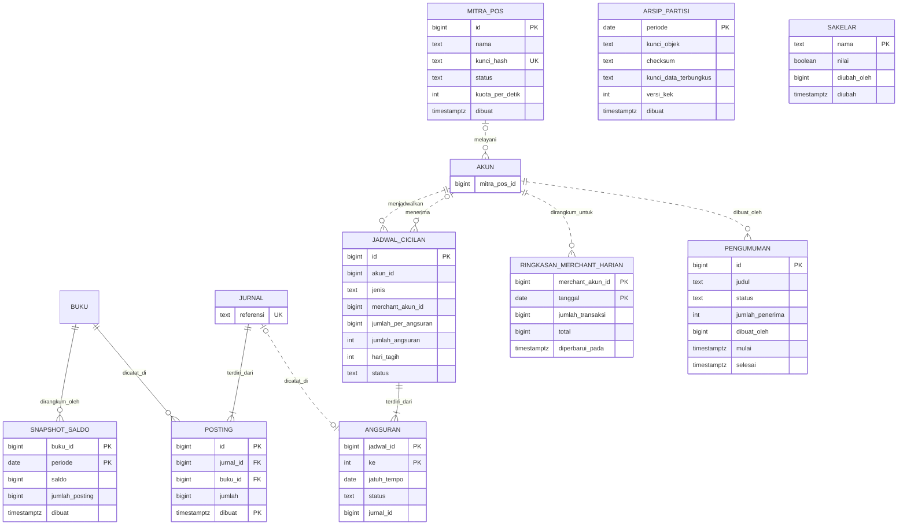

Draft otomatis, belum ditinjau pemilik

# Cerita Rekeningo · Tahap 5: Skala nasional

Ditulis 2026-10-31 · draf sebelum lab Tahap 5 ada dan sebelum pemilik meninjau Tahap 4 (tugas NASKAH-5, keputusan 1400 sampai 1404). Peninjau konsistensi memakai keputusan 1405 sampai 1409.

## Kenapa dokumen ini ada

Naskah ini adalah source of truth Tahap 5, disimpan di repo sebagai `plan/CERITA-TAHAP-5.md`. Strukturnya sama dengan Tahap 2, 3, dan 4: **PRD → fitur → pekerjaan teknis → inti teknis → masalah yang muncul pelan-pelan → konsep**. Halaman situs ditulis dari naskah ini. Penomoran melanjutkan Tahap 4: masalah M40 dan seterusnya (Tahap 4 berakhir di M39), ADR 46 dan seterusnya (Tahap 4 berakhir di ADR 45).

Seperti Tahap 3 dan 4, naskah ini draf otomatis, bukan tulisan pemilik. Bahannya naskah Tahap 1 sampai 4 dan PROPOSAL ("System design final", "Enam tahap dalam satu tabel", "Scaling: urutan yang diajarkan").

Bahan lainnya `plan/RISET-TAHAP-5.md` (ID `R5-nn` menunjuk ke sana; R5-100 sampai R5-103 ditambahkan untuk naskah ini) dan halaman Tahap 4 yang sudah di main. Terakhir `plan/EVALUASI-TAHAP-4.md`, `plan/TINJAUAN-PEMILIK.md` bagian Tahap 4, `plan/SETELAH-TAHAP-4.md`, dan `plan/USULAN-PERBAIKAN.md` (DIRI-4). Tugas `T5-siap` memasukkan peta halaman ke registry. Peninjau konsistensi mencocokkan naskah dengan semua naskah sebelumnya. Pemilik meninjau di akhir.

Semua pihak ketiga di Tahap 5 adalah tiruan lokal di container lab: gateway pembayaran, layanan verifikasi, penerbit kartu, layanan push, dan POS milik mitra. Merek nyata tidak dipakai. Standar dan dokumentasi publik disebut sebagai sumber, tanpa klaim izin atau kepatuhan regulasi apa pun.

Lab Tahap 5 belum ada dan belum bisa dijalankan. Docker Desktop menunggu dialog izin administrator di layar pemilik sejak 2026-10-31 06.57 WITA (TINJAUAN-PEMILIK Tahap 4, butir 1), jadi rekaman lab Tahap 5 menunggu Docker. Setiap pernyataan lab di bagian 4 ditulis sebagai hal yang bisa gagal. Tak satu pun angka kejadian di naskah ini berasal dari rekaman Tahap 5.

Pelajaran EVAL-4 dan DIRI-4 mengubah cara naskah ini ditulis. Delapan aturan berikut dipakai supaya kelas kesalahan Tahap 3 dan 4 tidak terulang.

1. **Satu angka, satu bentuk.** Angka beban dihitung sekali (tabel bagian 3), dengan nilai tepat dan satu pembulatan setengah ke atas. Turunan dihitung dari angka yang tertulis. Besaran yang punya dua versi ditulis berdampingan dengan labelnya.
2. **Kalimat rekaman menunggu rekaman.** Naskah hanya memakai label Asumsi, Hitungan, Ilustrasi, Tidak dijalankan, [perlu verifikasi], atau rekaman Tahap 1 sampai 4 yang sudah ada di `labs/*/output/`. Hitungan adalah hasil rumus yang tertulis di naskah, dan labelnya ikut masukan yang paling lemah.
3. **Klaim universal dan negatif menyebut lingkupnya.** "Tidak ada X" hanya untuk lab, tahap, atau folder yang disebut. Kata "setiap", "semua", dan "hanya" dicek terhadap kasus tandingan sebelum ditulis.
4. **"Kapan salah" tidak bertentangan dengan pembandingnya sendiri.** Setiap ambang di tabel ADR bagian 4 punya satuan dan angka pembanding Tahap 5 yang sama dengan tabel beban.
5. **Label tidak lebih kuat daripada sumbernya.** Kata pelunak di sumber (might, some, "not guaranteed", satu lawan banyak) ikut ke kalimat naskah. Kasus industri ditulis dengan batas yang ditulis sumbernya sendiri.
6. **ADR lama dibaca ulang terhadap PRD baru.** Pemindaian kata "Tahap 5" di `situs/src/content/docs/tahap-1/` sampai `tahap-4/` (2026-10-31) menemukannya di halaman ADR 6 (revisi Tahap 2), ADR 12, 26, 38, 44, dan 45. ADR 33, 36, dan 37 tidak menyebut Tahap 5, tetapi syarat salahnya cocok dengan isi PRD v5. Semuanya diperiksa terhadap PRD v5 di bagian 1.
7. **Satu kata per konsep.** Naskah memakai "replica", "secret", "pembeli", "pengumuman" (satu pesan ke banyak HP), "angsuran", dan "service" untuk unit milik Rekeningo. "Layanan" hanya untuk pihak ketiga tiruan.
8. **Rujukan bisa diikuti.** "Di atas" hanya menunjuk bagian yang memang lebih dulu di naskah. Bagian rekaman disebut dengan nama file dan huruf bagiannya hanya bila file itu sudah ada.

### Pilihan draf yang perlu dilihat pemilik

Sembilan pilihan berikut diambil tanpa bertanya, dengan opsi paling aman dan paling mudah dibatalkan. Masing-masing dicatat sebagai usulan perubahan cerita atau butir "Perlu dicek pemilik" di badan PR.

1. **Transaksi per user aktif per hari: 3, dengan hasil untuk 2 di sebelahnya.** Registry `tahap[4].asumsi.trx` bernilai 2, sedangkan naskah Tahap 2, 3, dan 4 serta `tahap[3]` memakai 3. Halaman 4.28 menulis angka Tahap 5 dengan 3 dan menyebut hasil dengan 2. Naskah ini sama: 3 sebagai dasar, dan hasil dengan 2 di sebelahnya. `T5-siap` diminta menyamakan registry `tahap[4].asumsi.trx` (usulan di badan PR).
2. **Tim: 28 orang, termasuk platform, SRE, dan security.** PROPOSAL menulis "20–40 (5–7 tim + platform, SRE, security)". Halaman 4.31 menulis "20 sampai 40 orang dalam 5 sampai 7 tim, ditambah platform, SRE, dan security". Dua bacaan itu berbeda. Naskah ini memakai satu bacaan: 28 orang dalam delapan tim. Isinya lima tim produk dan tiga tim fungsi, semuanya dihitung dalam 20 sampai 40 (Asumsi cerita). Registry `tim` bernilai "20+ developer" dan tidak berubah.
3. **Enam service, satu cluster PostgreSQL.** PROPOSAL menulis "pecah service dengan DB sendiri". Naskah ini memberi tiap service schema dan role sendiri di satu cluster (primary dan replica), seperti ADR 37, karena lab hanya bisa merekam satu primary. Database terpisah per service ditunda ke ADR 60 dengan pemicu tertulis. Pemilik memutuskan mana yang berlaku.
4. **BFF tetap sengaja belum.** PROPOSAL menulis BFF di bentuk Tahap 4, dan naskah Tahap 4 menundanya ke ADR 45 (TINJAUAN-PEMILIK Tahap 4, butir 3). Naskah ini mengikuti naskah Tahap 4: pemicunya, satu layar app butuh lebih dari 3 request berurutan, belum terukur. Request paralel bukan pemicunya.
5. **Satu kill switch untuk semua pod dan semua service yang menyentuh kartu.** TINJAUAN-PEMILIK butir 4b membiarkan terbuka apakah kill switch kartu satu atau dua (monolith dan service pembayaran), dan di luar proses atau tidak. Naskah ini memilih satu sakelar di tabel `sakelar` yang dibaca semua pod, dengan jawaban tolak bila tabelnya tidak terbaca (ADR 55).
6. **Penagihan atas otorisasi kartu yang ditolak tetap keputusan produk.** Butir 4a TINJAUAN-PEMILIK membiarkannya terbuka. Naskah ini tidak memutuskannya, dan menulis asumsi aman bila halaman perlu satu bentuk: tidak didebit, dicatat sebagai insiden bernomor.
7. **RPO dan RTO ditulis di PRD v5.** PRD v3 dan v4 tidak menulis batas waktu pulih atau jendela kehilangan data, sehingga pemicu ADR 33 tetap terbuka (butir 4d). PRD v5 menulisnya sebagai Asumsi produk: tidak ada transaksi uang yang sudah dijawab sukses lalu hilang, dan pulih dalam 15 menit.
8. **api-t5 memakai Go 1.27.3, lab Tahap 4 tidak dinaikkan.** `api-t4` gagal gerbang ADR 44 pada Go 1.27.1 (TINJAUAN-PEMILIK butir 2). Lab Tahap 5 memakai Go 1.27.3 dari RISET (R5-01, Asumsi sampai lab mengecek ulang). Merekam ulang semua lab Tahap 4 adalah tugas terpisah yang bukan lingkup naskah ini.
9. **Heuristik ±50 developer tidak dipakai sebagai pemicu.** Angka itu tidak punya sumber primer [perlu verifikasi] (butir 9). Pemicu rilis di naskah ini adalah kejadian dan angka di halaman ADR. Contohnya lima tim yang menunggu satu rilis (ADR 45, butir 2) dan pipeline lebih dari 10 menit per PR (ADR 44).

## Latar: dari publik ke seluruh negeri

Uji coba publik lolos pada minggu ke-12 Tahap 4. Rekonsiliasi harian selisih Rp0 atau insiden tertutup dalam satu hari kerja selama 14 hari berturut-turut (target Tahap 4, Asumsi). Puncak beban 138,9 request per detik.

PT Rekeningo (fiktif) kini menargetkan satu negara. Targetnya 1.000.000 user terdaftar (20% aktif tiap hari, registry) dan merchant di seluruh kota, dan kata "ratusan ribu" dari Sinta ditulis 200.000 (Asumsi; R5-36).

Frasa "uang elektronik nasional" di PRD v5 tidak membawa klaim izin atau regulasi apa pun. Naskah ini juga tidak.

Tiga hal berubah sekaligus. Pertama, **salinan datang**: laporan, riwayat, pengumuman, dan cadangan membaca data yang sama dari banyak tempat, sehingga Rekeningo untuk pertama kali punya data yang sengaja tertinggal. Kedua, **pihak luar memanggil masuk**: POS milik mitra membuat QR dan membaca status pembayaran lewat API publik. Ketiga, **tim dan rilis berlipat**: 28 orang dalam delapan tim merilis hampir tiap hari ke enam service.

Tahap 5 berangkat dari `api-t4` di akhir Tahap 4, bukan dari sistem yang sudah dibereskan. Yang tercatat dari naskah Tahap 4, halaman Tahap 4 yang sudah di main, dan README lab `api-t4`:

- Satu monolith Go dengan lima modul dan satu service `pembayaran`. Satu PostgreSQL 17.11 di lab, dibagi dalam schema dan role per modul. Proses monolith memakai satu role `t4m_monolit` dan satu pool.
- Ledger dari Tahap 2 tetap satu-satunya tempat uang bergerak. Service `pembayaran` meminta jurnal lewat API ledger dengan Idempotency-Key (ADR 37). Notifikasi lewat outbox dalam transaction yang sama dengan jurnal (ADR 23) dan klaim per baris (ADR 24). Pengiriman maksimal 5 percobaan lalu dead-letter (ADR 25), dan kelas queue memisahkan uang dari promo (ADR 32).
- Satu worker dengan 4 pengirim serentak dan 0,3 detik per pengiriman, sehingga kapasitasnya 13,33 per detik (Asumsi Tahap 3). Breaker per vendor hidup di memori proses worker (ADR 36). Kill switch kartu adalah flag di memori satu proses (ADR 42).
- Kapasitas satu server belum pernah diukur. `make beban` di `api-t4` memutar beban berjadwal di laptop dan menulis sendiri bahwa itu bukan kapasitas produksi (halaman 4.27, 4.28).
- ADR 45 menunda delapan komponen dengan pemicu tertulis. Empat pemicu berangka belum terlewati di Tahap 4, dan yang terdekat adalah koneksi database: 40 dari 70, atau 57%. Halaman 4.26 menunda sebelas butir lain, termasuk tempat flag kill switch di luar proses, rilis kartu bertahap, atestasi app, dan pemindai state IaC.
- Tahap 4 berakhir dengan tiga keadaan yang belum selesai. `api-t4` gagal gerbang ADR 44 pada Go 1.27.1, RPO dan RTO belum ada di PRD, dan satu server belum diukur.

Tim tumbuh dari 13 menjadi 28 orang selama 16 minggu (Asumsi cerita), dan tiap minggu memasukkan satu sampai tiga engineer baru. Delapan tim:

| Tim | Orang | Pemimpin | Memegang |
| --- | --- | --- | --- |
| Pembayaran | 4 | Nadia | gateway, top-up bank, kartu virtual |
| Ledger dan Tabungan | 4 | Hendra | ledger, cicilan, tabungan, batch harian |
| Merchant | 4 | Wulan | merchant, QR, laporan, API untuk POS |
| Akun | 4 | Raka | app, akun, identitas |
| Notifikasi | 4 | Sari (tidak muncul di adegan) | pengiriman push, pengumuman |
| Platform | 4 | Bayu | cluster, pooler, pipeline, observability |
| SRE | 2 | Dewi | SLO, giliran jaga, latihan failover |
| Security | 2 | Laras | threat model, tinjauan, uji penetrasi lokal |

Totalnya 4 × 6 + 2 × 2 = 28 orang. Yang tidak berubah: satu bahasa (Go di backend, Dart di app), PostgreSQL sebagai source of truth, dan ledger dari Tahap 2. Yang baru: enam service, satu read replica, event streaming, dan Kubernetes.

### Tokoh baru

| Tokoh | Siapa | Ingin | Kelemahan | Yang dibawanya ke cerita |
| --- | --- | --- | --- | --- |
| **Dewi** | Site reliability engineer (SRE) yang bergabung di minggu 3. Delapan tahun giliran jaga di sistem pembayaran lain, belum pernah menulis fitur. | Sistem yang berhenti dengan aman dan pulih dalam waktu yang sudah diumumkan | Menolak rilis tanpa metrik penjaga, sehingga perbaikan kecil ikut menunggu | SLO, alert, latihan failover, error budget |
| **Hendra** | Engineer data dari tim akuntansi Lestari, memimpin tim Ledger dan Tabungan. Menguasai tutup buku dan batch malam. | Angka yang bisa dicocokkan sampai rupiah terakhir | Menganggap batch malam selalu bisa diulang dari awal | Cicilan, tabungan, snapshot saldo, arsip |
| **Tomi** | Engineer di penyedia POS (fiktif), mitra pertama API publik. | Kasir yang tidak pernah menunggu Rekeningo | Mengulang permintaan tanpa batas bila tidak ada jawaban | Sudut pandang pihak luar yang memanggil Rekeningo |

Tokoh lama tetap:

- **Raka** memimpin tim Akun dan masih menulis backend bila perlu.
- **Nadia** memimpin tim Pembayaran dan masih cenderung mengusulkan solusi yang terlalu berat, kali ini event streaming untuk semua hal.
- **Bayu** memimpin tim Platform dan masih menganggap bawaan komponen aman, kali ini bawaan Kubernetes dan pooler.
- **Wulan** memimpin tim Merchant dan masih menganggap data dari sistem sendiri aman ditampilkan.
- **Laras** memimpin tim Security dan masih menandai hampir semua temuan sebagai kritis.
- **Ratih** memimpin tim risk (bukan tim engineer) dan memakai back office setiap hari.
- **Sinta** menulis PRD v5.
- **Budi** dan **Citra** memakai Rekeningo di kota masing-masing, dengan cicilan dan tabungan.
- **Bu Marni** kini memakai laporan penjualan di HP dan menerima pembayaran lewat POS mitra.
- **Ani** satu dari ±60 warung Lestari, tetap seperti Tahap 4.
- **Pak Hadi** menambah satu syarat: angka yang ia tanda tangani dibaca dari catatan yang sama dengan yang menggerakkan uang.
- **Pihak yang mencoba** tetap tidak dikenal, dan kali ini mencoba pintu yang paling jarang dijaga: API untuk mitra, arsip, dan jaringan di dalam cluster.
- **Dimas** tidak muncul di Tahap 5.

## 1. PRD v5 · Rekeningo untuk satu negara

**Latar masalah.** Tahap 4 membuktikan top-up dari bank, verifikasi identitas, QR merchant luar, kartu virtual, dan back office untuk 100.000 user. Tiga kebutuhan belum terpenuhi. Merchant ingin melihat penjualan sampai detik ini, Rekeningo harus tetap hidup saat satu mesin mati, dan penyedia POS ingin memakai Rekeningo dari kasir mereka. Ketiganya berlaku untuk jumlah user sepuluh kali lipat.

**Tujuan.** (1) Satu juta user terdaftar dan ratusan ribu merchant memakai Rekeningo tanpa perubahan di app. (2) Merchant melihat penjualannya hampir seketika. (3) Pembayaran tidak berhenti saat deploy atau saat satu mesin mati, dan tidak ada uang yang hilang. (4) Penyedia POS pihak ketiga membuat QR dan membaca status lewat API publik. (5) Cicilan dan tabungan berjalan lewat batch harian yang tidak menagih dua kali.

**User.**

| User | Kebutuhan baru | Yang membuatnya berhenti memakai |
| --- | --- | --- |
| User umum (Budi dan Citra di kota masing-masing) | Cicilan ke merchant, tabungan berjangka, pengumuman yang sampai | Pembayaran yang tidak muncul di riwayat, angsuran yang ditagih dua kali |
| Merchant (Bu Marni dan ±200.000 lainnya, Asumsi) | Laporan penjualan hampir seketika, per cabang | Laporan yang terlambat, pembayaran yang melambat saat ia membuka laporan |
| Mitra POS (Tomi dan ±50 penyedia, Asumsi) | API untuk membuat QR dan membaca status, webhook ke kasir | Kuota yang tidak jelas, kunci yang bocor, perubahan API tanpa kabar |
| Warung Lestari (Ani dan ±59 lainnya) | Tetap seperti Tahap 4 | Pembayaran atau notifikasi yang terganggu urusan nasional |
| Tim risk (Ratih) | Back office tetap cepat saat user berlipat | Data yang tertinggal tanpa tanda |
| Keuangan (Pak Hadi) | Laporan resmi dan tutup buku harian dari catatan yang sama dengan ledger | Angka dari salinan yang tertinggal |
| SRE dan security (Dewi dan Laras) | Batas waktu pulih yang tertulis, bukti rilis aman | Rilis tanpa metrik penjaga, kunci tanpa rotasi |

**Ruang lingkup (nasional, 1.000.000 user terdaftar, 200.000 aktif per hari, 28 orang, 16 minggu).**

| Prioritas | Fitur | Keterangan |
| --- | --- | --- |
| P0 | Skala nasional | 1.000.000 user dan ±200.000 merchant (Asumsi). Deploy tanpa error yang terlihat user |
| P0 | Laporan merchant real-time | Penjualan hari ini per merchant dan per cabang tampil paling lambat 5 detik sesudah pembayaran tercatat (Asumsi produk). Laporan periode dan ekspor memakai catatan yang sama dengan ledger |
| P0 | Tidak berhenti, tidak kehilangan uang | Ketersediaan pembayaran 99,9% per 30 hari: error budget 0,001 × 43.200 menit = 43,2 menit. Tidak ada transaksi uang yang sudah dijawab sukses lalu hilang (RPO nol), dan pulih dalam 15 menit (RTO). Angka ini Asumsi produk dan menjawab pemicu ADR 33 yang tertunda sejak Tahap 3 |
| P0 | Notifikasi massal | Pengumuman ke semua HP terkirim dalam 30 menit (Asumsi produk). Notifikasi uang tetap janji PRD v3: 95% di bawah 30 detik, dan pemberitahuan tidak mendahului uang |
| P0 | Cicilan dan tabungan berjangka | Cicilan adalah pembayaran bertahap ke merchant tanpa bunga, dan PT tidak meminjamkan uang (Asumsi produk). Tabungan memindahkan jumlah tetap ke kantong tabungan tiap minggu. Batch harian menagih yang jatuh tempo, dan tiap angsuran terdebit tepat sekali |
| P0 | API publik untuk POS pihak ketiga | Mitra membuat QR dinamis, membaca status pembayaran, dan menerima webhook. Kunci per mitra, kuota per mitra, dan Idempotency-Key wajib untuk perintah yang menggerakkan uang |
| P1 | Kartu virtual untuk semua user terverifikasi | Rilis bertahap dari PRD v4, dengan satu kill switch |
| P1 | Laporan Keuangan dari catatan yang sama dengan ledger | Syarat Pak Hadi di bawah |
| P2 | Ditunda ke v6 | Multi-region, skor risiko real-time, platform internal untuk lebih dari 50 developer, 10 juta user |

**Bukan lingkup v5.** Pembayaran offline, pencairan merchant otomatis lewat bank (tetap file), tarik tunai, kartu fisik, dan multi-mata uang. Bunga atau pinjaman dari PT juga bukan lingkup, dan tidak ada klaim izin atau kepatuhan regulasi apa pun.

**Metrik keberhasilan (target, Asumsi).**

- 200.000 user aktif per hari (20% dari 1.000.000, registry).
- 99,9% pembayaran tersedia dalam 30 hari (43,2 menit error budget), RPO nol untuk transaksi uang yang sudah dijawab sukses, RTO 15 menit.
- Laporan merchant tertinggal paling lama 5 detik dari pembayaran yang tercatat.
- Pengumuman ke 1.000.000 HP terkirim dalam 30 menit, dan 95% notifikasi uang di bawah 30 detik.
- 0 angsuran terdebit dua kali, dan 0 angsuran jatuh tempo tanpa catatan.
- 0 permintaan dari satu mitra yang membuat mitra lain mendapat 429.

**Batasan.** 28 engineer dalam delapan tim selama 16 minggu. Semua pihak ketiga berupa tiruan lokal di lab. Security review Laras lolos sebelum tiap rilis ke seluruh negeri. Kapasitas satu server belum pernah diukur, dan pengukurannya dijadwalkan sebelum fitur pertama yang menambah beban (ADR 45, aturan 5).

Syarat Pak Hadi bertambah: *"Angka yang saya tanda tangani harus dibaca dari catatan yang sama dengan yang menggerakkan uang. Salinan boleh untuk dilihat, bukan untuk memutuskan."*

**Risiko yang ditulis Sinta.** Rekeningo pertama kali punya data yang sengaja tertinggal, enam unit yang dirilis sendiri-sendiri, dan pihak luar yang memanggil masuk dengan laju yang tidak ia kendalikan.

**Pertanyaan terbuka di PRD.**

- Kalau laporan dan pembayaran membaca database yang sama, siapa yang melambat?
- Kalau database utama mati, apa yang hilang, dan siapa yang tahu?
- Kalau pengumuman, makan siang, dan rilis datang bersamaan, notifikasi uang yang mana yang terlambat?

Ketiganya tidak dijawab PRD dan menjadi masalah terbesar Tahap 5.

Halaman 5.1 membuka jawaban tebakan di halaman 4.31 (dari ADR Tahap 4, mana yang pecah lebih dulu?). Pilihan yang cocok adalah ADR 36, ADR 37, ADR 44, dan ADR 45. Buktinya sudah tertulis di halaman Tahap 4, dan tebakan itu penalaran (Asumsi), bukan urutan kejadian yang direkam. Empat kalimat berikut ditulis halaman ADR-nya sendiri sebelum PRD v5 ada:

| ADR | Kalimat di halaman Tahap 4 | Isi PRD v5 yang memenuhinya | Dilanjutkan di |
| --- | --- | --- | --- |
| 45 | Satu pemicu read replica adalah laporan merchant real-time yang diminta PRD v5 (4.29) | Laporan merchant real-time | M40, ADR 46 |
| 36 | Breaker hidup di memori satu proses worker, dan dua worker tidak berbagi hitungan, jadi tiap proses menunggu enam kegagalannya sendiri (4.11, dibaca dari kode, tidak direkam) | Notifikasi massal, yang butuh banyak worker | M45, ADR 51 |
| 37 | Keputusan salah bila satu modul punya profil beban atau tim yang membuat deploy bersama tidak lagi masuk akal (4.13) | 28 orang dalam delapan tim | M44, ADR 50 |
| 44 | Pipeline dan giliran jaga dibagi per tim, dan batas modul perlu menjadi batas deploy (4.26) | 28 orang dalam delapan tim | M44, ADR 58 |

Dua pilihan lain di tebakan tidak cocok. ADR 41 menulis syarat salah per satu impor (50 produk menjadi 21 detik), dan ADR 40 memakai pembanding persen yang mengecil bila merchant bertambah. Tak satu pun menyebut isi PRD v5.

Tahap 5 mengubah dugaan itu menjadi hitungan di bagian 3. Worker terpakai 564% (Tahap 4: 56%), pengumuman ke 1.000.000 HP butuh 20,8 jam di satu worker, dan koneksi terpasang 180 lawan 97 tersedia.

Angka worker dan pengumuman sama dengan halaman 4.28 (Hitungan atas Asumsi). Halaman itu menghitung koneksi tertahan 27,8 lawan batas 18 untuk dua pool, dan bagian 3 menghitung ulang koneksi untuk enam service. Urutan "lebih dulu" di tebakan tetap penalaran, dan urutan masalah di bagian 4 adalah urutan cerita, bukan hasil pengukuran.

Sembilan ADR sebelumnya menulis Tahap 5 sebagai revisi atau memuat syarat salah yang cocok dengan PRD ini, jadi syaratnya dibaca ulang:

- ADR 6 (revisi di Tahap 2) menjadwalkan partisi `posting` per bulan dan snapshot saldo di Tahap 5. ADR 12 menjadwalkan Kubernetes (mulai dari k3s di lab) dan read replica untuk laporan di Tahap 5. ADR 49, 50, dan 46 mengerjakannya.
- ADR 26 menulis bahwa PROPOSAL menaruh Kubernetes di Tahap 5. ADR 33 menunda VPS kedua sampai waktu pulih atau jendela kehilangan data melebihi yang diterima Pak Hadi atau PRD. PRD v5 menulis keduanya (RPO nol, RTO 15 menit), jadi pemicu ADR 33 terpenuhi dan dijawab ADR 48.
- ADR 14 membatasi umur Idempotency-Key 24 jam. ADR 34 mencatat bahwa jurnal bisa ganda bila proses mati di antara ledger dan transaction pembayaran, lalu kiriman ulang datang sesudah key habis. Batch yang ditunda lebih dari 24 jam melewati batas itu (ADR 54).
- ADR 36 menulis breaker per proses. Pengumuman ke 1.000.000 HP butuh puluhan proses (ADR 51).
- ADR 38 menghitung unduhan staf 1.157 KB per detik untuk registry Tahap 5 (4.15, Hitungan atas Asumsi). Rumusnya 20.000 × 500 KB ÷ 86.400 × 10. Kapasitas jaringan instance tidak diukur lab, jadi angka itu belum bisa dibandingkan dengan pemicunya. Hitungannya diulang di bagian 3.
- ADR 42 menaruh kill switch di memori satu proses, dan Kubernetes menjalankan beberapa pod per service. Itu menjadi M49.
- ADR 44 menulis pipeline dan giliran jaga per tim, dan ADR 58 mengerjakannya.
- ADR 45 menunda delapan komponen. Tahap 5 membaca tiap pemicunya terhadap PRD v5 (tabel di bagian 3), dan ADR 60 menulis ulang yang belum tercapai.

ADR 45 aturan 5 menjadwalkan tiga pengukuran sebelum fitur PRD v5 pertama. Pengukuran itu load test kapasitas satu server, role dan pool per modul, dan hitungan request berurutan per layar app. Lab `api-t5` mengerjakan dua yang pertama dengan batas yang sama seperti `api-t4`: beban berjadwal di laptop, bukan kapasitas produksi, dan satu role per service. Yang ketiga tetap milik tim Akun, dan BFF tetap sengaja belum sampai angkanya ada.

## 2. Dari fitur ke pekerjaan teknis

| Fitur | Di app | Di backend | Di database | Konsep yang akan dibutuhkan |
| --- | --- | --- | --- | --- |
| Skala nasional, tidak berhenti | Tidak ada perubahan yang terlihat | Enam service di Kubernetes, tiga instance tiap service, rilis tanpa jeda; pooler; failover | Read replica, replica sinkron, schema dan role per service | Read replica, failover, service, Kubernetes, pooler |
| Laporan merchant real-time | Layar laporan di app Merchant dan dasbor web, diperbarui tiap 30 detik | Laporan dibaca dari replica, ringkasan harian per merchant | `ringkasan_merchant_harian`; `posting` dipartisi | Read replica, read-your-writes, partisi, snapshot saldo |
| Notifikasi massal | Pengumuman muncul di HP, notifikasi uang tetap cepat | Worker diskalakan keluar; pengumuman lewat event streaming; kuota penyedia push | `pengumuman`; topik di event streaming | Fan-out, backpressure, event streaming |
| Cicilan dan tabungan | Atur jadwal, lihat angsuran, hentikan | Service cicilan dan batch harian tahan crash | `jadwal_cicilan`, `angsuran`, kantong tabungan sebagai buku | Batch harian, saga, kunci bisnis |
| API publik untuk POS | Tidak ada (kasir mitra) | Pintu di tepi: kuota per mitra, tanda tangan, WAF; webhook ke POS | `mitra_pos`; `akun.mitra_pos_id` | Rate limit per mitra, WAF, mTLS antar service |
| Kartu virtual untuk semua | Tidak ada perubahan | Rilis bertahap, satu kill switch | `sakelar` | Progressive delivery, feature flag, GitOps |
| 28 engineer, delapan tim | Paket app per tim | Pipeline per service, observability penuh, platform sebagai jalan beraspal | Migration per service | OpenTelemetry, SLO, GitOps, on-prem lawan cloud |

Dari tabel ini lahir pertanyaan pertama Tahap 5, sebelum satu baris kode: **salinan boleh banyak, tetapi tempat uang bergerak hanya satu**. Cara pertama yang ditulis tim memperlakukan semua salinan seperti sumber, dan itu bagian 3.

## 3. Inti teknis Tahap 5 · Salinan boleh banyak, tempat uang bergerak hanya satu

Ini jantung Tahap 5. Pertanyaannya dirumuskan di minggu 0, sebelum masalah apa pun muncul. Di Tahap 4 arahnya kabar dari luar. Di Tahap 5 arahnya salinan ke luar.

Laporan, riwayat, cadangan, pengumuman, dan event membaca data yang sama dari tempat berbeda. Tiap salinan tertinggal beberapa detik sampai beberapa jam dari sumbernya.

Tiga hal harus selalu benar:

1. Uang bergerak hanya lewat ledger: jurnal seimbang, posting tidak diubah, dan satu primary menerima semua tulisan. Service lain membaca, atau meminta posting dengan Idempotency-Key (PROPOSAL; syarat Pak Hadi sejak Tahap 2).
2. Keputusan yang menentukan uang dibaca dari sumber yang sama dengan yang menggerakkan uang. Replica, ringkasan, cache, dan event hanya untuk dilihat, dan jarak ketertinggalannya diketahui dan disebut (syarat Pak Hadi di PRD v5; ADR 45 aturan 2).
3. Pekerjaan yang lebih panjang dari satu proses, satu hari, atau satu mesin tetap benar bila dihentikan dan diulang di titik mana pun. Contohnya batch, failover, dan deploy (syarat Direksi dan Dewi).

**Versi pertama (minggu 2).** Wulan menulis laporan real-time sebagai satu endpoint. Endpoint itu menjumlah posting hari ini milik merchant dari primary yang sama dengan pembayaran, dan app memanggilnya tiap 30 detik.

Raka memakai endpoint riwayat yang sama untuk layar "Berhasil". Hendra menulis cicilan sebagai job malam yang menagih semua jadwal jatuh tempo, lalu menandai angsuran lunas. Nadia mengusulkan event streaming untuk semuanya.

Di staging dengan 200 merchant tiap bagian tampak cukup.

| Kejadian | 1. Uang hanya lewat ledger | 2. Keputusan dari sumber yang sama | 3. Benar bila diulang atau dihentikan |
| --- | --- | --- | --- |
| 20.000 merchant membuka laporan tiap 30 detik di primary | Terjaga | Terjaga: laporan hanya melihat | Rusak: query laporan ikut memperlambat pembayaran (M40) |
| Riwayat dibaca dari replica sesudah bayar | Terjaga | Rusak: pembeli melihat catatan yang tertinggal (M41) | Tidak berlaku |
| Primary mati saat replica asinkron | Rusak: transaksi yang sudah dijawab sukses ikut hilang (M42) | Tidak berlaku | Tidak berlaku |
| Pemeriksaan saldo malam membaca semua posting | Terjaga | Terjaga | Rusak: tidak selesai sebelum pagi (M43) |
| Notifikasi uang dan pengumuman memakai 4 pengirim yang sama | Terjaga | Tidak berlaku | Rusak: notifikasi uang tertunda berjam-jam (M45) |
| Pod notifikasi memanggil ledger tanpa identitas | Rusak: siapa pun di jaringan dalam bisa membuat jurnal baru (M47) | Tidak berlaku | Tidak berlaku |
| Batch cicilan diulang sesudah 24 jam | Rusak: angsuran terdebit dua kali (M48) | Tidak berlaku | Rusak: key idempotensi sudah habis |
| Kill switch hanya di memori satu pod | Tidak berlaku | Rusak: pod lain memakai nilai lama (M49) | Tidak berlaku |

Mode rentan yang menjalankan versi pertama (laporan di primary, cicilan satu job) belum ada. `api-t5` akan merekamnya (bagian 4, tabel "Yang harus bisa dibuktikan lab"). Kalimat di tabel ini tentang M42 dan M47 adalah penalaran dari dokumentasi (R5-100, R5-20), bukan kejadian yang direkam.

Halaman ini menanam tiga pertanyaan. Di minggu 2 Wulan bertanya siapa yang melambat bila laporan dan pembayaran membaca database yang sama. Pak Hadi bertanya angka mana yang ia tanda tangani bila ada dua salinan. Dewi bertanya apa yang hilang bila database utama mati pukul 02.10.

Jawabannya ada di M40 sampai M43.

**Yang pembaca lakukan.** Widget W5-zona di halaman 5.2: klik tiap zona dari lima lapisan (client, edge, service, data, operasi) dan tandai zona tempat uang bergerak. Lalu lihat tabel di atas terisi.

**Yang dipelajari Raka dengan susah payah.** Pola yang sama muncul lagi di arsip yang dipindah ke penyimpanan objek (ADR 57), di cicilan yang diulang (M48), dan di sakelar kartu (M49). Setiap salinan diberi nama, diberi umur, dan dilarang memutuskan.

### Angka beban Tahap 5 (Asumsi, rumus ditulis)

Masukan registry `tahap[4].asumsi`: 1.000.000 user, aktif 20%, 60 request per user aktif, faktor puncak 10, unggahan 20.000 per hari, 500 KB per file. Transaksi uang 3 per user aktif per hari mengikuti naskah Tahap 2 sampai 4, dan registry `tahap[4].asumsi.trx` bernilai 2. Naskah ini menulis dasar 3 dan hasil dengan 2 di sebelahnya (pilihan draf 1). Hasil rumus memakai label masukan terlemahnya, jadi seluruh tabel berlabel Asumsi.

| Besaran | Rumus | Masukan | Hasil |
| --- | --- | --- | --- |
| Request per detik | aktif × request ÷ 86.400 × puncak | 200.000 × 60 = 12 juta per hari | 138,9 rata-rata dan 1.388,9 puncak (Tahap 4: 138,9 puncak; naik 10 kali karena user 10 kali dan persen aktif tetap 20%) (R5-30) |
| Transaksi uang (bayar, transfer, QR) | aktif × trx ÷ 86.400 × puncak | 200.000 × 3 = 600.000 per hari (trx 2: 400.000) | 6,94 rata-rata dan 69,4 puncak (trx 2: 4,63 dan 46,3). Jendela makan siang (80% dalam 90 menit): 88,9 (trx 2: 59,3) (R5-31) |
| Transaksi per merchant | transaksi per hari ÷ merchant | 600.000 ÷ 200.000 | 3 per merchant per hari (trx 2: 2); laporan harian satu merchant ringan (R5-36) |
| Top-up dari bank | aktif × 0,25 ÷ 86.400 × puncak | 50.000 per hari | 0,579 rata-rata dan 5,79 puncak |
| Notifikasi uang dan worker | (transaksi + top-up) ÷ 86.400 × puncak lawan c ÷ t | 650.000 per hari; c = 4, t = 0,3 detik, kapasitas 13,33 per detik | 75,2 per detik puncak = 564% kapasitas (trx 2: 52,1 = 391%). Makan siang: 650.000 × 0,8 ÷ 5.400 = 96,3 = 722% (trx 2: 66,7 = 500%) (Tahap 4: 56% dan 72%) |
| Pengirim yang dibutuhkan | L = λ × t | 96,3 × 0,3 = 28,9, dibulatkan 29 | 8 proses × 4 = 32 pengirim = 106,7 per detik, terpakai 90%. 11 proses = 44 pengirim = 146,7 per detik, terpakai 66% (Asumsi desain: paling tinggi ±70%) |
| Antrean bila tetap 4 pengirim | (λ − c ÷ t) × 5.400 | (96,3 − 13,33) × 5.400 | ±448.000 baris di akhir makan siang; dikuras paling cepat 448.000 ÷ 13,33 = 33.600 detik = 9,3 jam. Umur tertua 40 menit sesudah makan siang mulai, bila antrean urut dan kedatangan tetap: 2.400 × (1 − 13,33 ÷ 96,3) = 2.068 detik = 34,5 menit |
| Pengumuman ke 1.000.000 HP | N × t ÷ pengirim | 1.000.000 × 0,3 ÷ pengirim | 4 pengirim: 75.000 detik = 20,8 jam (Tahap 4: 100.000 HP = 7.500 detik). 32 pengirim: 9.375 detik = 156 menit. Target 30 menit: 1.000.000 ÷ 1.800 = 555,6 per detik, dikali 0,3 = 167 pengirim = 42 proses |
| Kuota penyedia push (tiruan lab) | N ÷ detik | 600.000 per menit = 10.000 per detik (mengikuti dokumentasi satu penyedia push, R5-08) | Target 30 menit memakai 555,6 ÷ 10.000 = 5,6% kuota. Semua dalam 1 menit = 16.667 per detik = 167% kuota, dan kelebihannya dijawab 429 |
| Polling laporan | merchant online ÷ interval | 200.000 × 10% = 20.000 online; polling 30 detik; query 20 ms; 8 vCPU (Asumsi) | 666,7 per detik, atau 9,6 kali transaksi uang puncak (666,7 ÷ 69,4). L = 666,7 × 0,02 = 13,3 query berjalan. CPU 666,7 × 0,02 ÷ 8 = 167% (R5-34) |
| Baca selain uang | (request − transaksi uang) × W | (1.388,9 − 69,4) × 0,02 | L = 26,4 koneksi, atau 528% dari pemicu read replica ADR 45 (5 koneksi) |
| Koneksi database | service × instance × pool | 6 × 3 × 10 = 180 terpasang; tersedia 100 − 3 = 97 | 180 ÷ 97 = 186% dari yang tersedia, dan 180 ÷ 70 = 257% dari pemicu PgBouncer ADR 45. Rata-rata terpakai L = 1.388,9 × 0,02 = 27,8 (R5-37) |
| Data posting | aktif × trx × 2 × 365 × byte | 200.000 × 3 × 2 × 365 = 438 juta; 250 B per posting | 109,5 GB per tahun, atau 36,5 juta posting dan 9,1 GB per bulan. Trx 2: 292 juta dan 73,0 GB. Rumus registry (1 baris 300 B): 43,8 GB (trx 2) dan 65,7 GB (trx 3). Tahap 4: 10,95 GB (R5-32) |
| Pemeriksaan saldo malam | baris yang dibaca | tanpa snapshot: semua posting sejak awal | 438 juta setelah 1 tahun dan 1.314 juta setelah 3 tahun. Dengan snapshot dan partisi bulan berjalan: paling banyak 36,5 juta, atau 8,3% dari 438 juta di tahun pertama |
| Snapshot saldo | buku × bulan × byte | 1.200.000 buku (1.000.000 user + 200.000 merchant) × 12 × 50 B (Asumsi) | 720 MB per tahun |
| File identitas | upload × KB × 365 | 20.000 × 500 KB | 10 GB per hari, 3.650 GB per tahun; 1.157 KB per detik puncak (Tahap 4: 365 GB; 10 kali) (R5-33) |
| Outbox | (transaksi + top-up) × 365 × byte | 650.000 × 365 × 300 B | 71,2 GB per tahun tanpa pembersihan, dan 1,365 GB dengan retensi 7 hari |
| Volume trace | RPS × span × byte | 8 span × 500 B (Asumsi) | 5,6 MB per detik puncak, 555,6 KB per detik rata-rata = 48,0 GB per hari. Tail sampling ±6% (1% error + 5% sisanya, Asumsi) = 2,9 GB per hari (R5-38) |
| RPO replica asinkron | jeda × laju puncak | jeda 1 detik (Asumsi) × 69,4 | 69 transaksi bisa hilang saat failover (trx 2: 46) (R5-39) |
| Canary tanpa traffic router | 1 ÷ replika | 3 replika; 20 replika | Langkah terkecil 33,3% dengan 3 replika, dan 5% butuh 20 replika (R5-40) |
| Umur kunci pembungkus | 2^32 ÷ baris per tahun | 4.294.967.296 ÷ 438 juta | 9,8 tahun bila satu data key per posting (trx 2: ÷ 292 juta = 14,7 tahun) (R5-41) |
| Cicilan | jadwal × bagian jatuh tempo ÷ hari | 100.000 jadwal aktif (10% user, Asumsi); 40% jatuh tempo di tiga hari gajian | 13.333 angsuran per hari puncak dan 3.333 rata-rata (100.000 ÷ 30). Pada 20 per detik: 667 detik = 11,1 menit |
| Satu mitra POS | λ mitra ÷ puncak semua | 3.000 permintaan per detik ÷ 1.388,9 | 216% dari seluruh puncak. Kuota per mitra 100 per detik (Asumsi) |
| Anggaran kegagalan | (1 − SLO) × menit | 0,001 × 43.200 | 43,2 menit per 30 hari. Burn rate 14,4 menghabiskannya dalam 720 ÷ 14,4 = 50 jam (R5-17) |
| Orang per service | tim ÷ service | 28 ÷ 6 | 4,7 (Tahap 4: 13 ÷ 6 = 2,2 di ADR 45) |

Tiga kesimpulan dari tabel ini menentukan tahap. Pertama, beban 1.388,9 request per detik naik 10 kali, tetapi yang melewati batasnya lebih dulu bukan request. Yang melewatinya adalah worker 564%, koneksi terpasang 180 lawan 97 tersedia, dan pemeriksaan malam yang membaca 438 juta baris.

Kedua, tidak ada hitungan di tabel ini yang menunjukkan primary tidak sanggup 69,4 transaksi uang per detik. Itu belum diukur, dan `make beban` di `api-t5` memberi batas di laptop, bukan kapasitas produksi.

Ketiga, yang berbahaya adalah **salinan yang tertinggal dan pekerjaan yang diulang**, bukan banyaknya request. 69 transaksi dalam jeda 1 detik, angsuran yang ditagih dua kali, dan notifikasi uang yang berebut pengirim berasal dari dasar yang sama dengan Tahap 4. Dasarnya Little's Law (R2-35) dan hasil yang tidak diketahui sesudah gagal.

Pemicu ADR 45 dibaca ulang dengan angka di atas. "Terpenuhi" berarti halaman Tahap 5 menulis keadaan yang sama dengan pemicunya, bukan bahwa komponennya terbukti perlu.

| Komponen ADR 45 | Pemicu yang ditulis | Tahap 4 | Tahap 5 (Hitungan atas Asumsi) | Dilanjutkan |
| --- | --- | --- | --- | --- |
| 1. Semua modul jadi service | Dua tim atau lebih tidak bisa merilis tanpa saling menunggu | 3 tim | 5 tim produk dan 3 tim fungsi: terpenuhi | M44, ADR 50 |
| 2. Kubernetes | Lima tim atau lebih perlu merilis tanpa menunggu tim lain | 3 tim | 5 tim produk: terpenuhi | M44, ADR 50 |
| 2. Service mesh | Lebih dari satu jalur antar service butuh TLS timbal balik dan retry seragam | 1 jalur | Ledger dipanggil dari tiga service (pembayaran, cicilan, merchant): terpenuhi untuk TLS timbal balik, dikerjakan di Go tanpa mesh | M47, ADR 53 |
| 2. Event streaming | 100 pesan per detik terus-menerus, atau dua consumer atau lebih bergantung pada urutan | 7,5 per detik (7,5%) | 75,2 per detik puncak (75%), pengumuman 555,6 per detik selama 30 menit (556%); tiga consumer atas event pembayaran (rancangan ADR 51) | M45, ADR 51 |
| 3. gRPC | Tambahan p95 satu lompatan HTTP melewati 50 ms antar host | Di bawah 50 ms di localhost | Jaringan antar host tetap belum diukur: belum terpenuhi | ADR 60 |
| 4. Read replica | Laporan merchant real-time diminta, atau L baca 5 koneksi | L baca 2,64 (53%) | Laporan diminta; L baca 26,4 (528%): terpenuhi | M40, ADR 46 |
| 4. PgBouncer | 70 koneksi dari 100 | 40 (57%) | 180 terpasang (257%), rata-rata terpakai 27,8: terpenuhi lewat potensi | M46, ADR 52 |
| 5. BFF terpisah | Satu layar butuh lebih dari 3 request berurutan | Belum diukur | Belum diukur: belum terpenuhi | ADR 60 |
| 6. Login sosial | PRD meminta masuk dengan akun penyedia lain | Tidak diminta | Tidak diminta | ADR 60 |
| 7. SLSA dan HTTP Message Signatures | Pihak luar atau auditor meminta bukti pembuatan image | Tidak diminta | Tidak diminta; mitra POS memakai HMAC bertimestamp seperti ADR 34 | ADR 60 |
| 8. Durable execution | Alur lebih dari satu hari yang harus lanjut dari tengah | Tidak ada | Cicilan berjalan berbulan-bulan: terpenuhi | M48, ADR 54 |

Lima dari sebelas butir "Sengaja belum" di halaman 4.26 menjadi bahan Tahap 5. Dua dikerjakan di ADR 55: flag kill switch kartu di luar proses dan rilis kartu bertahap (M49). Satu dikerjakan di ADR 58: pemindai kunci produksi atas state IaC dan konfigurasi, karena repo konfigurasi GitOps menambah permukaan yang sama. Dua tetap ditunda di ADR 60: provenance SLSA dan atestasi app.

## 3b. Skema data: ERD dari Tahap 4 ke Tahap 5

Aturan sama dengan Tahap 2 sampai 4: ERD tahap sebelumnya selalu tampil berdampingan dengan tahap sekarang, dari skema lab. Halaman skema Tahap 5 memakai widget ERD bertumbuh dengan Tahap 4 di kiri dan Tahap 5 di kanan, dibuat dari skema lab `api-t5`.

Blok mermaid di bawah hanya memuat tabel baru dan tabel yang berubah. Tabel lain tidak berubah dari Tahap 4 (`ERD4`). Kolom persisnya harus dicocokkan dengan skema lab `api-t5`. Kalau berbeda, skema lab yang benar dan diagramnya yang diperbarui.

### Apa yang berubah dan kenapa

| Tahap 4 | Tahap 5 | Alasan | Masalah atau syarat |
| --- | --- | --- | --- |
| `posting` (PK `id`) | `posting` dipartisi per bulan menurut `dibuat`, PK `(id, dibuat)`; bulan lama dilepas dan diarsip | PRIMARY KEY dan UNIQUE harus memuat kolom kunci partisi (R5-04) | M43 |
| (tidak ada) | `snapshot_saldo` (`buku_id`, `periode`, `saldo`, `jumlah_posting`, `dibuat`; PK `(buku_id, periode)`) | Saldo akhir tiap bulan, dicocokkan dengan jumlah posting; pemeriksaan membaca posting sesudahnya saja | M43 |
| (tidak ada) | `arsip_partisi` (`periode` PK, `kunci_objek`, `checksum`, `kunci_data_terbungkus`, `versi_kek`, `dibuat`) | Partisi lama dipindah ke penyimpanan objek terenkripsi, dan arsipnya tercatat | M43, ADR 57 |
| (tidak ada) | `ringkasan_merchant_harian` (`merchant_akun_id`, `tanggal`, `jumlah_transaksi`, `total`, `diperbarui_pada`; PK `(merchant_akun_id, tanggal)`) | Laporan periode tanpa menjumlah posting; dibaca dari replica | M40 |
| (tidak ada) | `jadwal_cicilan` (id, `akun_id`, `jenis`: cicilan atau tabungan, `merchant_akun_id` boleh kosong, `jumlah_per_angsuran`, `jumlah_angsuran`, `hari_tagih`, `status`) | Jadwal milik service cicilan | M48 |
| (tidak ada) | `angsuran` (`jadwal_id`, `ke`, `jatuh_tempo`, `status`: menunggu, terjurnal, dicatat, gagal; `jurnal_id` boleh kosong; PK `(jadwal_id, ke)`) | Kunci bisnis yang tidak kedaluwarsa menahan jurnal kedua | M48 |
| (tidak ada) | `pengumuman` (id, `judul`, `status`: dibuat, berjalan, selesai, dihentikan; `jumlah_penerima`, `dibuat_oleh`, `mulai`, `selesai`) | Satu baris per pengumuman, bukan satu baris per penerima | M45 |
| (tidak ada) | `mitra_pos` (id, `nama`, `kunci_hash` UNIK, `status`, `kuota_per_detik`, `dibuat`) | Identitas, kunci, dan kuota per mitra | M50 |
| (tidak ada) | `sakelar` (`nama` PK, `nilai`, `diubah_oleh`, `diubah`) | Satu kill switch yang dibaca semua pod | M49 |
| `akun` | `akun` + `mitra_pos_id` boleh kosong (Asumsi cerita: satu merchant, satu mitra POS) | Cakupan kunci mitra: hanya merchant miliknya | M50 |
| `outbox` (`tujuan`: push, verifikasi) | `outbox` + nilai `tujuan` baru `stream` untuk diteruskan ke event streaming | Outbox tetap pintu masuk atomik; relay yang mengirim ke topik | M45 |
| `jurnal` (`jenis`) | `jurnal` + nilai `jenis` `angsuran` dan `tabungan`, dan kolom `referensi` UNIK boleh kosong (bentuk `angsuran:<jadwal_id>:<ke>`) | Referensi bisnis yang tidak kedaluwarsa menahan jurnal berulang, berbeda dari Idempotency-Key yang hidup 24 jam | M48 |
| 22 tabel dalam enam schema modul | 30 tabel dalam enam schema service, tanpa foreign key lintas service | Service tidak boleh terikat migration service lain; konsistensi lintas service dijaga Idempotency-Key dan rekonsiliasi | M44 |

Pembagian service dan schema berikut adalah rancangan (Asumsi desain); lab `api-t5` menentukan bentuk akhirnya. Jumlahnya 30 tabel: 22 dari Tahap 4 dan 8 baru (`snapshot_saldo`, `arsip_partisi`, `ringkasan_merchant_harian`, `jadwal_cicilan`, `angsuran`, `pengumuman`, `mitra_pos`, `sakelar`).

Itu sesuai baris Tahap 5 di tabel pertumbuhan Tahap 2 ("±30"). Naskah Tahap 2 menulis "sebagian di service terpisah". Naskah ini membagi ke-30 tabel ke enam service di satu cluster, dan database terpisah per service ditunda ke ADR 60.

| Service (schema) | Tabel | Jumlah |
| --- | --- | --- |
| `ledger` | `buku`, `jurnal`, `posting`, `kunci_idempotensi`, `batch_pencairan`, `baris_pencairan`, `snapshot_saldo`, `arsip_partisi`, `outbox` | 9 |
| `akun` | `akun`, `sesi`, `kota`, `verifikasi`, `audit_log` | 5 |
| `pembayaran` | `topup_bank`, `webhook_event`, `insiden_rekon`, `kartu`, `otorisasi_kartu`, `sakelar` | 6 |
| `merchant` | `produk`, `promo`, `operasi_sinkron`, `qr`, `ringkasan_merchant_harian`, `mitra_pos` | 6 |
| `notifikasi` | `perangkat`, `pengumuman` | 2 |
| `cicilan` | `jadwal_cicilan`, `angsuran` | 2 |

`outbox` ada di schema `ledger` karena ADR 23 menuntutnya satu transaction dengan jurnal. Di Tahap 4, 21 foreign key melintasi modul. Di Tahap 5 foreign key itu dihapus, dan kolom seperti `buku.akun_id` dan `angsuran.jurnal_id` menjadi referensi tanpa constraint. Lab menghitungnya dari katalog (bagian 4, `api-t5`).

### Pertumbuhan skala database, Tahap 4 sampai 6

Rumus dan angka mengikuti naskah Tahap 2 bagian 3b dan naskah Tahap 4. *Posting per tahun = transaksi per hari × 2 × 365*, ±250 byte per posting termasuk index.

| Tahap | User | Tabel inti | Baris terbesar per tahun | Ukuran per tahun | Perubahan skema penting |
| --- | --- | --- | --- | --- | --- |
| 4 | 100.000 | 22, dibagi per modul | `posting` ±44 juta (43,8 juta) | ±11 GB (10,95 GB) | Pembayaran gateway, webhook masuk, verifikasi identitas, kartu virtual, audit log berantai |
| 5 | 1 juta | 30, dibagi per service | `posting` ±440 juta (438 juta), dipartisi per bulan | ±110 GB (109,5 GB) | Partisi `posting`, snapshot saldo, read replica, cicilan, pengumuman, API untuk POS |
| 6 (proyeksi, naskah Tahap 2) | 10 juta | per negara | `posting` ±4,4 miliar | ±1 TB | Multi-mata uang, data per negara, pemisahan database per wilayah |

Ukuran data Tahap 5 punya tiga besaran, semuanya Asumsi. Pertama 43,8 GB (rumus registry, 2 transaksi, 300 B), lalu 65,7 GB (rumus registry, 3 transaksi), dan 109,5 GB (rumus ledger, 3 transaksi). Ketiganya satu orde besaran. Batas 32 TB per tabel (R5-04) jauh di atasnya: 32.000 ÷ 109,5 = 292 tahun (Hitungan atas Asumsi).

Ukuran bukan alasan partisi. Alasannya retensi, VACUUM, dan pemeriksaan yang membaca terlalu banyak (M43).

Tabel baru Tahap 5 kecil. `ringkasan_merchant_harian` 200.000 × 365 × 100 B = 7,3 GB per tahun (100 B per baris adalah Asumsi). `snapshot_saldo` 720 MB per tahun (tabel beban). `angsuran` 100.000 jadwal × 12 angsuran per tahun = 1,2 juta baris.

`outbox` 71,2 GB tanpa pembersihan dan 1,365 GB dengan retensi 7 hari. File identitas 3.650 GB per tahun tidak masuk tabel (ADR 38).

Pola yang ditanam: di Tahap 5 database tumbuh karena **salinan dan retensi**. Tabel terbesar dipartisi, laporan membaca replica, dan arsip keluar dari database utama.

### Spesifikasi untuk Claude Code

Blok di bawah dibaca mesin. Diagram di situs dibuat dari skema lab yang sesungguhnya, lalu dicocokkan dengan blok ini. Garis putus-putus (`..`) adalah referensi tanpa foreign key.

Versi dasar lab (R5-01, dicek 2026-10-25 oleh riset dan belum dicek ulang untuk naskah ini; lab mengecek ulang saat dibangun):

- Database dan bahasa: PostgreSQL 17.11 di lab (terbaru 18.6; dokumentasi dibaca di versi 18; 19 RC 1 belum GA). Go 1.27.3 untuk `api-t5` (Asumsi, pilihan draf 8); `api-t4` tetap 1.27.1. pgx v5.11.0.
- Cluster dan rilis: Kubernetes 1.37.1 (2026-09-15), k3s v1.37.1+k3s1, k3d v5.9.0, Argo CD v3.5.6, Argo Rollouts v1.10.1. Ingress NGINX dihentikan sejak Maret 2026, jadi canary memakai Gateway API (R5-14; R5-102). Flux v2.9.6 hanya disebut.
- Event streaming: Kafka 4.3 (dokumentasi; halaman unduhan memuat 4.2.2 dan 4.3.1 dengan urutan tanggal yang janggal, [perlu verifikasi]) dengan KRaft, franz-go v1.22.2. NATS server v2.15.1 dan Redpanda v26.2.2 hanya disebut (lisensi Redpanda [perlu verifikasi]).
- Pooler dan operasi: PgBouncer 1.26.1. pgBackRest 2.60.0, Patroni v4.1.5, CloudNativePG v1.30.1, dan pg_partman v5.5.0 hanya disebut, Tidak dijalankan.
- Workflow: DBOS Go v1.7.0 (MIT) dibandingkan dengan tabel langkah buatan sendiri. Temporal v1.32.1 dan TigerBeetle 0.17.9 hanya disebut.
- Keamanan: Coraza v3.8.1 dengan OWASP CRS v4.30.0, SoftHSM 2.7.0 (Ilustrasi), dan cert-manager v1.21.3. OpenBao: R5-01 menulis v2.7.1, tetapi lab Tahap 4 memakai v2.7.2, jadi lab Tahap 5 memakai v2.7.2 atau yang lebih baru. SPIRE v1.15.5 hanya disebut.
- Observability: OpenTelemetry Go v1.47.0, Collector v0.163.0, Prometheus v3.15.1, Tempo v3.1.1. Shorebird v1.6.131 untuk app.
- Hanya dibandingkan, tidak dijalankan: Debezium v3.7.0.Final (CDC), Istio dan Linkerd, multi-region, dan semua layanan terkelola.

## 4. Masalah yang muncul, pelan-pelan

Pola sama dengan Tahap 1 sampai 4. Gejala yang dilihat orang, lalu yang Raka, Nadia, atau Bayu kira, lalu yang sebenarnya, konsep, dan keputusan. Angka kejadian di kolom gejala berlabel Ilustrasi kecuali ada hitungan yang ditulis.

Hitungan memakai angka dari tabel beban bagian 3 dan berlabel Asumsi. Mekanismenya yang akan direkam lab Tahap 5, angkanya tidak. Rekaman Tahap 1 sampai 4 yang sudah ada disebut dengan nama file-nya. Pernyataan yang harus dibuktikan lab ada di tabel "Yang harus bisa dibuktikan lab" sesudah tabel ADR.

| # | Minggu | Gejala yang dilihat orang | Yang dikira | Yang sebenarnya | Konsep yang lahir | Keputusan (ADR) |
| --- | --- | --- | --- | --- | --- | --- |
| M40 | 2 | Kamis 11.40 Ani menunggu dua pembayaran yang belum muncul di layar kasirnya. Di app Budi tombol Bayar berputar 6 detik. Pada jam yang sama Wulan baru merilis laporan real-time, dan merchant di enam kota membukanya (Ilustrasi). | Server kurang kuat. Nadia mengusulkan cache laporan 30 detik di Redis, seperti katalog di ADR 28 | Laporan dan pembayaran memakai primary yang sama. 20.000 merchant online yang memanggil tiap 30 detik membuat 666,7 query per detik, 9,6 kali transaksi uang puncak, dan CPU 167% pada query 20 ms di 8 vCPU (Hitungan atas Asumsi; R5-34). L baca seluruh request 26,4 koneksi, 528% dari pemicu read replica ADR 45. Cache tidak menolong: satu perangkat per merchant memanggil sekali per 30 detik, sama dengan umur isi cache, sehingga hampir tidak ada panggilan yang menemukan isinya (penalaran; lab menguji) | **Read replica**; model baca (ringkasan harian per merchant); beban baca lawan tulis; polling lawan push | ADR 46: satu read replica asinkron untuk laporan dan bacaan berat; semua yang memutuskan uang tetap dibaca dari primary; laporan periode dari `ringkasan_merchant_harian`; `statement_timeout` 20 detik di replica supaya query tidak dibatalkan karena konflik dengan WAL (bawaan 30 detik, R5-02) |
| M41 | 3 | Budi membayar Rp35.000 di warung. Layar menulis "Berhasil", tetapi riwayat dan saldo di app masih seperti sebelum membayar selama ±2 detik. Ia membuka riwayat dua kali, lalu menghubungi CS (Ilustrasi). | Pembayaran belum tercatat, atau app menyimpan data lama. Raka menambah muat ulang otomatis | Sesudah ADR 46 tim Akun memindahkan bacaan riwayat dan saldo tampil ke replica supaya primary lebih lega. Replica asinkron tertinggal dari primary (R5-02), sehingga transaksi milik sendiri belum terlihat. Uang aman: saldo yang menentukan bayar tetap dibaca dari primary (ADR 45, aturan 2). Yang salah hanya yang dilihat user. Lab lama `t5-replika/output/replika.txt` bagian A menunjukkan polanya dengan jeda 2 detik yang dibuat dengan sengaja (skema lama; bukan jeda alami) | **Replication lag**; read-your-writes; LSN; sinkron lawan asinkron | ADR 47: tiga kelas baca. Yang menentukan uang dibaca dari primary di dalam transaction. Yang milik sendiri sesudah menulis dibaca dari primary sampai replica mencapai LSN tulis (token LSN dari jawaban tulis, dikirim balik app). Laporan dan bacaan lain dari replica |
| M42 | 4 | Sabtu 02.10 mesin database utama restart karena pembaruan kernel yang tidak dijadwalkan. Pembayaran gagal 23 menit sampai Dewi mempromosikan replica. Senin pagi rekonsiliasi Pak Hadi menemukan dua top-up, Rp200.000 dan Rp75.000, yang gateway tandai dibayar dan ledger tidak punya (Ilustrasi). | Gateway tidak mengirim webhook. Raka: minta kirim ulang. Backup harian bisa memulihkan | Replica asinkron belum menerima rekaman commit terakhir saat primary mati. Handler sudah membalas 2xx sesudah COMMIT (ADR 34), jadi gateway tidak mengulang, dan transaksi yang dijawab sukses ikut hilang. Jeda 1 detik × 69,4 transaksi per detik = 69 transaksi pada puncak (Hitungan atas Asumsi; trx 2: 46; R5-39). Pukul 02.10 lajunya jauh lebih kecil, sehingga hanya dua (Ilustrasi). Hanya rekonsiliasi yang menemukannya (`tidak_di_ledger`, ADR 35). 23 menit melewati RTO 15 menit di PRD v5. PostgreSQL tidak punya perangkat deteksi kegagalan, dan promosi dengan `pg_promote()` diserahkan ke administrator (R5-100) | **RPO dan RTO**; replica sinkron; failover; fencing | ADR 48: ledger memakai replica sinkron kuorum (`ANY 1`) dan commit menunggu satu standby menulis rekaman commit ke penyimpanan tahan lama; replica laporan terpisah dan asinkron; failover otomatis dengan fencing; latihan bulanan oleh SRE |
| M43 | 5 | Pak Hadi membuka laporan tutup buku harian pukul 08.00 dan belum ada. Pemeriksaan harian yang ditulis Hendra selesai pukul 14.20, padahal target Pak Hadi pukul 06.00. Sepanjang siang p95 pembayaran ikut naik (Ilustrasi). | Disk dan CPU kurang. Nadia mengusulkan ledger pindah ke database khusus ledger | Pemeriksaan harian mencocokkan `buku.saldo_cache` dengan jumlah posting tiap buku (saldo adalah jumlah posting, ADR 6 revisi), dan membaca semua posting sejak awal: 438 juta baris (109,5 GB) setelah satu tahun dan 1.314 juta setelah tiga (Hitungan atas Asumsi). Index riwayat `(buku_id, dibuat, id)` mempercepat satu akun, bukan pemeriksaan semua akun. Ukuran bukan masalahnya: batas satu tabel 32 TB, 292 tahun data (R5-04). Yang bermasalah adalah pekerjaan yang membaca seluruh tabel tiap malam, VACUUM yang makin panjang, dan membuang data lama. Lab lama `t5-skala/output/partisi.txt` menunjukkan polanya di skema lama: DETACH dan DROP 101.090 baris 3 ms lawan DELETE 97.830 baris 65 ms (satu mesin, bukan nilai produksi). Posting tidak boleh dihapus (aturan ledger) | **Partisi tabel**; snapshot saldo; retensi dan arsip | ADR 49: `posting` dipartisi per bulan menurut `dibuat` (PK jadi `(id, dibuat)`); snapshot saldo akhir bulan; pemeriksaan malam membaca snapshot terakhir dan posting sesudahnya; partisi lebih dari 13 bulan (Asumsi) dilepas, dienkripsi, dan diarsipkan, tidak dihapus |
| M44 | 6 | Kamis 14.00 lima tim berebut rilis hari itu. Pipeline 14 menit dan antrean merge 6 jam. Satu perbaikan kecil tim Akun menunggu sampai Jumat. Tim Pembayaran sudah siap dan menunggu antrean merge tim Merchant (Ilustrasi). | Tambah runner CI dan jadwal rilis bergilir. Nadia: tiap modul jadi service saat ini juga | Lima tim produk bergantung pada satu artefak deploy. Pemicu ADR 45 butir 1 dan 2 terpenuhi (bagian 3). ADR 37 menulis keputusannya salah bila tim membuat deploy bersama tidak lagi masuk akal, dan ADR 44 menulis pipeline lebih dari 10 menit per PR membuat tim melewatinya. Pemicunya jadwal rilis, bukan ukuran: 28 ÷ 6 = 4,7 orang per service (Hitungan). Memecah memutus transaction lintas modul (peringatan ADR 12), jadi konsistensi bergeser ke Idempotency-Key dan rekonsiliasi (ADR 37) | **Dari modul ke service**; schema dan role per service; Kubernetes (k3s di lab); Gateway API; kapan menggabungkan kembali | ADR 50: enam service (ledger, akun, pembayaran, merchant, notifikasi, cicilan) di Kubernetes; satu cluster PostgreSQL, schema dan role per service, tanpa foreign key lintas service; ledger tetap satu-satunya tempat uang bergerak; HTTP dan OpenAPI, bukan gRPC |
| M45 | 7 | Kamis 11.30 tim Merchant mengirim pengumuman diskon makan siang ke 1.000.000 HP. Pukul 12.10 Ani masih menunggu notifikasi pembayaran. Umur notifikasi uang tertua 34,5 menit (Hitungan; kejadiannya Ilustrasi). Ratih menghentikan pengumuman, dan antrean uang tetap panjang. | Pengumuman menahan notifikasi uang, jadi hentikan pengumuman | Kelas queue (ADR 32) sudah memisahkan uang dari promo, jadi pengumuman bukan penyebabnya. Penyebabnya kapasitas: saat makan siang 96,3 notifikasi uang datang per detik dan worker mengirim 13,33 (722%), sehingga antrean tumbuh 83 per detik (Hitungan atas Asumsi). Pengumuman sendiri butuh 20,8 jam di 4 pengirim, dan satu baris outbox per penerima menulis ±300 MB ke primary (1.000.000 × 300 B, Asumsi). Menambah proses worker membawa akibat lain: breaker ADR 36 hidup di memori tiap proses, jadi tiap proses menunggu enam kegagalannya sendiri (dibaca dari kode, tidak direkam). Penyedia push tiruan di lab meniru kuota 600.000 per menit (10.000 per detik) dan menjawab 429 di atasnya (rancangan lab) | **Fan-out**; backpressure; kapasitas worker; event streaming; consumer group | ADR 51: notifikasi uang tetap outbox per baris dan worker diskalakan keluar sampai terpakai paling tinggi ±70%; event pembayaran dan pengumuman lewat event streaming (Kafka, KRaft); pengumuman satu baris `pengumuman` dan satu event, bukan satu baris per penerima; kuota penyedia push dihormati |
| M46 | 8 | Selasa 10.00 latihan failover pertama Dewi. Replica dipromosikan dalam 40 detik, tetapi semua service menjawab 500 selama 4 menit dan alert menyala walau database sehat. Log penuh kode 53300 (Ilustrasi). | Promosi belum selesai, atau database belum siap menerima koneksi | Tiap pod menutup koneksinya saat primary lama hilang dan membuka ulang bersamaan. Koneksi potensial 6 × 3 × 10 = 180, tersedia 97 (100 dikurangi 3 cadangan), jadi 83 permintaan ditolak walau rata-rata hanya 27,8 yang dibutuhkan (Hitungan atas Asumsi; R5-37). Retry menambah badai (penalaran). `MaxConns` bawaan pgx lebih besar dari 4 atau jumlah CPU, dan `MaxConnLifetimeJitter` bawaan 0, jadi koneksi yang dibuat bersamaan kedaluwarsa bersamaan (pgx v5.11.0, R5-103) | **Pooler koneksi**; transaction pooling; badai koneksi | ADR 52: PgBouncer 1.26.1 mode transaction di depan primary; pgx dengan statement cache dan `max_prepared_statements` lebih dari 0; tanpa fitur sesi; jitter masa hidup koneksi; backoff dan jitter saat menyambung ulang |
| M47 | 9 | Dalam tinjauan keamanan Laras memasang satu pod uji di namespace notifikasi dan memanggil API ledger dengan Idempotency-Key baru. Ledger membuat jurnal top-up Rp1.000 untuk akun uji. Tidak ada yang menolak (Ilustrasi). | Jaringan di dalam cluster privat, jadi aman. Bayu: bawaan Kubernetes sudah membatasi lalu lintas | Ledger mempercayai setiap pemanggil di jaringan dalam. Idempotency-Key mencegah pemrosesan ganda untuk request yang sama, bukan pemanggil yang tidak berhak membuat request baru (penalaran). Tanpa identitas service, ledger tidak bisa membedakan `pembayaran` dari pod lain. Pembatasan lalu lintas antar pod dan pemegang kuncinya adalah pilihan yang harus ditulis, bukan bawaan (NetworkPolicy dan jaringan yang menegakkannya, [perlu verifikasi]) | **Identitas antar service**; mTLS; otorisasi per pemanggil; sender-constrained token | ADR 53: mTLS di Go (`RequireAndVerifyClientCert`) dengan sertifikat dari CA internal yang berotasi; ledger memeriksa identitas terhadap daftar jenis jurnal yang boleh dibuat tiap service; NetworkPolicy; Idempotency-Key tetap; service mesh ditunda |
| M48 | 10 | Senin pagi Budi menerima dua notifikasi "Angsuran Rp200.000 dibayar" dan saldonya berkurang Rp400.000. Hendra menemukan 312 angsuran dengan dua jurnal sesudah batch Sabtu (Ilustrasi). | Bug di penagihan. Hendra: batch selalu bisa diulang dari awal | Batch Sabtu 02.00 mati di tengah karena node dikosongkan (Ilustrasi) dan baru dijalankan lagi Selasa 02.00. Job menandai angsuran lunas sesudah jurnal, dan pod mati di antaranya. Ulangan dalam 24 jam aman karena key ledger menahan jurnal kedua (ADR 14, ADR 19). Ulangan sesudahnya menjurnal lagi: rekaman Tahap 4 `labs/t4-modul/output/proses-mati.txt` bagian C menunjukkan polanya untuk top-up (+23 jam satu jurnal, +25 jam dua; jam ledger diperankan). Batas 24 jam cocok untuk top-up yang dikirim ulang gateway dalam hitungan jam, tetapi tidak untuk batch yang tertunda berhari-hari | **Batch harian tahan crash**; kunci bisnis; tabel langkah; durable execution; saga | ADR 54: tabel `angsuran` dengan PK `(jadwal_id, ke)` sebagai kunci bisnis yang tidak kedaluwarsa; status per langkah; Idempotency-Key = `angsuran:<jadwal_id>:<ke>`; job mengklaim per baris dan boleh diulang kapan saja; kompensasi lewat jurnal pembalik; tabel langkah buatan sendiri dibandingkan dengan DBOS |
| M49 | 11 | Selasa 15.00 tim Pembayaran merilis otorisasi kartu versi baru dengan canary "5%". Pukul 15.04 rasio otorisasi ditolak naik dari 2% ke 31%. Nadia menekan kill switch, dan dua dari tiga pod tetap menyetujui sampai dimulai ulang (Ilustrasi). | Canary 5% berarti 5% user terdampak, dan kill switch mematikan semuanya | Argo Rollouts tanpa traffic router hanya berusaha mendekati bobot lewat rasio replika (R5-16): `setWeight` 5 dengan 3 replika menjadi 1 dari 3 pod, atau 33,3% bila controller membulatkan ke satu pod penuh (R5-40, Hitungan; pembulatan [perlu verifikasi]). 5% butuh 20 replika. Kill switch ADR 42 adalah flag atomik di memori satu proses, hilang saat dimulai ulang dan tidak lintas instance (rekaman Tahap 4 `labs/t4-kartu/output/kill-switch.txt` bagian B, dua instance Tidak dijalankan). Dengan banyak pod, mematikannya di satu pod tidak mengubah pod lain | **Progressive delivery**; canary dengan traffic router; GitOps; feature flag di luar proses | ADR 55: Argo Rollouts v1.10.1 dengan bobot lewat Gateway API; analisis otomatis dan rollback; satu sakelar di tabel `sakelar` yang dibaca semua pod; tolak otorisasi baru bila sakelar tidak terbaca |
| M50 | 12 | Rabu 10.15 Tomi memasang pembaruan POS. Kasir menunggu jawaban status pembayaran dan mengulang tanpa jeda. Satu mitra mengirim 3.000 permintaan per detik, 216% dari seluruh puncak. Bu Marni dan merchant mitra lain mendapat 429 dan lambat (Ilustrasi). | Serangan DDoS. Blokir alamat mitra. Nadia: tambah replika API | Bukan serangan: kasir mitra mengulang tanpa batas bila tidak ada jawaban. Rate limit per IP (ADR 27) menghitung semua kasir mitra di satu alamat NAT sebagai satu, dan batas bersama membuat mitra lain terkena 429 (penalaran). OWASP API4:2023 menamai ini konsumsi sumber daya tanpa batas (R5-21). Idempotency-Key hanya opsional di bayar, transfer, dan pesanan (Latar Tahap 4), sehingga pengulangan dari POS bisa membuat dua QR untuk satu pesanan, dan pembeli bisa membayar keduanya. Reset stream HTTP/2 beruntun pernah memaksa kerja berlebih di server Go; perbaikannya membatasi goroutine handler setara batas stream (golang/go#63417, ditutup 2023-10-10; R5-21) | **Rate limit per mitra**; WAF; konsumsi sumber daya tanpa batas; tanda tangan bertimestamp; cakupan kunci | ADR 56: gateway di tepi dengan WAF (Coraza dan OWASP CRS), kuota dan batas permintaan berjalan per mitra, kunci API dan HMAC bertimestamp per mitra dengan cakupan merchant miliknya, Idempotency-Key wajib untuk POST uang, rate limit enumerasi per akun dan IP tetap |
| M51 | 16 | Uji coba nasional lolos: 1.000.000 user terdaftar, dan rekonsiliasi harian selisih Rp0 atau insiden tertutup dalam satu hari kerja selama 14 hari berturut-turut (target, Asumsi). Sinta datang dengan PRD v6: 10 juta user, multi-region, skor risiko real-time, platform untuk lebih dari 50 developer (Ilustrasi). | Perlu multi-region dan service mesh sekarang | Dikali 10 dari Tahap 5: puncak 13.888,9 request per detik, 694,4 transaksi uang per detik, 752,3 notifikasi uang per detik, dan `posting` 4,38 miliar per tahun (Hitungan atas Asumsi). Kapasitas satu primary untuk 69,4 transaksi uang per detik belum pernah diukur, jadi 694,4 lebih belum bisa dinilai. Tiga hal belum pernah diuji: skor risiko yang butuh data banyak dalam 50 ms, data di dua wilayah, dan 28 orang menjadi lebih dari 50 | Estimasi Tahap 5 → 6; **Tim 5** retrospektif | ADR 60 "Sengaja belum dilakukan": tanpa service mesh penuh, multi-region, database per service, sharding, BFF, login sosial, gRPC |

Fitur PRD v5 yang memicu tiap masalah:

- M40: laporan merchant real-time (P0).
- M41: laporan merchant real-time (P0), lewat keputusan memindahkan bacaan ke replica, dan syarat Pak Hadi.
- M42: tidak berhenti, tidak kehilangan uang (P0): RPO nol dan RTO 15 menit.
- M43: skala nasional (P0) dan syarat Pak Hadi: tutup buku harian dari catatan yang sama dengan ledger.
- M44: 28 engineer dalam delapan tim (batasan PRD) dan deploy tanpa error yang terlihat user (P0).
- M45: notifikasi massal (P0).
- M46: tidak berhenti, tidak kehilangan uang (P0), lewat latihan failover.
- M47: tidak berhenti, tidak kehilangan uang (P0) dan API publik untuk POS (P0): ledger kini dipanggil lebih banyak service.
- M48: cicilan dan tabungan berjangka (P0).
- M49: kartu virtual untuk semua user terverifikasi (P1).
- M50: API publik untuk POS pihak ketiga (P0).
- M51: PRD v6, bukan fitur v5.
- ADR 57 (halaman 5.26, bukan halaman masalah): lahir dari M43 dan M42. Arsip partisi dan cadangan keluar dari database utama, dan Laras bertanya siapa yang bisa membacanya.
- ADR 58 (halaman 5.27, bukan halaman masalah): lahir dari M44, M46, dan M49. Enam service dirilis oleh delapan tim, dan tidak ada yang bisa menunjukkan di service mana satu pembayaran melambat.
- ADR 59 (halaman 5.28, bukan halaman masalah): lahir dari ADR 39 (biaya layanan terkelola melewati biaya mengoperasikan sendiri) dan pertanyaan Direksi.

### ADR yang lahir di Tahap 5

Setiap ADR ditulis dengan tiga opsi atau lebih, pre-mortem, dan "kapan keputusan ini salah", sesuai skill analisis-kritis. Ambang di kolom "Kapan salah" memakai satuan dan pembanding yang sama dengan tabel angka beban di bagian 3. Tabel ini hanya acuan untuk penulis halaman, dan kalimat bertanda [perlu verifikasi] dibuka ke sumbernya saat halaman ditulis.

| ADR | Keputusan | Opsi yang ditimbang selain pilihan | Kapan salah | Sumber |
| --- | --- | --- | --- | --- |
| 46 | Satu read replica asinkron untuk laporan merchant dan bacaan berat. Semua yang memutuskan uang (saldo untuk bayar, cek batas, tutup buku resmi) dibaca dari primary di dalam transaction (ADR 45, aturan 2). Laporan hari ini dibaca dari posting di replica lewat index riwayat. Laporan periode dibaca dari `ringkasan_merchant_harian`, yang diisi job idempoten dari posting yang sudah lewat. `statement_timeout` 20 detik (Asumsi) di replica, karena replica membatalkan query yang bentrok dengan replay WAL sesudah `max_standby_streaming_delay` (bawaan 30 detik). `hot_standby_feedback` tetap mati (bawaan) karena bisa menggembungkan primary. Replica menolak DML dan DDL | Cache laporan di Redis (ditolak: umur isi cache sama dengan interval polling, hampir tanpa panggilan yang menemukannya; penalaran, lab menguji); index tambahan di primary (menolong satu query, bukan 666,7 query per detik); mengganti polling dengan push (mengurangi query sampai sebesar jumlah kejadian, tetapi butuh event streaming yang baru ada di ADR 51); database analitik terpisah lewat CDC (terlalu berat untuk satu laporan; Debezium hanya disebut) | Jeda replica membuat laporan tertinggal lebih dari 5 detik (target PRD; pembanding jeda 1 detik, Asumsi). Query laporan dibatalkan karena konflik dengan WAL lebih sering daripada yang diterima Wulan. L baca lebih dari yang ditampung satu replica: pembanding 26,4 koneksi (Hitungan), dan bila p95 laporan di atas 1 detik (batas lab, Asumsi) tambah replica kedua. `hot_standby_feedback` dinyalakan: primary bisa membengkak. Polling diganti push (ADR 51): replica untuk laporan mungkin tidak diperlukan | R5-02, R5-05, R5-34 |
| 47 | Tiga kelas baca. (1) Menentukan uang (saldo untuk bayar, cek batas harian, status top-up yang akan dikredit): primary di dalam transaction. (2) Milik sendiri sesudah menulis (riwayat, saldo tampil, status top-up): primary sampai replica mencapai LSN tulis. Jawaban tulis membawa token LSN di header, app mengirimnya di bacaan berikutnya selama 30 detik (Asumsi), dan service membandingkannya dengan posisi replay replica; bila replica belum sampai, baca dari primary. (3) Laporan dan bacaan lain: replica. App versi lama tanpa token membaca dari primary (ADR 10) | `remote_apply` untuk semua commit (menghilangkan baca lama di semua bacaan, tetapi commit menunggu replay di standby dan jeda commit "much larger"); jendela waktu tetap 5 detik ke primary sesudah menulis (tidak mengikuti jeda sebenarnya, jadi terlalu lama atau terlalu pendek); semua baca ke primary (menghapus ADR 46); menyimpan transaksi sendiri di app sampai muncul (menolong satu app, bukan layar web) | Lebih dari 20% bacaan berakhir di primary karena replica belum sampai (Asumsi; pembanding: baca sesudah tulis 69,4 per detik dari 1.388,9, atau 5,0%, bila tiap transaksi diikuti satu bacaan; Hitungan). Jeda replica lebih dari 30 detik: semua bacaan pindah ke primary. App yang tidak mengirim token aman, tetapi menambah beban primary. Sesudah failover token dari primary lama mungkin tidak bisa dibandingkan dengan replica baru [perlu verifikasi]; aturannya semua bacaan ke primary selama jendela token | R5-02, R5-03, R5-100 |
| 48 | Ledger memakai replica sinkron kuorum: `synchronous_standby_names = 'ANY 1 (r1, r2)'` dan `synchronous_commit = on`, jadi commit menunggu satu standby menerima dan menulis rekaman commit ke penyimpanan tahan lama. Replica laporan (ADR 46) terpisah dan asinkron, dan tidak masuk daftar sinkron. Failover otomatis oleh alat (Patroni v4.1.5 atau CloudNativePG v1.30.1, Tidak dijalankan) dengan fencing, yaitu mematikan primary lama sebelum promosi; di lab promosi manual dengan `pg_promote()`. Webhook tetap dibalas 2xx hanya sesudah COMMIT (ADR 34). SRE melatih failover tiap bulan dan mencatat waktunya terhadap RTO 15 menit. Bila kedua standby sinkron mati, SRE menurunkan jumlah di `synchronous_standby_names` dan memuat ulang konfigurasi, dan itu dicatat sebagai insiden | Replica asinkron saja (RPO sama dengan jeda: 69 transaksi pada jeda 1 detik di puncak; ditolak oleh PRD v5); satu standby sinkron (`FIRST 1`: commit macet bila ia mati); `remote_apply` untuk ledger (jeda commit lebih besar dan tidak diperlukan untuk RPO nol); layanan terkelola dengan failover (jendelanya menurut penyedia [perlu verifikasi]; Tidak dijalankan) | Tambahan p95 commit pembayaran melewati 50 ms (anggaran satu lompatan seperti ADR 37, Asumsi). Latihan bulanan menunjukkan pulih lebih dari 15 menit (pembanding M42: 23 menit, Ilustrasi). Kedua standby mati bersamaan: dokumentasi menulis commit bisa tidak pernah selesai dan menyuruh menurunkan jumlah standby sinkron, jadi manusia turun tangan (R5-100). Promosi tanpa fencing menghasilkan dua primary. Standby di zona yang sama dengan primary gagal bersama | R5-24, R5-39, R5-100 |
| 49 | `posting` dipartisi per bulan menurut `dibuat`, dengan PK `(id, dibuat)` karena PRIMARY KEY dan UNIQUE harus memuat kolom kunci partisi (R5-04). Partisi bulan depan dibuat sebelum bulannya mulai (pg_partman v5.5.0 disebut, atau job sendiri), tanpa partisi default supaya `DETACH PARTITION ... CONCURRENTLY` boleh dipakai (R5-101). Snapshot saldo tiap akhir bulan per buku. Pemeriksaan harian membaca snapshot terakhir dan posting sesudahnya, lalu membandingkannya dengan `saldo_cache`. Partisi lebih dari 13 bulan (Asumsi) dilepas di luar blok transaction, dienkripsi, diarsipkan ke penyimpanan objek, dan dicatat di `arsip_partisi` (ADR 57). Posting tidak pernah dihapus | Tetap satu tabel dan index (cukup bila hanya ukuran yang dipertimbangkan: 109,5 GB per tahun lawan batas 32 TB; ditolak karena pemeriksaan harian dan VACUUM); sharding per wilayah atau per buku (ditolak: transfer lintas shard tidak lagi satu transaction); database ledger khusus (TigerBeetle: ditolak, ledger dan snapshot tetap di PostgreSQL; hanya disebut); partisi hash (tidak membantu retensi per bulan) | Satu primary tidak menampung 69,4 transaksi uang per detik untuk tulis: partisi tidak menambah kapasitas tulis, dan pilihannya sharding (belum terukur). Partisi bulan depan belum ada saat bulan mulai: INSERT gagal. Query tanpa `dibuat` memindai semua partisi (rekaman lama `partisi.txt`: Parallel Append atas tiga partisi). Arsip tidak bisa dipasang kembali: `ATTACH PARTITION` memindai seluruh tabel kecuali ada CHECK yang sudah valid (R5-101), jadi pemasangan diuji tiap kuartal. Pembanding: 36,5 juta posting dan 9,1 GB per bulan | R5-04, R5-101, R5-12 |
| 50 | Enam service: `ledger`, `akun`, `pembayaran`, `merchant`, `notifikasi`, `cicilan`, masing-masing dengan pipeline sendiri, tiga instance, dan tim pemilik. Satu cluster PostgreSQL, schema dan role per service (ADR 37), tanpa foreign key lintas service; konsistensi lintas service dijaga Idempotency-Key dan rekonsiliasi. Ledger tetap satu-satunya tempat uang bergerak: service lain membaca lewat API atau meminta jurnal dengan Idempotency-Key. Modul ledger sudah punya dua fungsi (`Posting` dan `Saldo`, PROPOSAL), jadi antarmukanya pindah ke HTTP dan OpenAPI tanpa mengubah kode domain. Kubernetes (k3s di lab, 1.37.1) menjalankan service, HPA memakai umur antrean dan CPU, dan Gateway API menggantikan Ingress NGINX yang dihentikan sejak Maret 2026 (R5-14) | Tetap modular monolith dengan rilis terjadwal, trunk-based, dan feature flag (benar bila antrean rilis bisa dipendekkan tanpa memecah; ditolak: M44); semua modul dan sub-modul jadi service (misalnya 12; 28 ÷ 12 = 2,3 orang per service, Hitungan); database per service (ADR 60) | Waktu tunggu rilis satu tim tidak turun (pembanding M44: antrean 6 jam, Ilustrasi). p95 lompatan HTTP ke ledger melewati 50 ms antar host (anggaran ADR 37; belum diukur antar host): gabungkan kembali atau pakai gRPC. Komponen yang bertukar data besar dan sering rugi bila dipisah: Prime Video memindahkan komponen kembali ke satu proses untuk satu service pemantau, bukan seluruh perusahaan, dan menulis keputusan dibuat kasus per kasus (R5-25). Selisih lintas service tidak tertutup rekonsiliasi dalam satu hari kerja. Satu service dipegang kurang dari 3 orang (Asumsi; pembanding 4,7) | R5-13, R5-14, R5-25, ADR 12, ADR 37 |
| 51 | Dua aturan. (1) Notifikasi uang tetap outbox per baris (ADR 23, 24) dan worker diskalakan keluar: pengirim serentak L = λ × t = 96,3 × 0,3 = 29 saat makan siang, jadi 8 proses minimal dan 11 proses untuk terpakai paling tinggi ±70% (Asumsi desain), dengan HPA memakai umur notifikasi tertua. (2) Event pembayaran masuk topik `pembayaran.tercatat` lewat relay dari outbox (`tujuan` bernilai `stream`) dengan kunci `merchant`. Pengumuman adalah satu baris `pengumuman` dan satu event `pengumuman.kirim` yang dikerjakan consumer group per partisi akun. Kafka 4.3 dengan KRaft, satu broker di lab; produksi tiga broker dan replication factor 3 (Tidak dijalankan). Consumer atas `pembayaran.tercatat`: notifikasi, ringkasan laporan, dan webhook ke POS, semuanya idempoten dengan `notifikasi_id` atau `event_id`. Laju ke penyedia push dijaga di bawah kuota 10.000 per detik (target 555,6 per detik, 5,6%), dan 429 dijawab dengan backoff eksponensial dan jitter | Tambah worker saja (benar bila hanya satu consumer, tetapi 1.000.000 baris outbox tetap ditulis ke primary); pengumuman per rentang akun di PostgreSQL, satu baris pengumuman dan kursor per rentang (benar bila hanya satu consumer group dan pengumuman jarang); NATS JetStream (lebih ringan, at-least-once; disebut); Redpanda (disebut; lisensi [perlu verifikasi]); CDC dengan Debezium (disebut: slot replikasi menahan WAL, dan `max_slot_wal_keep_size` bawaan -1 berarti tanpa batas, R5-09) | Hanya satu consumer group yang membaca dan pengumuman berhenti: opsi rentang di PostgreSQL lebih sederhana (pembanding: 75,2 uang + 555,6 pengumuman = 630,8 per detik, 6,3 kali pemicu 100 per detik). Relay tertinggal: umur event tertua lebih dari 30 detik (Asumsi; pembanding 75,2 per detik). Producer idempoten bukan jaminan tanpa ganda atau hilang: franz-go v1.22.1 pernah mengakui rekaman yang tidak ada di log (#1484), dan dokumentasi Kafka menyuruh membaca tulisan kecil soal "exactly-once" (R5-07), jadi consumer tetap idempoten. Jumlah proses dikali pool melewati koneksi tersedia: ADR 52 (M46) | R5-07, R5-08, R5-09, R5-35 |
| 52 | PgBouncer 1.26.1 mode transaction di depan primary, dua instance di belakang satu Service. Koneksi ke PostgreSQL dibatasi 60 dari 97 tersedia (Asumsi), dan pool tiap pod tetap 10 karena client yang melebihi batas menunggu giliran di PgBouncer, bukan ditolak [perlu verifikasi: dokumentasi PgBouncer]. pgx v5.11.0 memakai statement cache dengan `max_prepared_statements` lebih dari 0 di PgBouncer (PgBouncer 1.21.0 ke atas, R5-06), bukan `QueryExecModeDescribeExec`, dan `PREPARE` tingkat SQL tidak dipakai. Tanpa `SET`, `LISTEN`, dan advisory lock tingkat sesi di service; outbox memakai `FOR UPDATE SKIP LOCKED` di dalam transaction. `MaxConnLifetimeJitter` diisi (Asumsi: 5 menit), dan penyambungan ulang memakai backoff dan jitter. Latihan failover diulang sesudah pemasangan | Naikkan `max_connections` (ditolak: memindahkan batas tanpa mengubah badai; penalaran); kecilkan pool per pod saja (cukup bila jumlah pod tetap, tetapi HPA menambah pod dan koneksi lagi); pooler bawaan layanan terkelola (Tidak dijalankan; penyedia dipilih nanti [perlu verifikasi]) | Service butuh fitur sesi (`SET`, `LISTEN`, advisory lock sesi, `PREPARE` SQL) yang mode transaction tidak dukung (R5-06). Pooler menjadi titik gagal tunggal baru. `query_wait_timeout` mengubah badai koneksi menjadi badai timeout di client (isu pgx#1687, terbuka). p95 naik karena lompatan tambahan (anggaran 50 ms, ADR 37). Pembanding: 180 koneksi pod lawan 97 tersedia, dan server pool 60 | R5-06, R5-103, R5-37 |
| 53 | Panggilan antar service memakai mTLS di Go: `tls.Config` dengan `ClientAuth` bernilai `RequireAndVerifyClientCert` (R5-20), sertifikat dari CA internal yang diterbitkan dan diputar otomatis (cert-manager v1.21.3). Identitas service dibaca dari SAN sertifikat. Ledger menyimpan daftar jenis jurnal yang boleh dibuat tiap identitas: `pembayaran` (topup_bank, kartu_tahan, kartu_tangkap), `cicilan` (angsuran, tabungan), `merchant` (bayar); `notifikasi` dan `akun` tidak boleh membuat jurnal. NetworkPolicy membatasi pod yang boleh menjangkau ledger [perlu verifikasi: jaringan yang menegakkannya]. Idempotency-Key tetap di semua panggilan yang mengubah keadaan. Service mesh ditunda (ADR 60) | Jaringan privat dipercaya (ditolak: M47); token bearer per service (ditolak: bocor lewat log; RFC 9700 §4.10.1 menyebut token terikat pengirim, dan RFC 9449 DPoP mengaturnya); service mesh penuh dengan Istio atau Linkerd (proxy di jalur tiap panggilan; ditunda: satu tujuan kritis, tim platform 4 orang); SPIFFE/SPIRE v1.15.5 (identitas workload; disebut: melengkapi mTLS bila jalur bertambah) | Jalur antar service bertambah selain ke ledger dan butuh identitas yang sama (pembanding: 3 pemanggil ke 1 ledger): mesh atau SPIFFE lebih ringan daripada rotasi dengan tangan. Sertifikat kedaluwarsa tanpa rotasi otomatis: semua panggilan ke ledger gagal. mTLS membuktikan siapa yang memanggil, bukan niatnya: service sah yang dibajak tetap boleh membuat jenis jurnalnya. Daftar jenis jurnal yang salah menolak pemanggil sah | R5-20, R2-17, ADR 37 |
| 54 | Ledger menerima `referensi` unik di `jurnal` untuk jenis jurnal berulang (angsuran dan tabungan), berbentuk `angsuran:<jadwal_id>:<ke>`, dengan `INSERT ... ON CONFLICT` yang mengembalikan jurnal yang sama. Berbeda dari Idempotency-Key, referensi tidak kedaluwarsa. Di service cicilan, tabel `angsuran` dengan PK `(jadwal_id, ke)` adalah kunci bisnis, dan statusnya berjalan per langkah: `menunggu`, `terjurnal` (jurnal sudah ada di ledger), `dicatat` (angsuran selesai dan notifikasi diminta). Job mengklaim per baris (ADR 24) pada 20 per detik (Asumsi) dan boleh dijalankan ulang kapan saja: batch yang tertunda dijawab dengan menjalankan job yang sama. Langkah akhir yang gagal permanen dikompensasi dengan jurnal pembalik (saga; ADR 6). Lab membandingkan tabel langkah buatan sendiri dengan DBOS Go v1.7.0 | Cron dan job idempoten saja (ADR 19; ditolak: M48, key 24 jam); DBOS Go v1.7.0 (workflow dengan checkpoint di PostgreSQL, MIT; dibandingkan; benar bila jenis alur panjang bertambah); Temporal v1.32.1 (server workflow terpisah; disebut; dokumentasinya belum dibuka, R5-10); orkestrasi lewat event tanpa tabel langkah (sulit ditelusuri sampai angsuran terakhir) | Jenis alur panjang bertambah dari satu (cicilan dan tabungan memakai satu mesin status) menjadi tiga atau lebih (Asumsi): DBOS lebih ringan daripada tabel langkah per jenis. Jadwal diubah di tengah dan identitas angsuran ke-n bergeser. Kompensasi tidak bisa berupa jurnal pembalik (merchant sudah dibekukan sesudah menerima). Job melewati 1 jam (Asumsi) pada puncak 13.333 angsuran: 667 detik pada 20 per detik, jadi naikkan laju atau pecah klaim | R5-10, R5-11, ADR 14, ADR 19, ADR 34 |
| 55 | Rilis lewat Argo Rollouts v1.10.1: canary 1%, 5%, 25%, 100% dengan bobot dari Gateway API lewat plugin (R5-102), jeda manual sebelum 100%, analisis otomatis atas rasio tolak, p95 otorisasi, dan selisih rekonsiliasi kartu dengan `failureLimit` dan rollback otomatis. GitOps: Argo CD v3.5.6 menyamakan cluster dengan repo konfigurasi (ADR 58). Kill switch kartu adalah satu sakelar `kartu_aktif` di tabel `sakelar` (primary), dibaca semua pod dengan cache 5 detik (Asumsi). Nilai yang tidak terbaca berarti tolak otorisasi baru dengan jawaban tolak yang eksplisit, bukan galat, karena penerbit tiruan membaca non-200 sebagai timeout dan menyetujui (ADR 42). OpenFeature dan flagd tidak dipasang (spesifikasi belum 1.0; ADR 60) | Canary dengan rasio replika saja (ditolak: 33,3% lawan 5%); 20 replika tetap (5% = 1 dari 20; butuh banyak sumber daya untuk service kecil); blue/green (ADR 44; tidak ada langkah 1%); flag lewat OpenFeature (disebut); flag di memori seperti ADR 42 (ditolak: M49) | Cache 5 detik terlalu lama bila otorisasi kartu 1,16 per detik di puncak (10.000 per hari, 10 kali Tahap 4) membuat 5 × 1,16 = 5,8 otorisasi lolos sesudah sakelar dimatikan (Hitungan atas Asumsi). Langkah 1% menerima 1,16 × 0,01 = 0,0116 otorisasi per detik, ±42 per jam, jadi analisis error rate butuh waktu untuk sampel yang cukup (Hitungan). Plugin Gateway API tidak mendukung router yang dipilih [perlu verifikasi]. Primary mati: sakelar tak terbaca dan semua otorisasi baru ditolak (aman, tetapi user terdampak) | R5-14, R5-15, R5-16, R5-40, R5-102 |
| 56 | Pintu untuk pihak luar di tepi (Gateway API): WAF Coraza v3.8.1 dengan OWASP CRS v4.30.0 mode blokir untuk kelas umum; kuota dan batas permintaan berjalan per `mitra_id` (token bucket di Redis, ADR 27; 100 per detik dan 20 berjalan per mitra, Asumsi); timeout 3 detik dan batas ukuran body; kunci API per mitra (`mitra_pos.kunci_hash`) ditambah HMAC-SHA256 atas byte mentah bertimestamp (pola ADR 34) dengan cakupan hanya merchant yang punya `akun.mitra_pos_id` miliknya; Idempotency-Key wajib untuk POST yang membuat QR atau mengubah keadaan (tolak 400 tanpa key); rate limit enumerasi per akun dan per IP tetap (ADR 27; OWASP API6:2023). Serangan volumetrik di lapisan 3 dan 4 dilimpahkan ke penyedia jaringan: Ilustrasi | WAF saja (ditolak: tidak menjawab pengulangan yang sah); blokir IP mitra (ditolak: NAT, dan mitra sah); kuota bersama (ditolak: M50); mTLS untuk mitra (disebut; sertifikat client untuk ±50 mitra belum diminta); plugin Caddy untuk Coraza (stable, "needs a maintainer", R5-21: dipakai sebagai middleware Go) | Jumlah kuota melebihi kapasitas terukur: 50 mitra × 100 per detik = 5.000 per detik, 3,6 kali puncak 1.388,9, sedangkan kapasitas belum diukur (Hitungan atas Asumsi), jadi kuota diturunkan sampai ukuran dasar load test ada. WAF menolak permintaan POS yang sah (false positive CRS). Mitra menuntut mTLS atau skema tanda tangan lain. Coraza kehilangan pemelihara. Serangan volumetrik lapisan 3 dan 4 tidak tertutup di sini | R5-21, R5-34, ADR 27, ADR 34 |
| 57 | File arsip partisi (ADR 49) dan cadangan dienkripsi sebelum keluar dari database: envelope encryption. Data key AES-256-GCM per file dengan nonce acak 96 bit (`NewGCMWithRandomNonce` di Go, R5-18), dibungkus kunci pembungkus (KEK) di KMS tiruan OpenBao (v2.7.2 atau lebih baru) lewat mesin transit. Yang tersimpan: ciphertext, data key terbungkus, dan `versi_kek` di `arsip_partisi`. Rotasi KEK dengan `rotate`, data key dibungkus ulang, lalu `min_decryption_version` dinaikkan [perlu verifikasi: lab merekamnya]. Hash chain dan jangkar Tahap 4 diperluas: checksum tiap file dicatat di `arsip_partisi` dan di jangkar harian. Kunci utama di HSM: SoftHSM 2.7.0 lewat PKCS#11 sebagai Ilustrasi, bukan perangkat, dan client Go-nya [perlu verifikasi]. Data pribadi di kolom tidak dienkripsi per baris di Tahap 5; yang tidak perlu disimpan tidak disimpan (nomor identitas dan nomor kartu sudah tidak disimpan sejak Tahap 4) | Enkripsi disk saja (tidak melindungi file yang disalin); data key per posting (umur KEK 9,8 tahun: 2^32 ÷ 438 juta; ditolak: satu panggilan KMS tiap baris); data key per tabel (satu kunci dipakai terlalu lama); enkripsi oleh penyedia penyimpanan dengan kunci milik penyedia (Tidak dijalankan; kunci di tangan penyedia) | KEK dan file tersimpan di tempat yang sama. OpenBao tidak tersedia saat pemulihan: arsip tidak terbaca sampai ia hidup lagi, dan itu masuk RTO. KEK melewati 9,8 tahun hanya bila satu data key per posting; dengan satu per file (12 per tahun) batas 2^32 tidak relevan (Hitungan). Rotasi tanpa pembungkusan ulang membuat versi lama tidak bisa dicabut. HSM tiruan bukan perangkat, jadi tidak membuktikan apa pun tentang HSM nyata | R5-18, R5-19, R5-22, R5-41 |
| 58 | Tim Platform menyediakan jalan beraspal: template service (`service.yaml`), pipeline per service (ADR 44 diperluas: contract, SAST, SBOM, tanda tangan, canary), dashboard, dan alert. Repo kode terpisah dari repo konfigurasi: Argo CD v3.5.6 menyamakan cluster dengan repo konfigurasi, dan pemindai kunci berjalan atas repo konfigurasi dan state IaC. OpenTelemetry penuh: trace context W3C (`traceparent`) lintas HTTP dan header event; Collector dengan tail sampling yang menyimpan semua trace error dan sampel sisanya (±6% total, Asumsi); log dan metrik membawa trace id. SLO pembayaran 99,9% per 30 hari (43,2 menit anggaran kegagalan). Alert burn rate 14,4 selama 1 jam dan 6 selama 6 jam memanggil orang, dan 1 selama 3 hari membuka tiket (R5-17). Giliran jaga per tim, dan SRE melatih failover bulanan dan memegang tinjauan SLO. App: Shorebird v1.6.131 hanya untuk perbaikan Dart, bukan fitur, karena Apple 2.5.2 melarang app mengunduh kode yang mengubah fitur (R5-23); kebijakan Google Play [perlu verifikasi] | Tiap tim membuat pipeline dan dashboard sendiri (ditolak: 8 tim dan 6 service memberi enam konfigurasi berbeda); observability terkelola penuh (disebut; trace mentah 48,0 GB per hari); head sampling saja (membuang trace error secara acak; ditolak) | Platform menjadi antrean: permintaan template menunggu lebih dari satu minggu (Asumsi). Tail sampling membuang trace yang dibutuhkan saat insiden (sampel 2,9 GB per hari dari 48,0 mentah). HPA dan Argo CD bentrok soal jumlah replika [perlu verifikasi: butuh lab]. SLO 99,9% terlalu ketat untuk delapan tim yang merilis tiap hari. Pipeline lebih dari 10 menit per PR (ADR 44) | R5-15, R5-17, R5-23, R5-38, ADR 44 |
| 59 | Tahap 5 tetap di cloud terkelola, dengan jalan keluar yang dijaga: manifest Kubernetes standar (k3s di lab menjalankan yang sama), PostgreSQL standar tanpa fitur khusus penyedia, Kafka dan Redis tanpa layanan antrean milik penyedia, dan IaC dengan OpenTofu (ADR 39). Perbandingan biaya tiga tahun ditulis tiap tahun dengan rumus biaya = infrastruktur + orang operasi + migrasi + risiko, masukan berlabel Asumsi atau Ilustrasi. Data yang harus tinggal di lokasi tertentu ditulis sebagai syarat bila diminta, tanpa klaim kepatuhan. Lab dua Compose dari PROPOSAL (satu berbatas sumber daya tetap, satu dengan autoscale tiruan) Tidak dijalankan, dan ADR ini berlabel Tidak dijalankan | Cloud terkelola penuh (dipilih); on-prem atau colo dengan Kubernetes dan CloudNativePG v1.30.1 atau Patroni v4.1.5 sendiri (butuh tim operasi yang belum ada: 4 platform dan 2 SRE); campuran, ledger dan database di perangkat sendiri dan service tanpa state di cloud (latensi antar lokasi); tetap seperti Tahap 4 (ditolak: M42, M44) | Biaya cloud tiga tahun melebihi on-prem tiga tahun termasuk tim operasi (rumus; masukan Asumsi). Beban menjadi stabil, bukan kampanye dan tanggal gajian: 37signals menulis cloud unggul di dua ujung, yaitu sangat sederhana atau beban sangat tidak teratur, dan mereka pindah dalam enam bulan dengan tim operasi yang ukurannya tetap (R5-26; aplikasi stabil perusahaan menengah, hitungan "napkin" pendirinya tanpa audit independen). Data harus tinggal di lokasi tertentu (kondisi yang ditulis ADR 39). Tim platform dan SRE tumbuh melewati 6 orang (Asumsi; pembanding sekarang 4 + 2) | R5-26, ADR 39 |
| 60 | Sengaja belum (Tahap 5): service mesh penuh; multi-region; database terpisah per service; sharding; BFF terpisah; login sosial; gRPC; CDC dengan Debezium; TigerBeetle dan Temporal; provenance SLSA, HTTP Message Signatures, dan atestasi app; event sourcing penuh; OpenFeature dan flagd. Tiap butir punya pemicu di halamannya | Pasang semuanya (ditolak: 28 orang, enam service); tunda tanpa pemicu (ditolak); tunda dengan pemicu dan alat ukur (dipilih, seperti ADR 45) | Per butir: service mesh bila lebih dari satu tujuan kritis butuh identitas yang sama (sekarang satu: ledger); multi-region bila satu region mati lebih lama dari RTO 15 menit atau PRD v6 memintanya; database per service bila dua service saling memperlambat di cluster yang sama, terbaca dari L per schema; sharding bila satu primary tidak menampung tulis 69,4 transaksi uang per detik (belum terukur); BFF bila satu layar butuh lebih dari 3 request berurutan (belum terukur); login sosial bila PRD memintanya; gRPC bila p95 antar host melewati 50 ms; CDC bila relay outbox tertinggal lebih dari 30 detik terus-menerus (Asumsi); TigerBeetle dan Temporal bila ledger di PostgreSQL tidak menampung tulis atau jenis alur panjang lebih dari tiga; SLSA, HTTP Message Signatures, dan atestasi app bila pihak luar atau auditor memintanya; OpenFeature bila spesifikasinya 1.0 dan flag lebih dari satu | R5-06, R5-09, R5-10, R5-12, ADR 45 |

Isi halaman 5.27 (Tim dan infra) mengikuti PROPOSAL "Pipeline backend per tahap" dan "Pipeline app Flutter per tahap":

- Backend: merge per service menjalankan pemeriksaan ADR 44, ditambah canary dengan rollback otomatis dan tes beban terjadwal (PROPOSAL, Tahap 5). Lab Tahap 5 memakai Compose dan k3d, jadi Testcontainers dan k6 Tidak dijalankan seperti di Tahap 3 dan 4.
- GitOps: repo kode dan repo konfigurasi terpisah, promosi antar lingkungan lewat pull request ke repo konfigurasi. Argo CD hanya dibaca dari dokumentasi dan Tidak dijalankan di lab (butuh repositori Git yang terjangkau dari dalam cluster).
- App: `api_client` dibuat ulang dari OpenAPI dan diff-nya diperiksa (ADR 44). Shorebird hanya untuk perbaikan Dart, dan setiap patch tetap lewat feature flag. Rilis store bertahap tetap memakai ADR 10 untuk versi lama.
- On-call: rotasi mingguan per tim. Alert hanya untuk gejala: burn rate SLO, umur notifikasi uang tertua per kelas, selisih rekonsiliasi harian, dan relay outbox yang tertinggal (Asumsi).
- Security review: Laras dan tim Security membaca threat model tahap ini (PROPOSAL "Peta ancaman per lapisan": identitas, API, infrastruktur, data dan kunci, operasional). Mereka juga menjalankan pemeriksaan ADR 44 untuk tiap service.

### Yang harus bisa dibuktikan lab

Naskah ini ditulis sebelum lab, dan lab belum bisa dijalankan sampai Docker hidup. Tabel berikut daftar pernyataan yang bisa gagal; tiap lab merekam keluaran dari database bersih dan membandingkan status, saldo, dan urutan (bukan waktu). Bila lab membantah satu pernyataan, naskah yang diubah dan halamannya memakai rekaman. Angka kejadian di halaman hanya dari rekaman lab itu, dari hitungan di bagian 3, atau berlabel Ilustrasi.

| Lab | Pernyataan yang harus terbukti | Bila gagal |
| --- | --- | --- |
| `api-t5` (`make beban`, bagian `laporan`, `pooler`) | Mode rentan menjalankan laporan di primary. Dengan polling dari banyak client serentak, p95 pembayaran lebih tinggi daripada tanpa laporan (batas, bukan nilai tunggal); bila selisihnya tidak terlihat di laptop, halaman menulisnya dan hitungan 666,7 per detik tetap Asumsi. N client dengan pool 10 melewati `max_connections` menghasilkan kode 53300; dengan PgBouncer tidak. Jumlah foreign key lintas schema service dihitung dari katalog dan harus 0. Beban berjadwal pada 1.388,9 request per detik memeriksa status dan p95 sebagai batas di laptop, bukan kapasitas | M40, M46, ADR 46, 50, 52 diubah |
| `t5-replika` | Replica streaming nyata (primary, satu standby asinkron untuk laporan, satu standby sinkron) menolak DML dan DDL. Jeda alami terukur sebagai batas, dan jeda buatan hanya untuk memperagakan. Baca sesudah tulis tanpa token melihat saldo lama pada replica yang ditahan, dan dengan token LSN membaca dari primary sampai replica menyusul. `remote_apply` menambah jeda commit dibanding `on` (batas). Standby sinkron yang dimatikan membuat commit macet, dan menurunkan jumlah standby sinkron melepasnya. Promosi replica sesudah koneksi WAL diputus kehilangan transaksi yang belum diterima, dan jumlahnya dihitung. `statement_timeout` di replica menahan query yang akan dibatalkan | M41, M42, ADR 47, 48 diubah. Lab memakai satu kandidat sinkron, jadi `ANY 1` dari dua kandidat tetap Tidak dijalankan |
| `t5-partisi` | `posting` dipartisi per bulan: pruning terlihat di EXPLAIN untuk query satu bulan, dan query tanpa `dibuat` memindai semua partisi. PK tanpa kolom `dibuat` ditolak. `DETACH PARTITION CONCURRENTLY` tidak bisa di dalam blok transaction dan tidak jalan bila ada partisi default. DETACH dan DROP membuang satu bulan lebih cepat daripada DELETE dengan jumlah baris sama (batas). Pemeriksaan dengan snapshot membaca baris lebih sedikit daripada tanpa snapshot (jumlah baris dihitung, bukan waktu), dan hasilnya sama. `ATTACH PARTITION` memindai tabel kecuali ada CHECK valid | M43 dan ADR 49 diubah |
| `t5-fanout` | Satu pengumuman ditulis sebagai satu baris dan satu event, bukan satu baris outbox per penerima. Consumer group membagi partisi dan tiap penerima menerima tepat satu notifikasi akhir (consumer idempoten) walau satu consumer dimatikan di tengah. Penyedia push tiruan menjawab 429 di atas kuota, dan pengirim mundur dengan backoff dan jitter. Notifikasi uang dengan kelas lebih kecil tidak menunggu di belakang pengumuman, dan umur tertua uang tetap di bawah batas lab. Kafka satu broker di lab: replication factor 3 Tidak dijalankan | M45 dan ADR 51 diubah |
| `t5-service` | Dua service dengan mTLS: pemanggil tanpa sertifikat gagal di handshake, dan sertifikat tanpa izin jenis jurnal dijawab 403. Tanpa mTLS dan daftar jenis jurnal (mode rentan), pemanggil mana pun dengan key baru membuat jurnal. Permintaan yang sama dikirim dua kali menghasilkan satu jurnal. `traceparent` merambat dari service pertama ke ledger, dan Collector dengan tail sampling menyimpan trace error dan membuang sebagian trace normal | M47, ADR 53, dan bagian OpenTelemetry ADR 58 diubah |
| `t5-cicilan` | Batch yang dimatikan di antara jurnal dan penandaan, lalu diulang dengan jam ledger diperankan +25 jam, menghasilkan dua jurnal pada versi dengan Idempotency-Key saja, dan satu jurnal dengan `referensi` unik. Job yang dijalankan dua kali serentak tidak menagih dua kali. Tabel langkah buatan dan DBOS Go dibandingkan atas kasus yang sama: hasil sama, jumlah baris dan kode yang harus ditulis berbeda (dihitung, bukan dinilai) | M48 dan ADR 54 diubah |
| `t5-rollout` | Di k3d, `setWeight` 5 dengan 3 replika tanpa traffic router menghasilkan 1 dari 3 pod, dan 5% butuh 20 replika. Dengan bobot Gateway API (bila plugin berjalan di k3d) bobot 5% terukur dari hitungan permintaan. Analisis yang gagal membalik rollout. Tiga pod membaca satu sakelar dari tabel dan semuanya berhenti menyetujui dalam jendela cache; sakelar tak terbaca dijawab tolak yang eksplisit. HPA menambah replika menurut metrik | M49 dan ADR 55 diubah. Argo CD Tidak dijalankan di lab, jadi bentrok HPA dan Argo CD soal jumlah replika tetap [perlu verifikasi] |
| `t5-waf` | Satu mitra yang melebihi kuota mendapat 429 sementara mitra lain tetap 200. Coraza dengan CRS memblokir payload serangan umum dengan 403 dan meloloskan payload POS yang sah. POST tanpa Idempotency-Key dijawab 400. Permintaan dengan HMAC yang salah atau timestamp lama ditolak, dan kunci mitra A tidak membuka merchant mitra B. Serangan volumetrik lapisan 3 dan 4 Tidak dijalankan. Tidak ada perintah yang bisa diarahkan ke target di luar container | M50 dan ADR 56 diubah |
| `t5-kms` | File arsip dibuka tanpa KMS tidak terbaca, satu byte yang diubah gagal autentikasi GCM, dan data key terbungkus dengan versi KEK lama bisa dibuka sampai `min_decryption_version` dinaikkan. Rotasi KEK dengan pembungkusan ulang diperiksa di OpenBao transit; bila `rotate` atau pembungkusan ulang tidak didukung seperti ditulis, halaman menulis yang terekam. SoftHSM lewat PKCS#11 diperagakan sebagai Ilustrasi, dan client Go-nya [perlu verifikasi] | ADR 57 diubah |
| `t5-gabung` | Dua versi alur skor risiko (data akun, perangkat, dan riwayat dalam anggaran 50 ms): satu dipecah tiga proses dengan antrean, satu dalam satu proses. Jumlah panggilan jaringan per transaksi dihitung dan p95 diukur sebagai rasio, bukan nilai mutlak (PROPOSAL). Skor risiko bukan fitur PRD v5 dan hanya dipakai sebagai peraga | ADR 50 bagian "kapan menggabungkan kembali" diubah |

Lab yang dipakai. Semuanya baru atau naik dari lab Tahap 4. `t5-replika` dan `t5-skala` yang sudah ada di `labs/` memakai skema saldo lama dan jeda replica buatan. Keduanya hanya bahan, bukan dasar angka. `T5-siap` menulis ulang `t5-replika` ke skema ledger. RISET mengaitkan pengukuran beban dengan `t5-skala`. Pengukuran itu dikerjakan `api-t5` lewat `make beban`, seperti `t4-beban` dilipat ke `api-t4` di Tahap 4.

- `api-t5`: api-t4 naik ke enam service dengan tiga lapisan sama; lab utama dan sumber ERD. Target `make beban` menjalankan beban berjadwal untuk koneksi dan p95.
- `t5-replika`: replica streaming nyata, baca sesudah tulis, replica sinkron, dan promosi.
- `t5-partisi`: partisi `posting`, snapshot saldo, DETACH dan ATTACH.
- `t5-fanout`: Kafka KRaft satu broker, relay outbox, consumer group, dan penyedia push tiruan dengan kuota.
- `t5-service`: dua sampai tiga service dengan mTLS, daftar jenis jurnal, dan OpenTelemetry Collector.
- `t5-cicilan`: batch harian tahan crash, referensi unik, dan DBOS Go.
- `t5-rollout`: k3d, Argo Rollouts, HPA, dan sakelar.
- `t5-waf`: Coraza dengan CRS dan kuota per mitra.
- `t5-kms`: envelope encryption di Go dengan OpenBao transit, dan SoftHSM sebagai Ilustrasi.
- `t5-gabung`: skor risiko tiga proses lawan satu proses.

## 5. Yang dibawa pembaca keluar dari Tahap 5

| Konsep | Kalimat yang diingat | Kejadian |
| --- | --- | --- |
| Read replica | Salinan hanya untuk dilihat: yang memutuskan uang dibaca dari tempat yang menggerakkannya | PRD v5, M40 |
| Replication lag dan read-your-writes | Replica selalu sedikit tertinggal, jadi apa yang baru kamu tulis dibaca dari tempat yang pasti sudah memilikinya | M41 |
| RPO dan RTO | Pulih cepat belum cukup: tulis berapa transaksi yang boleh hilang, lalu buktikan dengan latihan | M42 |
| Partisi dan snapshot saldo | Ukuran jarang jadi masalah. Pekerjaan yang membaca semuanya tiap malam, dan data yang tidak boleh dihapus, yang jadi masalah | M43 |
| Dari modul ke service | Pecah karena jadwal rilis, bukan karena ukuran, dan siapkan konsistensi yang tidak lagi satu transaction | M44 |
| Kapan menggabungkan kembali | Komponen yang bertukar data besar dan sering rugi bila dipisah lewat jaringan | ADR 50, kasus industri |
| Fan-out dan event streaming | Satu kejadian untuk banyak penerima ditulis sekali, dan penerima yang membaginya | M45 |
| Pooler koneksi | Yang dihitung adalah koneksi yang mungkin dipakai saat semua pod menyambung bersamaan, bukan rata-ratanya | M46 |
| mTLS dan otorisasi per pemanggil | Idempotency-Key mencegah pemrosesan ganda, bukan pemanggil yang tidak berhak | M47 |
| Batch harian tahan crash | Key yang kedaluwarsa tidak boleh menjadi satu-satunya penahan jurnal ganda | M48 |
| Progressive delivery dan kill switch | 5% hanya 5% bila ada traffic router, dan sakelar yang tidak lintas pod bukan sakelar | M49 |
| Pintu untuk pihak luar | Kuota per mitra, bukan satu batas bersama | M50 |
| Envelope encryption | File yang keluar dari database dienkripsi dengan kunci yang tidak ikut keluar | ADR 57 |
| OpenTelemetry dan SLO | Tentukan anggaran kegagalan, lalu beri alert dari laju habisnya | ADR 58 |
| On-prem lawan cloud | Pilih dengan rumus tiga tahun dan jalan keluar, bukan dengan selera | ADR 59 |
| Estimasi | Masalah Tahap 5 adalah salinan yang tertinggal dan pekerjaan yang diulang, bukan kapasitas; kapasitas satu primary belum terukur | M51 |

## 6. Jembatan ke Tahap 6

PRD v6 tampil di halaman terakhir Tahap 5. Isinya mengikuti PROPOSAL "Enam tahap dalam satu tabel" dan "Tahap 6: apa yang berbeda saat 50+ developer". Semuanya Ilustrasi karena Tahap 6 adalah proyeksi konseptual tanpa lab:

- Skala: 10 juta user.
- Multi-region aktif-pasif.
- Skor risiko real-time dan graf akun-perangkat, oleh tim fraud dan compliance engineering.
- Platform internal: golden path, service catalog, dan SLO per tim.
- Chaos testing dan data mesh sederhana.

Tim naik dari 28 menjadi lebih dari 50 developer dalam lebih dari 10 tim (PROPOSAL). Pembaca diminta menebak: dari ADR Tahap 5, mana yang pecah lebih dulu?

Jawabannya dibuka di halaman pertama Tahap 6. Rencana jawabannya dibaca dari kalimat halaman ADR, dan penulis halaman mencocokkannya dengan teks yang sudah jadi.

ADR 60 menulis multi-region sebagai sengaja belum dengan pemicu "PRD v6 memintanya". ADR 59 menulis data yang harus tinggal di lokasi tertentu sebagai salah satu syarat salah, dan PROPOSAL menulis data per negara di Tahap 6. ADR 58 menulis platform menjadi antrean bila permintaan template menunggu lebih dari satu minggu. Tim yang naik dari 28 menjadi lebih dari 50 membuat itu mungkin.

Dua pilihan lain di tebakan tidak cocok dengan isi PRD v6. Contohnya ADR 52, yang syarat salahnya tentang fitur sesi di mode transaction, dan ADR 56, yang syarat salahnya tentang jumlah kuota mitra.

Pola ini sama dengan Tahap 4 ke 5. Halaman 5.32 mengikuti pola itu. Bukti dari halaman Tahap 5 boleh tampil di tebakan tanpa isi Tahap 6, dan "pecah lebih dulu" ditulis sebagai penalaran (Asumsi). Halaman 5.1 membuka jawaban tebakan 4.31 dengan bukti yang sudah tertulis di halaman ADR Tahap 4 (bagian 1). Halaman 5.29 menghitung beban Tahap 6 sebagai Hitungan atas Asumsi dan tidak memilih komponen.

## Peta halaman Tahap 5

Jenis halaman sama dengan Tahap 1 sampai 4. Halaman lama Tahap 5 dipakai ulang isinya dan ditulis ulang pembukanya:

- T5 "Tahap 5 · Ceritanya" digantikan bagian Latar dan 5.1.
- D2 Scaling dilebur ke 5.5 dan 5.13 (urutan scaling dan kapan berhenti).
- D3 Replica dan consistency menjadi 5.5 dan 5.7.
- D4b Feed dan notifikasi menjadi 5.15.

| # | Bagian | Halaman | Jenis | ★ | Lab | Widget |
| --- | --- | --- | --- | --- | --- | --- |
| 5.1 | 1 | PRD v5: Rekeningo untuk satu negara | PRD | ★ | – | – |
| 5.2 | 2 | Dari fitur ke pekerjaan teknis v5 | Fitur → teknis | ★ | api-t5 | W5-zona |
| 5.3 | 3b | Skema data: ERD Tahap 4 → Tahap 5 dan pertumbuhannya | Konsep | ★ | api-t4, api-t5 | ERD bertumbuh |
| 5.4 | 4 | M40: Pembayaran melambat saat merchant membuka laporan | Masalah | ★ | api-t5 | alur |
| 5.5 | 4 | Read replica dan model baca untuk laporan + ADR 46 | Konsep + ADR | ★ | t5-replika | banding |
| 5.6 | 4 | M41: Riwayat belum memuat pembayaran yang baru dibuat | Masalah | ★ | t5-replika | alur |
| 5.7 | 4 | Replication lag dan read-your-writes + ADR 47 | Konsep + ADR | ★ | t5-replika | W5-lag |
| 5.8 | 4 | M42: Database utama mati, dua top-up hilang | Masalah | ★ | t5-replika | alur |
| 5.9 | 4 | RPO, RTO, replica sinkron, dan failover + ADR 48 | Konsep + ADR | ★ | t5-replika | tebak |
| 5.10 | 4 | M43: Pemeriksaan saldo harian selesai pukul 14.20 | Masalah | ★ | t5-partisi | alur |
| 5.11 | 4 | Partisi tabel ledger dan snapshot saldo + ADR 49 | Konsep + ADR | ★ | t5-partisi | runsql |
| 5.12 | 4 | M44: Rilis Kamis menunggu lima tim | Masalah | ★ | api-t5 | alur |
| 5.13 | 4 | Dari modul ke service, Kubernetes, kapan menggabungkan kembali + ADR 50 | Konsep + ADR | ★ | t5-gabung, t5-rollout | banding |
| 5.14 | 4 | M45: Pengumuman ke satu juta HP, notifikasi uang terlambat | Masalah | ★ | t5-fanout | alur |
| 5.15 | 4 | Fan-out: event streaming, partisi, backpressure + ADR 51 | Konsep + ADR | ★ | t5-fanout | W5-fanout |
| 5.16 | 4 | M46: Latihan failover membuat semua service error | Masalah | ★ | api-t5 | alur |
| 5.17 | 4 | Pooler koneksi: PgBouncer + ADR 52 | Konsep + ADR | ★ | api-t5 | kalkulator |
| 5.18 | 4 | M47: Pod notifikasi membuat jurnal | Masalah | ★ | t5-service | alur |
| 5.19 | 4 | Keamanan 10: Identitas antar service, mTLS + ADR 53 | Keamanan + ADR | ★ | t5-service | banding |
| 5.20 | 4 | M48: Angsuran Budi terdebit dua kali | Masalah | ★ | t5-cicilan | alur |
| 5.21 | 4 | Batch harian tahan crash, saga + ADR 54 | Konsep + ADR | ★ | t5-cicilan | banding |
| 5.22 | 4 | M49: Rilis kartu 5% ternyata sepertiga | Masalah | ★ | t5-rollout | alur |
| 5.23 | 4 | Progressive delivery, GitOps, kill switch + ADR 55 | Konsep + ADR | ★ | t5-rollout | tebak |
| 5.24 | 4 | M50: Satu POS mengirim 3.000 permintaan per detik | Masalah | ★ | t5-waf | alur |
| 5.25 | 4 | Keamanan 11: Pintu untuk pihak luar, kuota, WAF + ADR 56 | Keamanan + ADR | ★ | t5-waf | pilah |
| 5.26 | 4 | Keamanan 12: Arsip dan cadangan, envelope encryption + ADR 57 | Keamanan + ADR | ★ | t5-kms | alur |
| 5.27 | 4 | Tim dan infra Tahap 5: platform, GitOps, OpenTelemetry, SLO + ADR 58 | Tim dan infra | ★ | t5-service | pilah |
| 5.28 | 4 | On-prem lawan cloud + ADR 59 | ADR | ★ | – | kalkulator |
| 5.29 | 4 | M51: Uji coba nasional lolos, PRD v6 datang, dan estimasi Tahap 5 → 6 | Masalah + Konsep | ★ | api-t5 | kalkulator |
| 5.30 | 4 | ADR 60: Sengaja belum dilakukan | ADR | ★ | – | – |
| 5.31 | 5 | Yang dibawa keluar dari Tahap 5 | Konsep | ★ | – | kartu |
| 5.32 | 6 | Jembatan: pratinjau PRD v6 | PRD | ★ | – | tebak |

Widget bertanda W5 adalah widget baru (tugas `W5-lag`, `W5-fanout`, dan `W5-zona`); widget lain sudah ada atau diturunkan dari yang ada.

- `W5-zona` memakai lima lapisan (client, edge, service, data, operasi), enam service, dan batas delapan tim. Klik zona membuka service, data, dan halaman yang menjelaskannya, dan ledger tetap satu-satunya tempat uang bergerak. Dipasang di 5.2.
- `W5-lag` memakai kasus saldo lama sesudah transfer dan jeda replica dari rekaman `t5-replika`, atau berlabel Simulasi bila rekaman belum ada. Pembaca menggeser jeda dan memilih aturan baca (replica biasa, token LSN, `remote_apply`). Dipasang di 5.7.
- `W5-fanout` memakai angka bagian 3: 1.000.000 penerima, 4, 32, dan 167 pengirim, dan kuota 10.000 per detik. Pembaca mengubah jumlah penerima dan melihat antrean per partisi dan backpressure. Dipasang di 5.15 dan berlabel Simulasi bila rekaman `t5-fanout` belum ada.
- Halaman 5.3 memakai widget **ERD bertumbuh** yang sama dengan 1.12, 2.9, 3.5, dan 4.5, dengan Tahap 4 dan 5 berdampingan.
- Halaman 5.17 memakai kalkulator koneksi dengan rumus service × instance × pool lawan `max_connections` dan batas server pool PgBouncer, seperti kalkulator ADR 45 di 4.29.
- Halaman 5.28 dan 5.29 memakai kalkulator: model biaya tiga tahun dengan masukan Asumsi, dan estimasi Tahap 5 ke 6 dengan rumus yang sama dengan 4.28.

Jalur per peran:

- **Mobile** menonjolkan 5.2, 5.6, 5.7 (token LSN dikirim app), 5.14, 5.23, 5.27 (Shorebird, hanya perbaikan Dart).
- **Backend** hampir semua, terutama 5.4 sampai 5.21.
- **DevOps** 5.9, 5.12, 5.13, 5.16, 5.17, 5.22, 5.23, 5.27, 5.28.
- **Security** 5.18, 5.19, 5.24, 5.25, 5.26.
